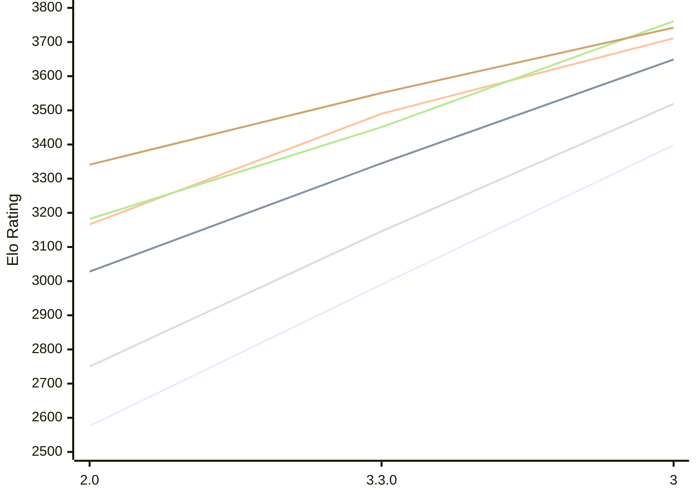

# Engine: Ravager

Author: Abhinav Tiwari

Home: https://github.com/erensh27/Ravager

## Elo Ratings E1 (Ultra 7 265T (1.50 GHz) - E-Core)

| Version | Published | STC 8.0+0.08s  | LTC 60.0+0.60s | VLTC 2m24s+1.12s | Comment |
| --- | --- | --- | --- | --- | --- |
| 3 | 2026-10-22 | 3398(+408) | 3649(+304) | 3711(+221) |  |
| 3.3.0 | 2026-10-09 | 2990(+414) | 3345(+317) | 3490(+324) |  |
| 2.0 | 2026-08-23 | 2576 | 3028 | 3166 |  |
 | | | cElo (∆ prev) | cElo (∆ prev) | cElo (∆ prev) | 

## Elo Ratings P1 (Ultra 7 265T (1.50 GHz) - P-Core)

| Version | Published | STC 8.0+0.08s  | LTC 60.0+0.60s | VLTC 2m24s+1.12s | Comment |
| --- | --- | --- | --- | --- | --- |
| 3 | 2026-10-22 | 3519(+373) | 3761(+310) | 3742(+191) |  |
| 3.3.0 | 2026-10-09 | 3146(+396) | 3451(+269) | 3551(+210) |  |
| 2.0 | 2026-08-23 | 2750 | 3182 | 3341 |  |
 | | | cElo (∆ prev) | cElo (∆ prev) | cElo (∆ prev) | 

## Elo Ratings T1 (i5-7500T 2.70GHz)

| Version | Published | STC 8.0+0.08s  | LTC 60.0+0.60s | VLTC 2m24s+1.12s | Comment |
| --- | --- | --- | --- | --- | --- |
| 2.0 | 2026-08-23 | 2757 | 3109 | 3220 |  |
 | | | cElo (∆ prev) | cElo (∆ prev) | cElo (∆ prev) | 

<a href="https://github.com/computer-chess-index/cci/issues/new?template=submit-version.yml&title=[VERSION]+Ravager+<version>&body=###%20Engine%20name%0ARavager%0A%0A###%20Version%0A2.0" target="_blank">Submit new version</a>

 Test Conditions:

GUI/CLI: <a href=https://github.com/cutechess/cutechess target="_blank">Cute-Chess</a> 
Elo Calculation: <a href=https://www.remi-coulom.fr/Bayesian-Elo/ target="_blank">Bayesian-Elo</a> 
CPU for P1: Intel(R) Core(TM) Ultra 7 265T (1.50 GHz) - P-Core 
CPU for E1: Intel(R) Core(TM) Ultra 7 265T (1.50 GHz) - E-Core 
CPU for T1: Intel(R) Core(TM) i5-7500T 2.70GHz 
Opening book: 8_moves_v3 
\* STC: 8.0+0.08s, LTC: 60.0+0.60s, VLTC: 2m24s+1.12s

 Lists:
Ratings: <a href=https://github.com/computer-chess-index/cci/blob/main/lists/CCIRatings.csv target="_blank">Complete list</a>

Generated: 2026-10-24 04:42:18

## Ratings Verlauf E1 / P1

## Detailed Evaluation Results

| Version | Time Control | Variant | Elo  | Range +/- | Matches | Score | Average Opponent Elo | Draws |
| --- | --- |--- | --- | --- | --- | --- | --- | --- |
| 3 | VLTC (2m24s+1.12s) | P1 | 3742 | 42 | 134 | 56% | 3700 | 78% |
|  |  | E1 | 3711 | 33 | 208 | 48% | 3725 | 86% |
|  | LTC (60.0+0.60s) | P1 | 3761 | 55 | 80 | 49% | 3760 | 75% |
|  |  | E1 | 3649 | 41 | 144 | 54% | 3615 | 82% |
|  | STC (8.0+0.08s) | P1 | 3519 | 45 | 124 | 53% | 3490 | 71% |
|  |  | E1 | 3398 | 32 | 254 | 56% | 3352 | 61% |
| --- | --- |--- | --- | --- | --- | --- | --- | --- |
| 3.3.0 | VLTC (2m24s+1.12s) | P1 | 3551 | 43 | 134 | 53% | 3528 | 69% |
|  |  | E1 | 3490 | 34 | 208 | 50% | 3486 | 76% |
|  | LTC (60.0+0.60s) | P1 | 3451 | 28 | 322 | 56% | 3405 | 68% |
|  |  | E1 | 3345 | 31 | 276 | 54% | 3310 | 68% |
|  | STC (8.0+0.08s) | E1 | 2990 | 36 | 226 | 54% | 2959 | 48% |
|  |  | P1 | 3146 | 36 | 216 | 50% | 3133 | 56% |
| --- | --- |--- | --- | --- | --- | --- | --- | --- |
| 2.0 | VLTC (2m24s+1.12s) | T1 | 3220 | 31 | 274 | 50% | 3218 | 64% |
|  |  | P1 | 3341 | 37 | 204 | 49% | 3353 | 54% |
|  |  | E1 | 3166 | 30 | 302 | 44% | 3216 | 56% |
|  | LTC (60.0+0.60s) | T1 | 3109 | 30 | 302 | 50% | 3109 | 57% |
|  |  | P1 | 3182 | 39 | 184 | 48% | 3197 | 52% |
|  |  | E1 | 3028 | 30 | 322 | 42% | 3092 | 56% |
|  | STC (8.0+0.08s) | T1 | 2757 | 35 | 256 | 49% | 2761 | 38% |
|  |  | P1 | 2750 | 37 | 216 | 48% | 2759 | 43% |
|  |  | E1 | 2576 | 35 | 298 | 39% | 2695 | 26% |