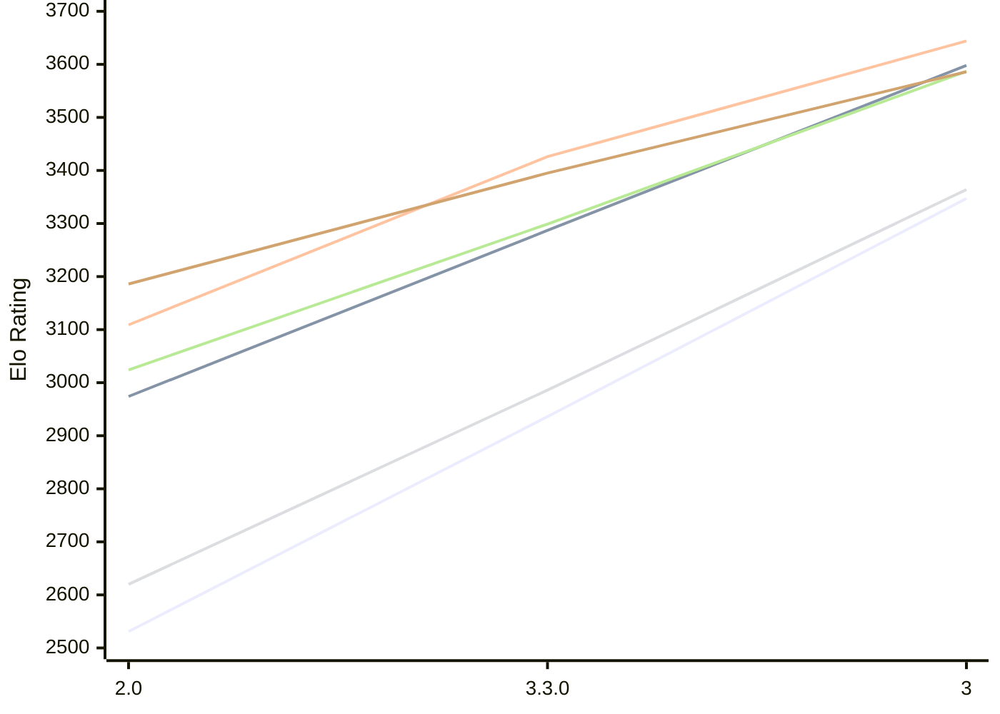

# Engine: Ravager

Author: Abhinav Tiwari

Home: https://github.com/erensh27/Ravager

## Elo Ratings E1 (Ultra 7 265T (1.50 GHz) - E-Core)

| Version | Published | STC 8.0+0.08s  | LTC 60.0+0.60s | VLTC 2m24s+1.12s | Comment |
| --- | --- | --- | --- | --- | --- |
| 3 | 2026-10-22 | 3347(+411) | 3598(+311) | 3644(+218) |  |
| 3.3.0 | 2026-10-09 | 2936(+405) | 3287(+313) | 3426(+317) |  |
| 2.0 | 2026-08-23 | 2531 | 2974 | 3109 |  |
 | | | cElo (∆ prev) | cElo (∆ prev) | cElo (∆ prev) | 

## Elo Ratings P1 (Ultra 7 265T (1.50 GHz) - P-Core)

| Version | Published | STC 8.0+0.08s  | LTC 60.0+0.60s | VLTC 2m24s+1.12s | Comment |
| --- | --- | --- | --- | --- | --- |
| 3 | 2026-10-22 | 3364(+378) | 3587(+288) | 3586(+191) |  |
| 3.3.0 | 2026-10-09 | 2986(+366) | 3299(+275) | 3395(+209) |  |
| 2.0 | 2026-08-23 | 2620 | 3024 | 3186 |  |
 | | | cElo (∆ prev) | cElo (∆ prev) | cElo (∆ prev) | 

## Elo Ratings T1 (i5-7500T 2.70GHz)

| Version | Published | STC 8.0+0.08s  | LTC 60.0+0.60s | VLTC 2m24s+1.12s | Comment |
| --- | --- | --- | --- | --- | --- |
| 2.0 | 2026-08-23 | 2757 | 3109 | 3220 |  |
 | | | cElo (∆ prev) | cElo (∆ prev) | cElo (∆ prev) | 

<a href="https://github.com/computer-chess-index/cci/issues/new?template=submit-version.yml&title=[VERSION]+Ravager+<version>&body=###%20Engine%20name%0ARavager%0A%0A###%20Version%0A2.0" target="_blank">Submit new version</a>

 Test Conditions:

GUI/CLI: <a href=https://github.com/cutechess/cutechess target="_blank">Cute-Chess</a> 
Elo Calculation: <a href=https://www.remi-coulom.fr/Bayesian-Elo/ target="_blank">Bayesian-Elo</a> 
CPU for P1: Intel(R) Core(TM) Ultra 7 265T (1.50 GHz) - P-Core 
CPU for E1: Intel(R) Core(TM) Ultra 7 265T (1.50 GHz) - E-Core 
CPU for T1: Intel(R) Core(TM) i5-7500T 2.70GHz 
Opening book: 8_moves_v3 
\* STC: 8.0+0.08s, LTC: 60.0+0.60s, VLTC: 2m24s+1.12s

 Lists:
Ratings: <a href=https://github.com/computer-chess-index/cci/blob/main/lists/CCIRatings.csv target="_blank">Complete list</a>

Generated: 2026-11-14 05:41:31

## Ratings Verlauf E1 / P1

## Detailed Evaluation Results

| Version | Time Control | Variant | Elo  | Range +/- | Matches | Score | Average Opponent Elo | Draws |
| --- | --- |--- | --- | --- | --- | --- | --- | --- |
| 3 | VLTC (2m24s+1.12s) | P1 | 3586 | 39 | 160 | 55% | 3552 | 81% |
|  |  | E1 | 3644 | 30 | 258 | 48% | 3654 | 86% |
|  | LTC (60.0+0.60s) | P1 | 3587 | 39 | 152 | 48% | 3598 | 81% |
|  |  | E1 | 3598 | 33 | 222 | 54% | 3571 | 81% |
|  | STC (8.0+0.08s) | P1 | 3364 | 41 | 148 | 53% | 3337 | 72% |
|  |  | E1 | 3347 | 28 | 336 | 55% | 3306 | 61% |
| --- | --- |--- | --- | --- | --- | --- | --- | --- |
| 3.3.0 | VLTC (2m24s+1.12s) | P1 | 3395 | 43 | 134 | 53% | 3372 | 69% |
|  |  | E1 | 3426 | 34 | 212 | 49% | 3425 | 76% |
|  | LTC (60.0+0.60s) | P1 | 3299 | 28 | 326 | 56% | 3252 | 68% |
|  |  | E1 | 3287 | 30 | 292 | 54% | 3256 | 67% |
|  | STC (8.0+0.08s) | P1 | 2986 | 35 | 232 | 50% | 2966 | 55% |
|  |  | E1 | 2936 | 35 | 242 | 52% | 2917 | 48% |
| --- | --- |--- | --- | --- | --- | --- | --- | --- |
| 2.0 | VLTC (2m24s+1.12s) | T1 | 3220 | 31 | 274 | 50% | 3218 | 64% |
|  |  | P1 | 3186 | 37 | 204 | 49% | 3197 | 54% |
|  |  | E1 | 3109 | 30 | 302 | 44% | 3159 | 56% |
|  | LTC (60.0+0.60s) | P1 | 3024 | 39 | 184 | 48% | 3038 | 52% |
|  |  | E1 | 2974 | 30 | 322 | 42% | 3038 | 56% |
|  |  | T1 | 3109 | 30 | 302 | 50% | 3109 | 57% |
|  | STC (8.0+0.08s) | P1 | 2620 | 37 | 216 | 48% | 2631 | 43% |
|  |  | E1 | 2531 | 35 | 298 | 39% | 2650 | 26% |
|  |  | T1 | 2757 | 35 | 256 | 49% | 2761 | 38% |