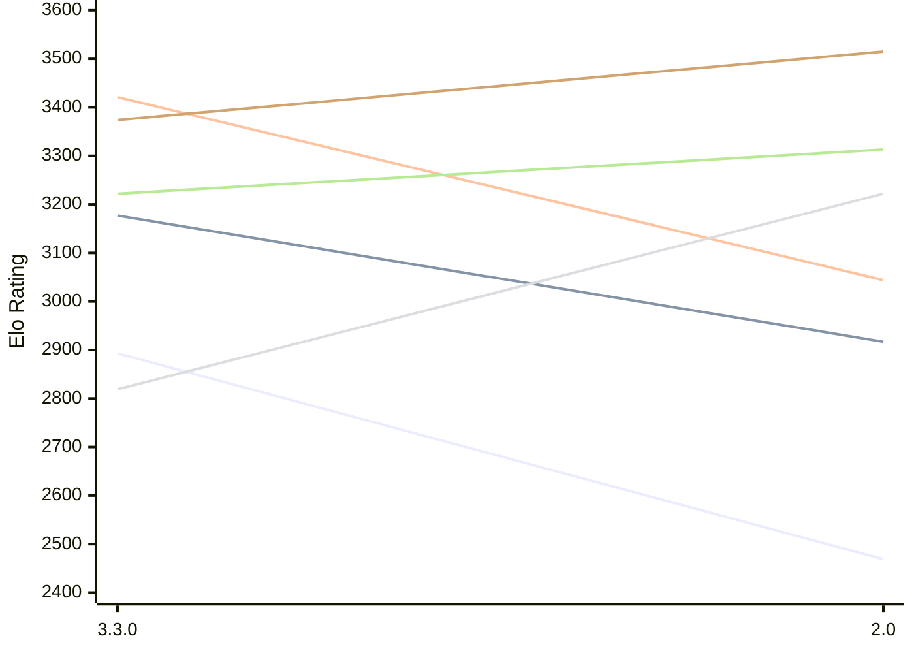

# Engine: Ravager

Author: Abhinav Tiwari

Home: https://github.com/erensh27/Ravager

## Elo Ratings E1

| Version | Published | STC 8.0+0.08s  | LTC 60.0+0.60s | VLTC 2m24s+1.12s | Comment |
| --- | --- | --- | --- | --- | --- |
| 3.3.0 | 2026-10-09 | 2893(+424) | 3177(+260) | 3421(+377) |  |
| 2.0 | 2026-08-23 | 2469 | 2917 | 3044 |  |
 | | | cElo (∆ prev) | cElo (∆ prev) | cElo (∆ prev) | 

## Elo Ratings P1

| Version | Published | STC 8.0+0.08s  | LTC 60.0+0.60s | VLTC 2m24s+1.12s | Comment |
| --- | --- | --- | --- | --- | --- |
| 3.3.0 | 2026-10-09 | 3222(+403) | 3313(+91) | 3515(+141) |  |
| 2.0 | 2026-08-23 | 2819 | 3222 | 3374 |  |
 | | | cElo (∆ prev) | cElo (∆ prev) | cElo (∆ prev) | 

## Elo Ratings T1

| Version | Published | STC 8.0+0.08s  | LTC 60.0+0.60s | VLTC 2m24s+1.12s | Comment |
| --- | --- | --- | --- | --- | --- |
| 2.0 | 2026-08-23 | 2757 | 3109 | 3220 |  |
 | | | cElo (∆ prev) | cElo (∆ prev) | cElo (∆ prev) | 

<a href="https://github.com/computer-chess-index/cci/issues/new?template=submit-version.yml&title=[VERSION]+Ravager+<version>&body=###%20Engine%20name%0ARavager%0A%0A###%20Version%0A2.0" target="_blank">Submit new version</a>

 Test Conditions:

GUI/CLI: <a href=https://github.com/cutechess/cutechess target="_blank">Cute-Chess</a> 
Elo Calculation: <a href=https://www.remi-coulom.fr/Bayesian-Elo/ target="_blank">Bayesian-Elo</a> 
CPU for P1: Intel(R) Core(TM) Ultra 7 265T (1.50 GHz) - P-Core 
CPU for E1: Intel(R) Core(TM) Ultra 7 265T (1.50 GHz) - E-Core 
CPU for T1: Intel(R) Core(TM) i5-7500T 2.70GHz 
Opening book: 8_moves_v3 
\* STC: 8.0+0.08s, LTC: 60.0+0.60s, VLTC: 2m24s+1.12s

 Lists:
Ratings: <a href=https://github.com/computer-chess-index/cci/blob/main/lists/CCIRatings.csv target="_blank">Complete list</a>

Generated: 2026-10-11 11:18:25

## Ratings Verlauf E1 / P1

## Detailed Evaluation Results

| Version | Time Control | Elo  | Range +/- | Matches | Score | Average Opponent Elo | Draws |
| --- | --- | --- | --- | --- | --- | --- | --- |
| 3.3.0 | VLTC (2m24s+1.12s) | 3515 | 131 | 14 | 64% | 3422 | 71% |
| 3.3.0 | VLTC (2m24s+1.12s) | 3421 | 82 | 40 | 60% | 3313 | 65% |
| 3.3.0 | LTC (60.0+0.60s) | 3313 | 116 | 18 | 56% | 3278 | 67% |
| 3.3.0 | LTC (60.0+0.60s) | 3177 | 75 | 50 | 60% | 3092 | 52% |
| 3.3.0 | STC (8.0+0.08s) | 3222 | 107 | 28 | 70% | 3033 | 46% |
| --- | --- | --- | --- | --- | --- | --- | --- |
| 3.3.0 | STC (8.0+0.08s) | 2893 | 71 | 60 | 65% | 2766 | 50% |
| --- | --- | --- | --- | --- | --- | --- | --- |
| 2.0 | VLTC (2m24s+1.12s) | 3044 | 31 | 280 | 42% | 3106 | 58% |
| 2.0 | VLTC (2m24s+1.12s) | 3220 | 31 | 274 | 50% | 3218 | 64% |
| 2.0 | VLTC (2m24s+1.12s) | 3374 | 38 | 188 | 47% | 3398 | 55% |
| 2.0 | LTC (60.0+0.60s) | 2917 | 30 | 318 | 42% | 2979 | 56% |
| 2.0 | LTC (60.0+0.60s) | 3109 | 30 | 302 | 50% | 3109 | 57% |
| 2.0 | LTC (60.0+0.60s) | 3222 | 39 | 184 | 48% | 3236 | 52% |
| 2.0 | STC (8.0+0.08s) | 2469 | 35 | 298 | 39% | 2588 | 26% |
| --- | --- | --- | --- | --- | --- | --- | --- |
| 2.0 | STC (8.0+0.08s) | 2757 | 35 | 256 | 49% | 2761 | 38% |
| --- | --- | --- | --- | --- | --- | --- | --- |
| 2.0 | STC (8.0+0.08s) | 2819 | 39 | 196 | 50% | 2813 | 45% |
| --- | --- | --- | --- | --- | --- | --- | --- |