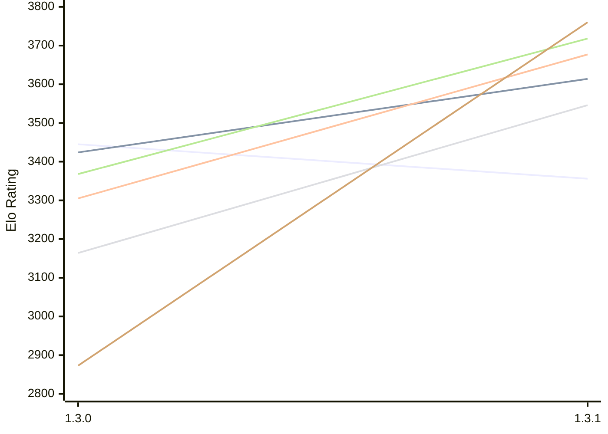
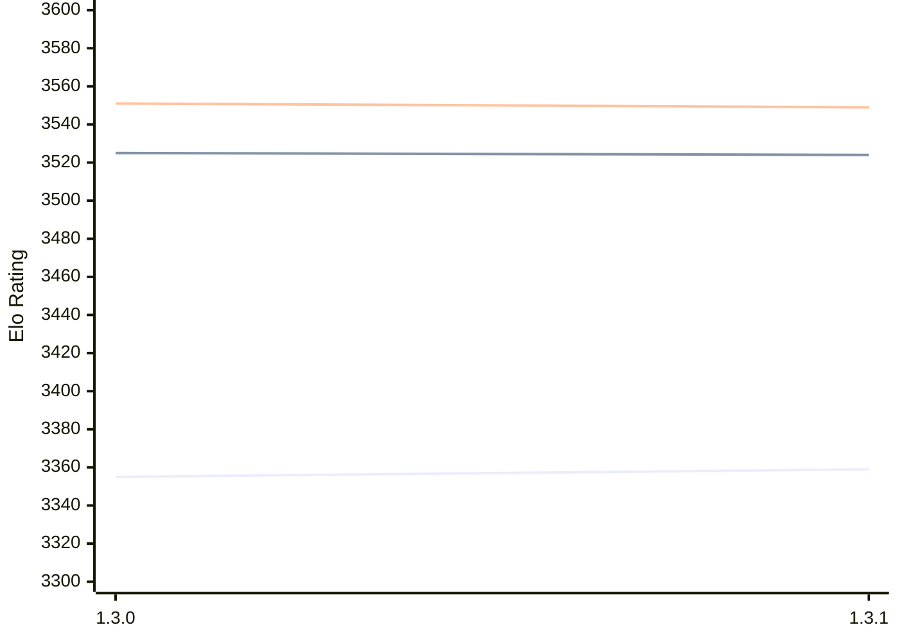

# Engine: Renegade

Author: Krisztián Peőcz

Home: https://github.com/pkrisz99/Renegade

## Elo Ratings E1 (Ultra 7 265T (1.50 GHz) - E-Core)

| Version | Published | STC 8.0+0.08s  | LTC 60.0+0.60s | VLTC 2m24s+1.12s | Comment |
| --- | --- | --- | --- | --- | --- |
| 1.3.1 | 2026-07-14 | 3356(-89) | 3614(+190) | 3677(+372) |  |
| 1.3.0 | 2026-06-17 | 3445 | 3424 | 3305 |  |
 | | | cElo (∆ prev) | cElo (∆ prev) | cElo (∆ prev) | 

## Elo Ratings P1 (Ultra 7 265T (1.50 GHz) - P-Core)

| Version | Published | STC 8.0+0.08s  | LTC 60.0+0.60s | VLTC 2m24s+1.12s | Comment |
| --- | --- | --- | --- | --- | --- |
| 1.3.1 | 2026-07-14 | 3546(+382) | 3718(+350) | 3760(+887) |  |
| 1.3.0 | 2026-06-17 | 3164 | 3368 | 2873 |  |
 | | | cElo (∆ prev) | cElo (∆ prev) | cElo (∆ prev) | 

## Elo Ratings T1 (i5-7500T 2.70GHz)

| Version | Published | STC 8.0+0.08s  | LTC 60.0+0.60s | VLTC 2m24s+1.12s | Comment |
| --- | --- | --- | --- | --- | --- |
| 1.3.1 | 2026-07-14 | 3359(+4) | 3524(-1) | 3549(-2) |  |
| 1.3.0 | 2026-06-17 | 3355 | 3525 | 3551 |  |
 | | | cElo (∆ prev) | cElo (∆ prev) | cElo (∆ prev) | 

<a href="https://github.com/computer-chess-index/cci/issues/new?template=submit-version.yml&title=[VERSION]+Renegade+<version>&body=###%20Engine%20name%0ARenegade%0A%0A###%20Version%0A1.3.1" target="_blank">Submit new version</a>

 Test Conditions:

GUI/CLI: <a href=https://github.com/cutechess/cutechess target="_blank">Cute-Chess</a> 
Elo Calculation: <a href=https://www.remi-coulom.fr/Bayesian-Elo/ target="_blank">Bayesian-Elo</a> 
CPU for P1: Intel(R) Core(TM) Ultra 7 265T (1.50 GHz) - P-Core 
CPU for E1: Intel(R) Core(TM) Ultra 7 265T (1.50 GHz) - E-Core 
CPU for T1: Intel(R) Core(TM) i5-7500T 2.70GHz 
Opening book: 8_moves_v3 
\* STC: 8.0+0.08s, LTC: 60.0+0.60s, VLTC: 2m24s+1.12s

 Lists:
Ratings: <a href=https://github.com/computer-chess-index/cci/blob/main/lists/CCIRatings.csv target="_blank">Complete list</a>

Generated: 2026-11-12 05:41:40

## Ratings Verlauf E1 / P1

## Ratings Verlauf T1

## Detailed Evaluation Results

| Version | Time Control | Variant | Elo  | Range +/- | Matches | Score | Average Opponent Elo | Draws |
| --- | --- |--- | --- | --- | --- | --- | --- | --- |
| 1.3.1 | VLTC (2m24s+1.12s) | T1 | 3549 | 33 | 206 | 50% | 3553 | 88% |
|  |  | P1 | 3760 | 37 | 186 | 55% | 3688 | 77% |
|  |  | E1 | 3677 | 32 | 240 | 54% | 3569 | 77% |
|  | LTC (60.0+0.60s) | T1 | 3524 | 31 | 244 | 49% | 3530 | 86% |
|  |  | P1 | 3718 | 36 | 200 | 56% | 3638 | 76% |
|  |  | E1 | 3614 | 30 | 292 | 55% | 3532 | 74% |
|  | STC (8.0+0.08s) | T1 | 3359 | 26 | 380 | 52% | 3347 | 70% |
|  |  | P1 | 3546 | 32 | 244 | 49% | 3552 | 69% |
|  |  | E1 | 3356 | 25 | 426 | 46% | 3386 | 64% |
| --- | --- |--- | --- | --- | --- | --- | --- | --- |
| 1.3.0 | VLTC (2m24s+1.12s) | T1 | 3551 | 33 | 226 | 54% | 3511 | 81% |
|  |  | P1 | 2873 | 170 | 8 | 81% | 2658 | 38% |
|  |  | E1 | 3305 | 267 | 12 | 100% | 2704 | 0% |
|  | LTC (60.0+0.60s) | T1 | 3525 | 31 | 260 | 53% | 3474 | 77% |
|  |  | P1 | 3368 | 211 | 8 | 94% | 3028 | 13% |
|  |  | E1 | 3424 | 228 | 12 | 96% | 2881 | 8% |
|  | STC (8.0+0.08s) | P1 | 3164 | 209 | 4 | 38% | 3221 | 75% |
|  |  | E1 | 3445 | 149 | 20 | 80% | 2971 | 20% |
|  |  | T1 | 3355 | 35 | 218 | 53% | 3297 | 66% |