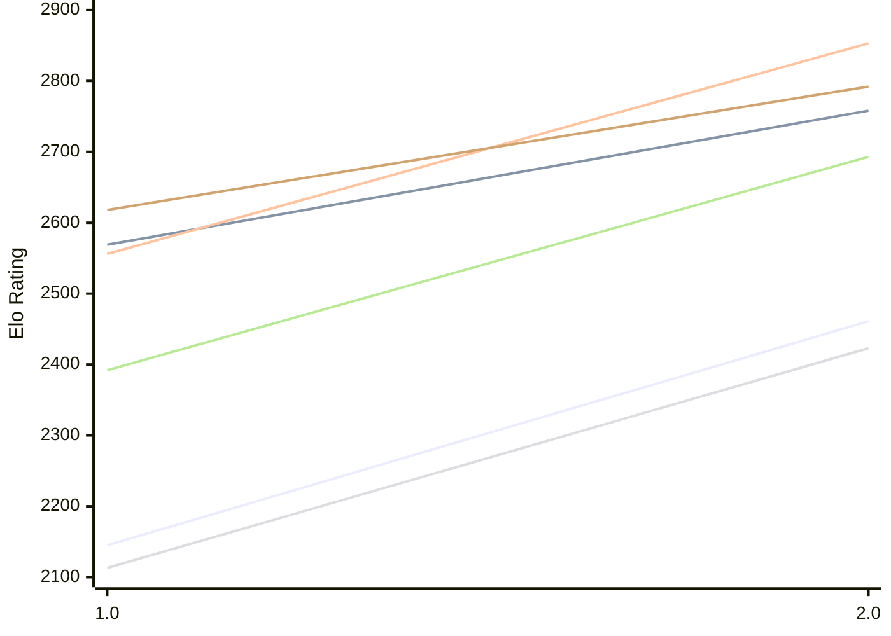
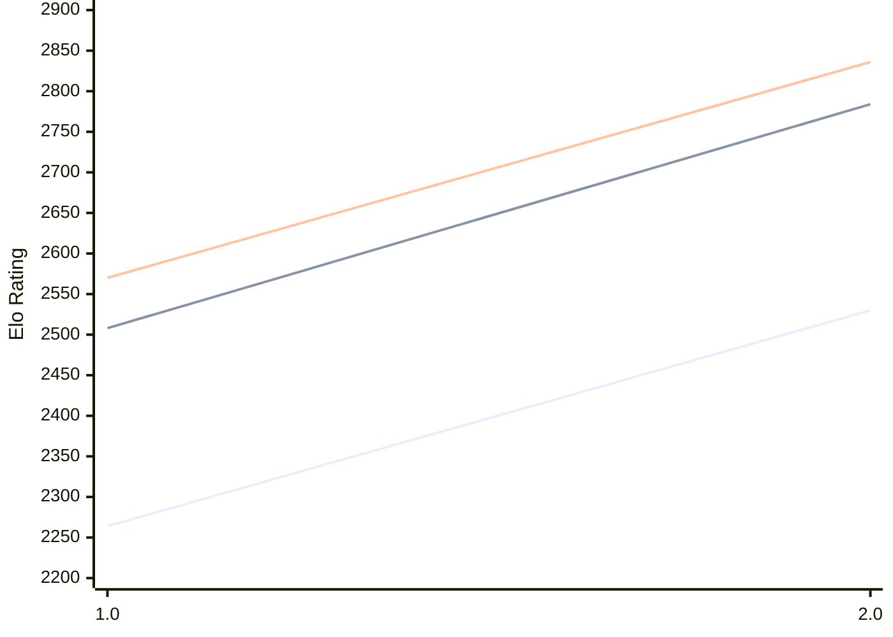

# Engine: Revolver

Author: Deshawn Mohan-Smith

Home: https://github.com/GoldenRare/Revolver

## Elo Ratings E1 (Ultra 7 265T (1.50 GHz) - E-Core)

| Version | Published | STC 8.0+0.08s  | LTC 60.0+0.60s | VLTC 2m24s+1.12s | Comment |
| --- | --- | --- | --- | --- | --- |
| 2.0 | 2026-05-01 | 2461(+316) | 2758(+189) | 2853(+297) |  |
| 1.0 | 2026-01-01 | 2145 | 2569 | 2556 |  |
 | | | cElo (∆ prev) | cElo (∆ prev) | cElo (∆ prev) | 

## Elo Ratings P1 (Ultra 7 265T (1.50 GHz) - P-Core)

| Version | Published | STC 8.0+0.08s  | LTC 60.0+0.60s | VLTC 2m24s+1.12s | Comment |
| --- | --- | --- | --- | --- | --- |
| 2.0 | 2026-05-01 | 2423(+310) | 2693(+301) | 2792(+174) |  |
| 1.0 | 2026-01-01 | 2113 | 2392 | 2618 |  |
 | | | cElo (∆ prev) | cElo (∆ prev) | cElo (∆ prev) | 

## Elo Ratings T1 (i5-7500T 2.70GHz)

| Version | Published | STC 8.0+0.08s  | LTC 60.0+0.60s | VLTC 2m24s+1.12s | Comment |
| --- | --- | --- | --- | --- | --- |
| 2.0 | 2026-05-01 | 2530(+266) | 2784(+276) | 2836(+266) |  |
| 1.0 | 2026-01-01 | 2264 | 2508 | 2570 |  |
 | | | cElo (∆ prev) | cElo (∆ prev) | cElo (∆ prev) | 

<a href="https://github.com/computer-chess-index/cci/issues/new?template=submit-version.yml&title=[VERSION]+Revolver+<version>&body=###%20Engine%20name%0ARevolver%0A%0A###%20Version%0A2.0" target="_blank">Submit new version</a>

 Test Conditions:

GUI/CLI: <a href=https://github.com/cutechess/cutechess target="_blank">Cute-Chess</a> 
Elo Calculation: <a href=https://www.remi-coulom.fr/Bayesian-Elo/ target="_blank">Bayesian-Elo</a> 
CPU for P1: Intel(R) Core(TM) Ultra 7 265T (1.50 GHz) - P-Core 
CPU for E1: Intel(R) Core(TM) Ultra 7 265T (1.50 GHz) - E-Core 
CPU for T1: Intel(R) Core(TM) i5-7500T 2.70GHz 
Opening book: 8_moves_v3 
\* STC: 8.0+0.08s, LTC: 60.0+0.60s, VLTC: 2m24s+1.12s

 Lists:
Ratings: <a href=https://github.com/computer-chess-index/cci/blob/main/lists/CCIRatings.csv target="_blank">Complete list</a>

Generated: 2026-11-16 05:42:02

## Ratings Verlauf E1 / P1

## Ratings Verlauf T1

## Detailed Evaluation Results

| Version | Time Control | Variant | Elo  | Range +/- | Matches | Score | Average Opponent Elo | Draws |
| --- | --- |--- | --- | --- | --- | --- | --- | --- |
| 2.0 | VLTC (2m24s+1.12s) | P1 | 2792 | 34 | 276 | 50% | 2778 | 38% |
|  |  | E1 | 2853 | 30 | 358 | 52% | 2804 | 37% |
|  |  | T1 | 2836 | 25 | 508 | 52% | 2819 | 39% |
|  | LTC (60.0+0.60s) | P1 | 2693 | 37 | 244 | 52% | 2633 | 31% |
|  |  | E1 | 2758 | 28 | 406 | 50% | 2755 | 35% |
|  |  | T1 | 2784 | 25 | 510 | 51% | 2774 | 38% |
|  | STC (8.0+0.08s) | P1 | 2423 | 36 | 254 | 49% | 2433 | 30% |
|  |  | E1 | 2461 | 30 | 384 | 49% | 2465 | 27% |
|  |  | T1 | 2530 | 26 | 512 | 51% | 2526 | 29% |
| --- | --- |--- | --- | --- | --- | --- | --- | --- |
| 1.0 | VLTC (2m24s+1.12s) | T1 | 2570 | 27 | 450 | 46% | 2611 | 32% |
|  |  | P1 | 2618 | 87 | 40 | 45% | 2655 | 35% |
|  |  | E1 | 2556 | 65 | 86 | 48% | 2580 | 20% |
|  | LTC (60.0+0.60s) | T1 | 2508 | 29 | 408 | 49% | 2519 | 25% |
|  |  | P1 | 2392 | 84 | 56 | 56% | 2288 | 27% |
|  |  | E1 | 2569 | 66 | 84 | 51% | 2519 | 24% |
|  | STC (8.0+0.08s) | T1 | 2264 | 26 | 516 | 51% | 2252 | 29% |
|  |  | P1 | 2113 | 80 | 66 | 45% | 2230 | 15% |
|  |  | E1 | 2145 | 55 | 122 | 58% | 2086 | 32% |