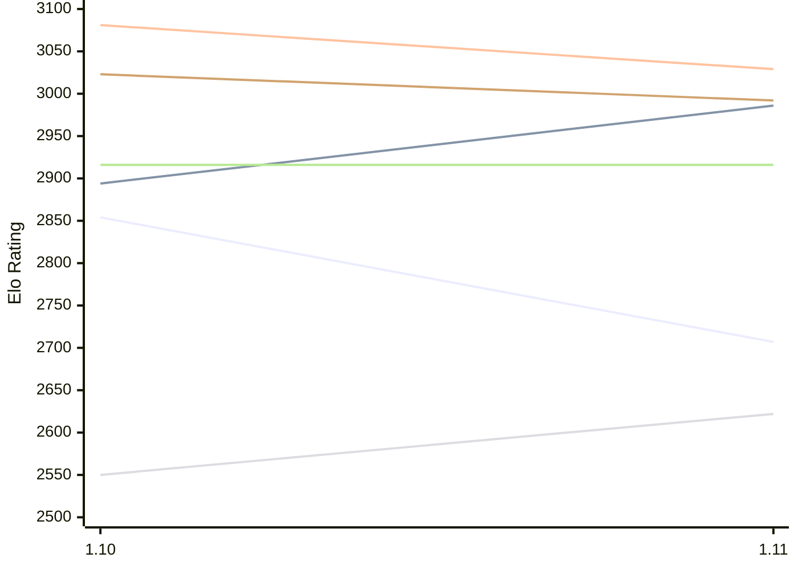
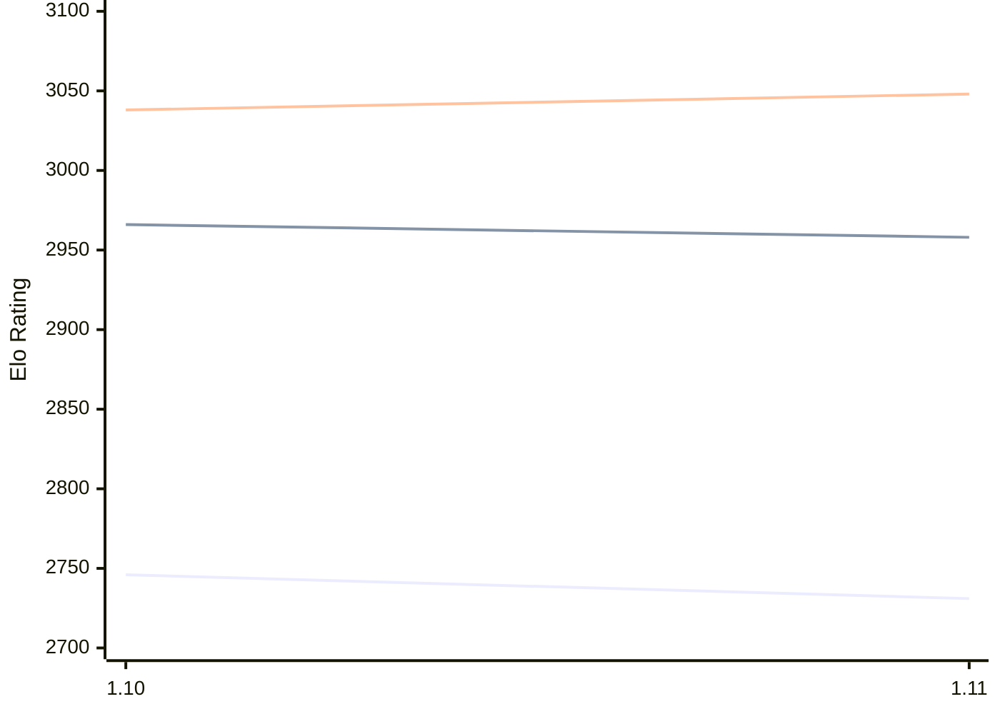

# Engine: Roc

Author: Tom Hyer

Home: https://github.com/TomHyer/Roc

## Elo Ratings E1 (Ultra 7 265T (1.50 GHz) - E-Core)

| Version | Published | STC 8.0+0.08s  | LTC 60.0+0.60s | VLTC 2m24s+1.12s | Comment |
| --- | --- | --- | --- | --- | --- |
| 1.11 | 2026-05-11 | 2707(-147) | 2986(+92) | 3029(-52) |  |
| 1.10 | 2026-02-21 | 2854 | 2894 | 3081 |  |
 | | | cElo (∆ prev) | cElo (∆ prev) | cElo (∆ prev) | 

## Elo Ratings P1 (Ultra 7 265T (1.50 GHz) - P-Core)

| Version | Published | STC 8.0+0.08s  | LTC 60.0+0.60s | VLTC 2m24s+1.12s | Comment |
| --- | --- | --- | --- | --- | --- |
| 1.11 | 2026-05-11 | 2622(+72) | 2916(0) | 2992(-31) |  |
| 1.10 | 2026-02-21 | 2550 | 2916 | 3023 |  |
 | | | cElo (∆ prev) | cElo (∆ prev) | cElo (∆ prev) | 

## Elo Ratings T1 (i5-7500T 2.70GHz)

| Version | Published | STC 8.0+0.08s  | LTC 60.0+0.60s | VLTC 2m24s+1.12s | Comment |
| --- | --- | --- | --- | --- | --- |
| 1.11 | 2026-05-11 | 2731(-15) | 2958(-8) | 3048(+10) |  |
| 1.10 | 2026-02-21 | 2746 | 2966 | 3038 |  |
 | | | cElo (∆ prev) | cElo (∆ prev) | cElo (∆ prev) | 

<a href="https://github.com/computer-chess-index/cci/issues/new?template=submit-version.yml&title=[VERSION]+Roc+<version>&body=###%20Engine%20name%0ARoc%0A%0A###%20Version%0A1.11" target="_blank">Submit new version</a>

 Test Conditions:

GUI/CLI: <a href=https://github.com/cutechess/cutechess target="_blank">Cute-Chess</a> 
Elo Calculation: <a href=https://www.remi-coulom.fr/Bayesian-Elo/ target="_blank">Bayesian-Elo</a> 
CPU for P1: Intel(R) Core(TM) Ultra 7 265T (1.50 GHz) - P-Core 
CPU for E1: Intel(R) Core(TM) Ultra 7 265T (1.50 GHz) - E-Core 
CPU for T1: Intel(R) Core(TM) i5-7500T 2.70GHz 
Opening book: 8_moves_v3 
\* STC: 8.0+0.08s, LTC: 60.0+0.60s, VLTC: 2m24s+1.12s

 Lists:
Ratings: <a href=https://github.com/computer-chess-index/cci/blob/main/lists/CCIRatings.csv target="_blank">Complete list</a>

Generated: 2026-11-14 05:41:51

## Ratings Verlauf E1 / P1

## Ratings Verlauf T1

## Detailed Evaluation Results

| Version | Time Control | Variant | Elo  | Range +/- | Matches | Score | Average Opponent Elo | Draws |
| --- | --- |--- | --- | --- | --- | --- | --- | --- |
| 1.11 | VLTC (2m24s+1.12s) | P1 | 2992 | 37 | 240 | 51% | 2965 | 38% |
|  |  | E1 | 3029 | 29 | 378 | 50% | 3016 | 35% |
|  |  | T1 | 3048 | 25 | 512 | 50% | 3052 | 39% |
|  | LTC (60.0+0.60s) | P1 | 2916 | 37 | 230 | 49% | 2923 | 39% |
|  |  | E1 | 2986 | 29 | 378 | 51% | 2979 | 36% |
|  |  | T1 | 2958 | 25 | 520 | 52% | 2942 | 38% |
|  | STC (8.0+0.08s) | P1 | 2622 | 34 | 294 | 43% | 2693 | 29% |
|  |  | E1 | 2707 | 31 | 354 | 47% | 2726 | 32% |
|  |  | T1 | 2731 | 25 | 498 | 49% | 2743 | 37% |
| --- | --- |--- | --- | --- | --- | --- | --- | --- |
| 1.10 | VLTC (2m24s+1.12s) | T1 | 3038 | 26 | 454 | 52% | 3023 | 40% |
|  |  | P1 | 3023 | 127 | 22 | 55% | 2985 | 18% |
|  |  | E1 | 3081 | 87 | 56 | 70% | 2769 | 29% |
|  | LTC (60.0+0.60s) | T1 | 2966 | 28 | 386 | 50% | 2966 | 41% |
|  |  | P1 | 2916 | 133 | 36 | 65% | 2608 | 14% |
|  |  | E1 | 2894 | 79 | 52 | 53% | 2865 | 29% |
|  | STC (8.0+0.08s) | T1 | 2746 | 27 | 446 | 53% | 2709 | 38% |
|  |  | P1 | 2550 | 117 | 24 | 46% | 2588 | 25% |
|  |  | E1 | 2854 | 81 | 52 | 57% | 2792 | 25% |