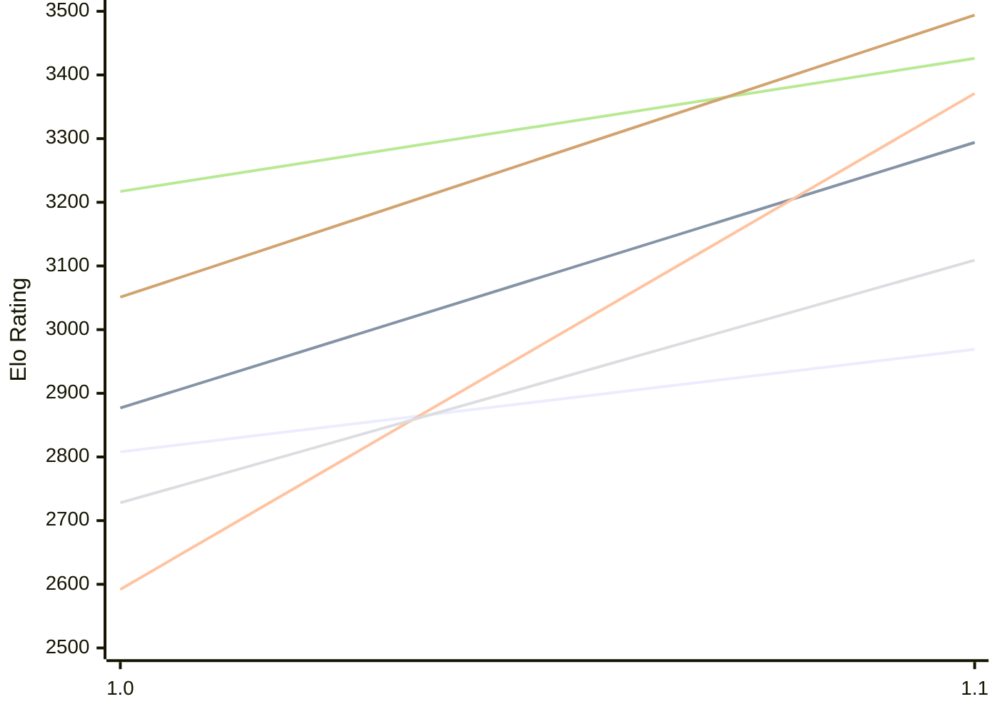
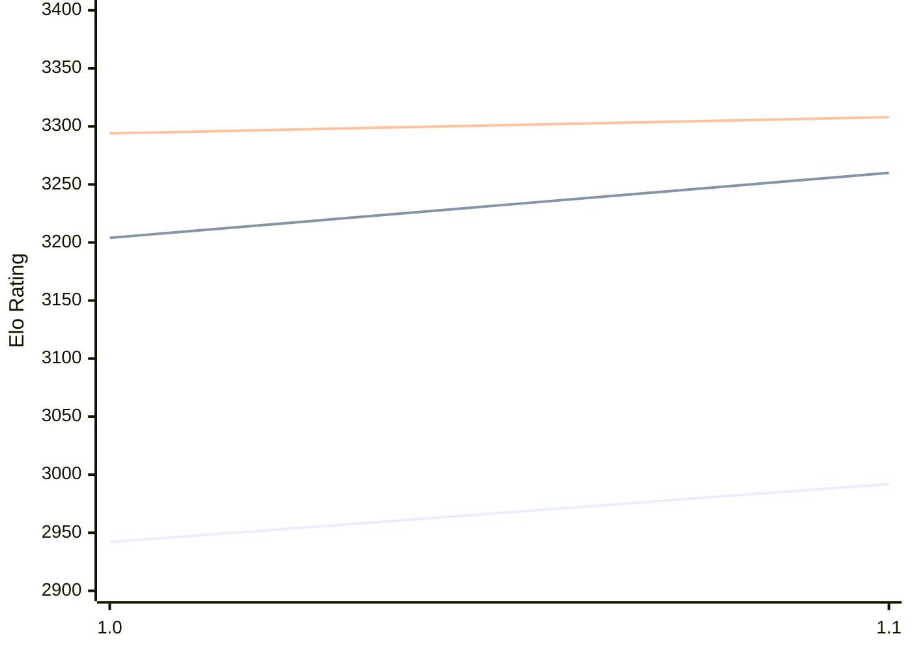

# Engine: RodentV

Author: Pawel Koziol

Home: https://github.com/nescitus/Rodent-V

## Elo Ratings E1 (Ultra 7 265T (1.50 GHz) - E-Core)

| Version | Published | STC 8.0+0.08s  | LTC 60.0+0.60s | VLTC 2m24s+1.12s | Comment |
| --- | --- | --- | --- | --- | --- |
| 1.1 | 2026-08-06 | 2969(+161) | 3294(+417) | 3371(+779) |  |
| 1.0 | 2026-08-02 | 2808 | 2877 | 2592 |  |
 | | | cElo (∆ prev) | cElo (∆ prev) | cElo (∆ prev) | 

## Elo Ratings P1 (Ultra 7 265T (1.50 GHz) - P-Core)

| Version | Published | STC 8.0+0.08s  | LTC 60.0+0.60s | VLTC 2m24s+1.12s | Comment |
| --- | --- | --- | --- | --- | --- |
| 1.1 | 2026-08-06 | 3109(+381) | 3426(+209) | 3494(+443) |  |
| 1.0 | 2026-08-02 | 2728 | 3217 | 3051 |  |
 | | | cElo (∆ prev) | cElo (∆ prev) | cElo (∆ prev) | 

## Elo Ratings T1 (i5-7500T 2.70GHz)

| Version | Published | STC 8.0+0.08s  | LTC 60.0+0.60s | VLTC 2m24s+1.12s | Comment |
| --- | --- | --- | --- | --- | --- |
| 1.1 | 2026-08-06 | 2992(+50) | 3260(+56) | 3308(+14) |  |
| 1.0 | 2026-08-02 | 2942 | 3204 | 3294 |  |
 | | | cElo (∆ prev) | cElo (∆ prev) | cElo (∆ prev) | 

<a href="https://github.com/computer-chess-index/cci/issues/new?template=submit-version.yml&title=[VERSION]+RodentV+<version>&body=###%20Engine%20name%0ARodentV%0A%0A###%20Version%0A1.1" target="_blank">Submit new version</a>

 Test Conditions:

GUI/CLI: <a href=https://github.com/cutechess/cutechess target="_blank">Cute-Chess</a> 
Elo Calculation: <a href=https://www.remi-coulom.fr/Bayesian-Elo/ target="_blank">Bayesian-Elo</a> 
CPU for P1: Intel(R) Core(TM) Ultra 7 265T (1.50 GHz) - P-Core 
CPU for E1: Intel(R) Core(TM) Ultra 7 265T (1.50 GHz) - E-Core 
CPU for T1: Intel(R) Core(TM) i5-7500T 2.70GHz 
Opening book: 8_moves_v3 
\* STC: 8.0+0.08s, LTC: 60.0+0.60s, VLTC: 2m24s+1.12s

 Lists:
Ratings: <a href=https://github.com/computer-chess-index/cci/blob/main/lists/CCIRatings.csv target="_blank">Complete list</a>

Generated: 2026-11-12 05:41:55

## Ratings Verlauf E1 / P1

## Ratings Verlauf T1

## Detailed Evaluation Results

| Version | Time Control | Variant | Elo  | Range +/- | Matches | Score | Average Opponent Elo | Draws |
| --- | --- |--- | --- | --- | --- | --- | --- | --- |
| 1.1 | VLTC (2m24s+1.12s) | T1 | 3308 | 29 | 292 | 50% | 3308 | 71% |
|  |  | P1 | 3494 | 32 | 260 | 50% | 3494 | 62% |
|  |  | E1 | 3371 | 27 | 368 | 49% | 3380 | 66% |
|  | LTC (60.0+0.60s) | T1 | 3260 | 27 | 374 | 53% | 3237 | 61% |
|  |  | P1 | 3426 | 32 | 268 | 49% | 3433 | 59% |
|  |  | E1 | 3294 | 26 | 400 | 48% | 3308 | 61% |
|  | STC (8.0+0.08s) | P1 | 3109 | 32 | 286 | 50% | 3109 | 50% |
|  |  | E1 | 2969 | 27 | 406 | 46% | 3004 | 49% |
|  |  | T1 | 2992 | 27 | 404 | 53% | 2946 | 49% |
| --- | --- |--- | --- | --- | --- | --- | --- | --- |
| 1.0 | VLTC (2m24s+1.12s) | P1 | 3051 | 230 | 4 | 75% | 2909 | 50% |
|  |  | E1 | 2592 | 176 | 16 | 78% | 2120 | 19% |
|  |  | T1 | 3294 | 33 | 250 | 49% | 3297 | 61% |
|  | LTC (60.0+0.60s) | P1 | 3217 | 294 | 4 | 100% | 2851 | 0% |
|  |  | E1 | 2877 | 208 | 8 | 100% | 2510 | 0% |
|  |  | T1 | 3204 | 32 | 260 | 51% | 3195 | 57% |
|  | STC (8.0+0.08s) | P1 | 2728 | 237 | 4 | 25% | 2878 | 0% |
|  |  | E1 | 2808 | 171 | 16 | 56% | 2680 | 13% |
|  |  | T1 | 2942 | 37 | 224 | 53% | 2913 | 43% |