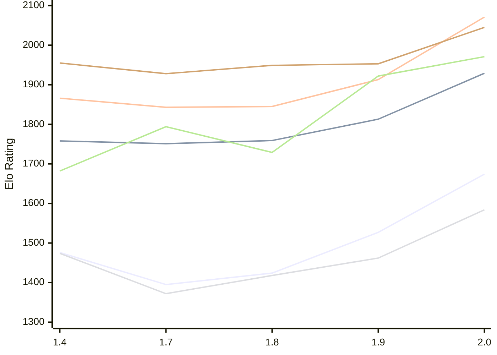

# Engine: Russell

Author: Dominic Fuentes

Home: https://github.com/stup1d1y-0bv10us/russell

## Elo Ratings E1 (Ultra 7 265T (1.50 GHz) - E-Core)

| Version | Published | STC 8.0+0.08s  | LTC 60.0+0.60s | VLTC 2m24s+1.12s | Comment |
| --- | --- | --- | --- | --- | --- |
| 2.0 | 2026-11-05 | 1674(+147) | 1929(+116) | 2071(+158) |  |
| 1.9 | 2026-10-30 | 1527(+103) | 1813(+54) | 1913(+68) |  |
| 1.8 | 2026-10-23 | 1424(+29) | 1759(+8) | 1845(+2) |  |
| 1.7 | 2026-10-16 | 1395(-81) | 1751(-7) | 1843(-23) |  |
| 1.4 | 2026-10-06 | 1476 | 1758 | 1866 |  |
 | | | cElo (∆ prev) | cElo (∆ prev) | cElo (∆ prev) | 

## Elo Ratings P1 (Ultra 7 265T (1.50 GHz) - P-Core)

| Version | Published | STC 8.0+0.08s  | LTC 60.0+0.60s | VLTC 2m24s+1.12s | Comment |
| --- | --- | --- | --- | --- | --- |
| 2.0 | 2026-11-05 | 1584(+122) | 1971(+49) | 2045(+92) |  |
| 1.9 | 2026-10-30 | 1462(+44) | 1922(+193) | 1953(+4) |  |
| 1.8 | 2026-10-23 | 1418(+46) | 1729(-65) | 1949(+21) |  |
| 1.7 | 2026-10-16 | 1372(-102) | 1794(+112) | 1928(-27) |  |
| 1.4 | 2026-10-06 | 1474 | 1682 | 1955 |  |
 | | | cElo (∆ prev) | cElo (∆ prev) | cElo (∆ prev) | 

## Elo Ratings T1 (i5-7500T 2.70GHz)

| Version | Published | STC 8.0+0.08s  | LTC 60.0+0.60s | VLTC 2m24s+1.12s | Comment |
| --- | --- | --- | --- | --- | --- |
| 1.4 | 2026-10-06 | 1474 | 1682 | 1955 |  |
 | | | cElo (∆ prev) | cElo (∆ prev) | cElo (∆ prev) | 

<a href="https://github.com/computer-chess-index/cci/issues/new?template=submit-version.yml&title=[VERSION]+Russell+<version>&body=###%20Engine%20name%0ARussell%0A%0A###%20Version%0A2.0" target="_blank">Submit new version</a>

 Test Conditions:

GUI/CLI: <a href=https://github.com/cutechess/cutechess target="_blank">Cute-Chess</a> 
Elo Calculation: <a href=https://www.remi-coulom.fr/Bayesian-Elo/ target="_blank">Bayesian-Elo</a> 
CPU for P1: Intel(R) Core(TM) Ultra 7 265T (1.50 GHz) - P-Core 
CPU for E1: Intel(R) Core(TM) Ultra 7 265T (1.50 GHz) - E-Core 
CPU for T1: Intel(R) Core(TM) i5-7500T 2.70GHz 
Opening book: 8_moves_v3 
\* STC: 8.0+0.08s, LTC: 60.0+0.60s, VLTC: 2m24s+1.12s

 Lists:
Ratings: <a href=https://github.com/computer-chess-index/cci/blob/main/lists/CCIRatings.csv target="_blank">Complete list</a>

Generated: 2026-11-12 05:42:09

## Ratings Verlauf E1 / P1

## Detailed Evaluation Results

| Version | Time Control | Variant | Elo  | Range +/- | Matches | Score | Average Opponent Elo | Draws |
| --- | --- |--- | --- | --- | --- | --- | --- | --- |
| 2.0 | VLTC (2m24s+1.12s) | P1 | 2045 | 42 | 168 | 52% | 2028 | 40% |
|  |  | E1 | 2071 | 38 | 224 | 51% | 2064 | 33% |
|  | LTC (60.0+0.60s) | P1 | 1971 | 48 | 136 | 49% | 1985 | 35% |
|  |  | E1 | 1929 | 35 | 244 | 52% | 1913 | 41% |
|  | STC (8.0+0.08s) | P1 | 1584 | 39 | 200 | 55% | 1539 | 39% |
|  |  | E1 | 1674 | 34 | 286 | 49% | 1682 | 29% |
| --- | --- |--- | --- | --- | --- | --- | --- | --- |
| 1.9 | VLTC (2m24s+1.12s) | P1 | 1953 | 52 | 116 | 53% | 1922 | 34% |
|  |  | E1 | 1913 | 38 | 216 | 50% | 1918 | 35% |
|  | LTC (60.0+0.60s) | P1 | 1922 | 49 | 136 | 49% | 1933 | 31% |
|  |  | E1 | 1813 | 35 | 272 | 53% | 1794 | 28% |
|  | STC (8.0+0.08s) | P1 | 1462 | 47 | 140 | 53% | 1440 | 37% |
|  |  | E1 | 1527 | 37 | 240 | 52% | 1512 | 32% |
| --- | --- |--- | --- | --- | --- | --- | --- | --- |
| 1.8 | VLTC (2m24s+1.12s) | P1 | 1949 | 55 | 108 | 53% | 1924 | 31% |
|  |  | E1 | 1845 | 37 | 232 | 51% | 1862 | 36% |
|  | LTC (60.0+0.60s) | E1 | 1759 | 38 | 224 | 49% | 1771 | 31% |
|  |  | P1 | 1729 | 48 | 148 | 51% | 1760 | 30% |
|  | STC (8.0+0.08s) | E1 | 1424 | 39 | 214 | 52% | 1408 | 31% |
|  |  | P1 | 1418 | 56 | 100 | 50% | 1416 | 32% |
| --- | --- |--- | --- | --- | --- | --- | --- | --- |
| 1.7 | VLTC (2m24s+1.12s) | P1 | 1928 | 53 | 120 | 43% | 2012 | 31% |
|  |  | E1 | 1843 | 39 | 214 | 49% | 1852 | 29% |
|  | LTC (60.0+0.60s) | P1 | 1794 | 54 | 108 | 51% | 1782 | 31% |
|  |  | E1 | 1751 | 40 | 208 | 52% | 1740 | 29% |
|  | STC (8.0+0.08s) | P1 | 1372 | 50 | 140 | 50% | 1397 | 25% |
|  |  | E1 | 1395 | 40 | 204 | 53% | 1373 | 28% |
| --- | --- |--- | --- | --- | --- | --- | --- | --- |
| 1.4 | VLTC (2m24s+1.12s) | E1 | 1866 | 39 | 222 | 55% | 1813 | 32% |
|  |  | P1 | 1955 | 50 | 144 | 55% | 1893 | 26% |
|  | LTC (60.0+0.60s) | E1 | 1758 | 41 | 210 | 57% | 1644 | 31% |
|  |  | P1 | 1682 | 60 | 120 | 69% | 1386 | 25% |
|  | STC (8.0+0.08s) | P1 | 1474 | 54 | 128 | 44% | 1597 | 27% |
|  |  | E1 | 1476 | 45 | 168 | 53% | 1455 | 30% |