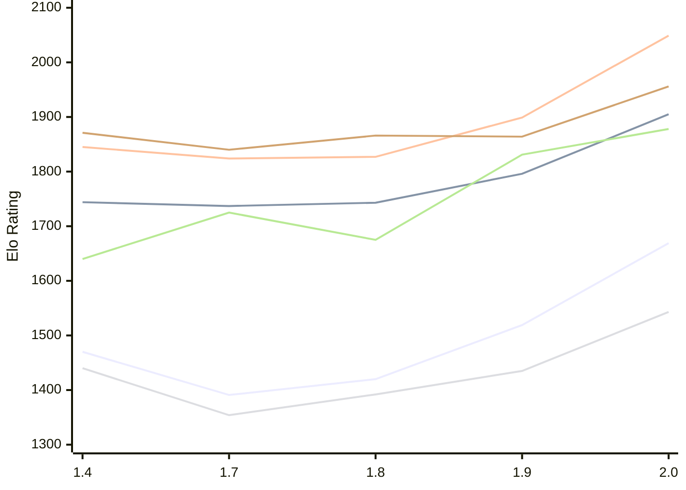

# Engine: Russell

Author: Dominic Fuentes

Home: https://github.com/stup1d1y-0bv10us/russell

## Elo Ratings E1 (Ultra 7 265T (1.50 GHz) - E-Core)

| Version | Published | STC 8.0+0.08s  | LTC 60.0+0.60s | VLTC 2m24s+1.12s | Comment |
| --- | --- | --- | --- | --- | --- |
| 2.0 | 2026-11-05 | 1669(+150) | 1905(+109) | 2049(+150) |  |
| 1.9 | 2026-10-30 | 1519(+99) | 1796(+53) | 1899(+72) |  |
| 1.8 | 2026-10-23 | 1420(+29) | 1743(+6) | 1827(+3) |  |
| 1.7 | 2026-10-16 | 1391(-79) | 1737(-7) | 1824(-21) |  |
| 1.4 | 2026-10-06 | 1470 | 1744 | 1845 |  |
 | | | cElo (∆ prev) | cElo (∆ prev) | cElo (∆ prev) | 

## Elo Ratings P1 (Ultra 7 265T (1.50 GHz) - P-Core)

| Version | Published | STC 8.0+0.08s  | LTC 60.0+0.60s | VLTC 2m24s+1.12s | Comment |
| --- | --- | --- | --- | --- | --- |
| 2.0 | 2026-11-05 | 1543(+108) | 1878(+47) | 1956(+92) |  |
| 1.9 | 2026-10-30 | 1435(+43) | 1831(+156) | 1864(-2) |  |
| 1.8 | 2026-10-23 | 1392(+38) | 1675(-50) | 1866(+26) |  |
| 1.7 | 2026-10-16 | 1354(-86) | 1725(+85) | 1840(-31) |  |
| 1.4 | 2026-10-06 | 1440 | 1640 | 1871 |  |
 | | | cElo (∆ prev) | cElo (∆ prev) | cElo (∆ prev) | 

## Elo Ratings T1 (i5-7500T 2.70GHz)

| Version | Published | STC 8.0+0.08s  | LTC 60.0+0.60s | VLTC 2m24s+1.12s | Comment |
| --- | --- | --- | --- | --- | --- |
| 1.4 | 2026-10-06 | 1440 | 1640 | 1871 |  |
 | | | cElo (∆ prev) | cElo (∆ prev) | cElo (∆ prev) | 

<a href="https://github.com/computer-chess-index/cci/issues/new?template=submit-version.yml&title=[VERSION]+Russell+<version>&body=###%20Engine%20name%0ARussell%0A%0A###%20Version%0A2.0" target="_blank">Submit new version</a>

 Test Conditions:

GUI/CLI: <a href=https://github.com/cutechess/cutechess target="_blank">Cute-Chess</a> 
Elo Calculation: <a href=https://www.remi-coulom.fr/Bayesian-Elo/ target="_blank">Bayesian-Elo</a> 
CPU for P1: Intel(R) Core(TM) Ultra 7 265T (1.50 GHz) - P-Core 
CPU for E1: Intel(R) Core(TM) Ultra 7 265T (1.50 GHz) - E-Core 
CPU for T1: Intel(R) Core(TM) i5-7500T 2.70GHz 
Opening book: 8_moves_v3 
\* STC: 8.0+0.08s, LTC: 60.0+0.60s, VLTC: 2m24s+1.12s

 Lists:
Ratings: <a href=https://github.com/computer-chess-index/cci/blob/main/lists/CCIRatings.csv target="_blank">Complete list</a>

Generated: 2026-11-13 05:42:33

## Ratings Verlauf E1 / P1

## Detailed Evaluation Results

| Version | Time Control | Variant | Elo  | Range +/- | Matches | Score | Average Opponent Elo | Draws |
| --- | --- |--- | --- | --- | --- | --- | --- | --- |
| 2.0 | VLTC (2m24s+1.12s) | P1 | 1956 | 41 | 180 | 53% | 1933 | 39% |
|  |  | E1 | 2049 | 37 | 230 | 51% | 2040 | 33% |
|  | LTC (60.0+0.60s) | P1 | 1878 | 48 | 136 | 49% | 1891 | 35% |
|  |  | E1 | 1905 | 34 | 256 | 52% | 1894 | 41% |
|  | STC (8.0+0.08s) | P1 | 1543 | 39 | 204 | 55% | 1499 | 39% |
|  |  | E1 | 1669 | 33 | 306 | 50% | 1671 | 31% |
| --- | --- |--- | --- | --- | --- | --- | --- | --- |
| 1.9 | VLTC (2m24s+1.12s) | P1 | 1864 | 51 | 124 | 53% | 1839 | 33% |
|  |  | E1 | 1899 | 38 | 228 | 51% | 1899 | 34% |
|  | LTC (60.0+0.60s) | P1 | 1831 | 48 | 144 | 47% | 1864 | 31% |
|  |  | E1 | 1796 | 35 | 284 | 53% | 1773 | 29% |
|  | STC (8.0+0.08s) | P1 | 1435 | 45 | 156 | 56% | 1380 | 37% |
|  |  | E1 | 1519 | 37 | 244 | 52% | 1505 | 31% |
| --- | --- |--- | --- | --- | --- | --- | --- | --- |
| 1.8 | VLTC (2m24s+1.12s) | E1 | 1827 | 37 | 232 | 51% | 1841 | 36% |
|  |  | P1 | 1866 | 55 | 108 | 53% | 1840 | 31% |
|  | LTC (60.0+0.60s) | E1 | 1743 | 38 | 224 | 49% | 1754 | 31% |
|  |  | P1 | 1675 | 48 | 148 | 51% | 1702 | 30% |
|  | STC (8.0+0.08s) | P1 | 1392 | 56 | 100 | 50% | 1392 | 32% |
|  |  | E1 | 1420 | 39 | 214 | 52% | 1403 | 31% |
| --- | --- |--- | --- | --- | --- | --- | --- | --- |
| 1.7 | VLTC (2m24s+1.12s) | P1 | 1840 | 53 | 120 | 43% | 1921 | 31% |
|  |  | E1 | 1824 | 39 | 214 | 49% | 1832 | 29% |
|  | LTC (60.0+0.60s) | P1 | 1725 | 54 | 108 | 51% | 1715 | 31% |
|  |  | E1 | 1737 | 40 | 208 | 52% | 1725 | 29% |
|  | STC (8.0+0.08s) | P1 | 1354 | 50 | 140 | 50% | 1376 | 25% |
|  |  | E1 | 1391 | 40 | 204 | 53% | 1369 | 28% |
| --- | --- |--- | --- | --- | --- | --- | --- | --- |
| 1.4 | VLTC (2m24s+1.12s) | P1 | 1871 | 50 | 144 | 55% | 1812 | 26% |
|  |  | E1 | 1845 | 39 | 222 | 55% | 1794 | 32% |
|  | LTC (60.0+0.60s) | P1 | 1640 | 59 | 120 | 69% | 1353 | 25% |
|  |  | E1 | 1744 | 41 | 210 | 57% | 1632 | 31% |
|  | STC (8.0+0.08s) | P1 | 1440 | 53 | 128 | 44% | 1553 | 27% |
|  |  | E1 | 1470 | 45 | 168 | 53% | 1447 | 30% |