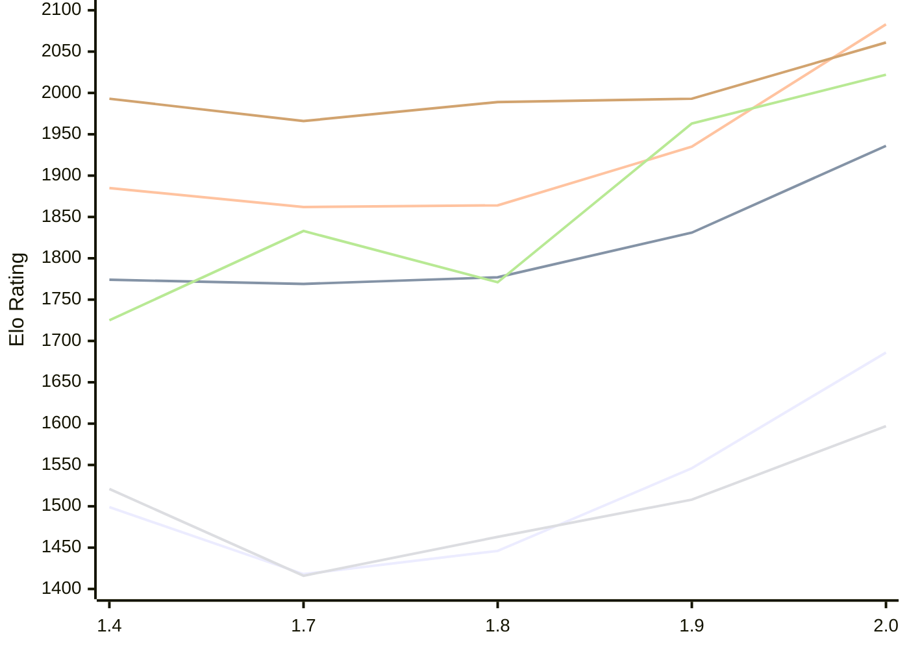

# Engine: Russell

Author: Dominic Fuentes

Home: https://github.com/stup1d1y-0bv10us/russell

## Elo Ratings E1 (Ultra 7 265T (1.50 GHz) - E-Core)

| Version | Published | STC 8.0+0.08s  | LTC 60.0+0.60s | VLTC 2m24s+1.12s | Comment |
| --- | --- | --- | --- | --- | --- |
| 2.0 | 2026-11-05 | 1686(+140) | 1936(+105) | 2083(+148) |  |
| 1.9 | 2026-10-30 | 1546(+100) | 1831(+54) | 1935(+71) |  |
| 1.8 | 2026-10-23 | 1446(+28) | 1777(+8) | 1864(+2) |  |
| 1.7 | 2026-10-16 | 1418(-81) | 1769(-5) | 1862(-23) |  |
| 1.4 | 2026-10-06 | 1499 | 1774 | 1885 |  |
 | | | cElo (∆ prev) | cElo (∆ prev) | cElo (∆ prev) | 

## Elo Ratings P1 (Ultra 7 265T (1.50 GHz) - P-Core)

| Version | Published | STC 8.0+0.08s  | LTC 60.0+0.60s | VLTC 2m24s+1.12s | Comment |
| --- | --- | --- | --- | --- | --- |
| 2.0 | 2026-11-05 | 1597(+89) | 2022(+59) | 2061(+68) |  |
| 1.9 | 2026-10-30 | 1508(+45) | 1963(+192) | 1993(+4) |  |
| 1.8 | 2026-10-23 | 1463(+47) | 1771(-62) | 1989(+23) |  |
| 1.7 | 2026-10-16 | 1416(-105) | 1833(+108) | 1966(-27) |  |
| 1.4 | 2026-10-06 | 1521 | 1725 | 1993 |  |
 | | | cElo (∆ prev) | cElo (∆ prev) | cElo (∆ prev) | 

## Elo Ratings T1 (i5-7500T 2.70GHz)

| Version | Published | STC 8.0+0.08s  | LTC 60.0+0.60s | VLTC 2m24s+1.12s | Comment |
| --- | --- | --- | --- | --- | --- |
| 1.4 | 2026-10-06 | 1521 | 1725 | 1993 |  |
 | | | cElo (∆ prev) | cElo (∆ prev) | cElo (∆ prev) | 

<a href="https://github.com/computer-chess-index/cci/issues/new?template=submit-version.yml&title=[VERSION]+Russell+<version>&body=###%20Engine%20name%0ARussell%0A%0A###%20Version%0A2.0" target="_blank">Submit new version</a>

 Test Conditions:

GUI/CLI: <a href=https://github.com/cutechess/cutechess target="_blank">Cute-Chess</a> 
Elo Calculation: <a href=https://www.remi-coulom.fr/Bayesian-Elo/ target="_blank">Bayesian-Elo</a> 
CPU for P1: Intel(R) Core(TM) Ultra 7 265T (1.50 GHz) - P-Core 
CPU for E1: Intel(R) Core(TM) Ultra 7 265T (1.50 GHz) - E-Core 
CPU for T1: Intel(R) Core(TM) i5-7500T 2.70GHz 
Opening book: 8_moves_v3 
\* STC: 8.0+0.08s, LTC: 60.0+0.60s, VLTC: 2m24s+1.12s

 Lists:
Ratings: <a href=https://github.com/computer-chess-index/cci/blob/main/lists/CCIRatings.csv target="_blank">Complete list</a>

Generated: 2026-11-07 05:42:00

## Ratings Verlauf E1 / P1

## Detailed Evaluation Results

| Version | Time Control | Variant | Elo  | Range +/- | Matches | Score | Average Opponent Elo | Draws |
| --- | --- |--- | --- | --- | --- | --- | --- | --- |
| 2.0 | VLTC (2m24s+1.12s) | P1 | 2061 | 53 | 108 | 50% | 2059 | 38% |
|  |  | E1 | 2083 | 42 | 186 | 49% | 2087 | 33% |
|  | LTC (60.0+0.60s) | P1 | 2022 | 56 | 96 | 51% | 2021 | 39% |
|  |  | E1 | 1936 | 39 | 200 | 51% | 1931 | 38% |
|  | STC (8.0+0.08s) | P1 | 1597 | 53 | 110 | 56% | 1543 | 39% |
|  |  | E1 | 1686 | 38 | 222 | 49% | 1698 | 32% |
| --- | --- |--- | --- | --- | --- | --- | --- | --- |
| 1.9 | VLTC (2m24s+1.12s) | P1 | 1993 | 52 | 116 | 53% | 1962 | 34% |
|  |  | E1 | 1935 | 39 | 212 | 51% | 1932 | 35% |
|  | LTC (60.0+0.60s) | P1 | 1963 | 49 | 136 | 49% | 1974 | 31% |
|  |  | E1 | 1831 | 36 | 264 | 54% | 1801 | 28% |
|  | STC (8.0+0.08s) | P1 | 1508 | 47 | 140 | 53% | 1486 | 37% |
|  |  | E1 | 1546 | 37 | 236 | 51% | 1532 | 32% |
| --- | --- |--- | --- | --- | --- | --- | --- | --- |
| 1.8 | VLTC (2m24s+1.12s) | E1 | 1864 | 37 | 232 | 51% | 1881 | 36% |
|  |  | P1 | 1989 | 55 | 108 | 53% | 1962 | 31% |
|  | LTC (60.0+0.60s) | E1 | 1777 | 38 | 224 | 49% | 1787 | 31% |
|  |  | P1 | 1771 | 48 | 148 | 51% | 1802 | 30% |
|  | STC (8.0+0.08s) | P1 | 1463 | 56 | 100 | 50% | 1462 | 32% |
|  |  | E1 | 1446 | 39 | 214 | 52% | 1430 | 31% |
| --- | --- |--- | --- | --- | --- | --- | --- | --- |
| 1.7 | VLTC (2m24s+1.12s) | P1 | 1966 | 53 | 120 | 43% | 2049 | 31% |
|  |  | E1 | 1862 | 39 | 214 | 49% | 1871 | 29% |
|  | LTC (60.0+0.60s) | P1 | 1833 | 54 | 108 | 51% | 1823 | 31% |
|  |  | E1 | 1769 | 40 | 208 | 52% | 1756 | 29% |
|  | STC (8.0+0.08s) | P1 | 1416 | 50 | 140 | 50% | 1440 | 25% |
|  |  | E1 | 1418 | 40 | 204 | 53% | 1395 | 28% |
| --- | --- |--- | --- | --- | --- | --- | --- | --- |
| 1.4 | VLTC (2m24s+1.12s) | P1 | 1993 | 50 | 144 | 55% | 1931 | 26% |
|  |  | E1 | 1885 | 39 | 222 | 55% | 1833 | 32% |
|  | LTC (60.0+0.60s) | P1 | 1725 | 60 | 120 | 69% | 1422 | 25% |
|  |  | E1 | 1774 | 41 | 210 | 57% | 1661 | 31% |
|  | STC (8.0+0.08s) | P1 | 1521 | 54 | 128 | 44% | 1644 | 27% |
|  |  | E1 | 1499 | 45 | 168 | 53% | 1477 | 30% |