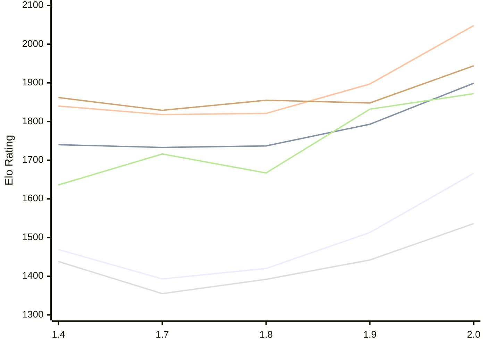

# Engine: Russell

Author: Dominic Fuentes

Home: https://github.com/stup1d1y-0bv10us/russell

## Elo Ratings E1 (Ultra 7 265T (1.50 GHz) - E-Core)

| Version | Published | STC 8.0+0.08s  | LTC 60.0+0.60s | VLTC 2m24s+1.12s | Comment |
| --- | --- | --- | --- | --- | --- |
| 2.0 | 2026-11-05 | 1666(+153) | 1899(+106) | 2048(+151) |  |
| 1.9 | 2026-10-30 | 1513(+93) | 1793(+56) | 1897(+76) |  |
| 1.8 | 2026-10-23 | 1420(+27) | 1737(+4) | 1821(+3) |  |
| 1.7 | 2026-10-16 | 1393(-76) | 1733(-7) | 1818(-22) |  |
| 1.4 | 2026-10-06 | 1469 | 1740 | 1840 |  |
 | | | cElo (∆ prev) | cElo (∆ prev) | cElo (∆ prev) | 

## Elo Ratings P1 (Ultra 7 265T (1.50 GHz) - P-Core)

| Version | Published | STC 8.0+0.08s  | LTC 60.0+0.60s | VLTC 2m24s+1.12s | Comment |
| --- | --- | --- | --- | --- | --- |
| 2.0 | 2026-11-05 | 1536(+94) | 1872(+40) | 1944(+96) |  |
| 1.9 | 2026-10-30 | 1442(+50) | 1832(+165) | 1848(-7) |  |
| 1.8 | 2026-10-23 | 1392(+37) | 1667(-49) | 1855(+26) |  |
| 1.7 | 2026-10-16 | 1355(-83) | 1716(+80) | 1829(-33) |  |
| 1.4 | 2026-10-06 | 1438 | 1636 | 1862 |  |
 | | | cElo (∆ prev) | cElo (∆ prev) | cElo (∆ prev) | 

## Elo Ratings T1 (i5-7500T 2.70GHz)

| Version | Published | STC 8.0+0.08s  | LTC 60.0+0.60s | VLTC 2m24s+1.12s | Comment |
| --- | --- | --- | --- | --- | --- |
| 1.4 | 2026-10-06 | 1438 | 1636 | 1862 |  |
 | | | cElo (∆ prev) | cElo (∆ prev) | cElo (∆ prev) | 

<a href="https://github.com/computer-chess-index/cci/issues/new?template=submit-version.yml&title=[VERSION]+Russell+<version>&body=###%20Engine%20name%0ARussell%0A%0A###%20Version%0A2.0" target="_blank">Submit new version</a>

 Test Conditions:

GUI/CLI: <a href=https://github.com/cutechess/cutechess target="_blank">Cute-Chess</a> 
Elo Calculation: <a href=https://www.remi-coulom.fr/Bayesian-Elo/ target="_blank">Bayesian-Elo</a> 
CPU for P1: Intel(R) Core(TM) Ultra 7 265T (1.50 GHz) - P-Core 
CPU for E1: Intel(R) Core(TM) Ultra 7 265T (1.50 GHz) - E-Core 
CPU for T1: Intel(R) Core(TM) i5-7500T 2.70GHz 
Opening book: 8_moves_v3 
\* STC: 8.0+0.08s, LTC: 60.0+0.60s, VLTC: 2m24s+1.12s

 Lists:
Ratings: <a href=https://github.com/computer-chess-index/cci/blob/main/lists/CCIRatings.csv target="_blank">Complete list</a>

Generated: 2026-11-14 05:42:06

## Ratings Verlauf E1 / P1

## Detailed Evaluation Results

| Version | Time Control | Variant | Elo  | Range +/- | Matches | Score | Average Opponent Elo | Draws |
| --- | --- |--- | --- | --- | --- | --- | --- | --- |
| 2.0 | VLTC (2m24s+1.12s) | P1 | 1944 | 41 | 184 | 54% | 1913 | 39% |
|  |  | E1 | 2048 | 37 | 234 | 51% | 2043 | 32% |
|  | LTC (60.0+0.60s) | P1 | 1872 | 46 | 148 | 49% | 1881 | 32% |
|  |  | E1 | 1899 | 34 | 272 | 52% | 1885 | 41% |
|  | STC (8.0+0.08s) | P1 | 1536 | 39 | 204 | 55% | 1492 | 39% |
|  |  | E1 | 1666 | 33 | 306 | 50% | 1667 | 31% |
| --- | --- |--- | --- | --- | --- | --- | --- | --- |
| 1.9 | VLTC (2m24s+1.12s) | P1 | 1848 | 50 | 128 | 54% | 1817 | 34% |
|  |  | E1 | 1897 | 37 | 236 | 51% | 1893 | 34% |
|  | LTC (60.0+0.60s) | P1 | 1832 | 46 | 152 | 48% | 1858 | 33% |
|  |  | E1 | 1793 | 34 | 288 | 53% | 1769 | 30% |
|  | STC (8.0+0.08s) | P1 | 1442 | 44 | 164 | 58% | 1370 | 36% |
|  |  | E1 | 1513 | 36 | 248 | 51% | 1503 | 31% |
| --- | --- |--- | --- | --- | --- | --- | --- | --- |
| 1.8 | VLTC (2m24s+1.12s) | P1 | 1855 | 55 | 108 | 53% | 1828 | 31% |
|  |  | E1 | 1821 | 37 | 232 | 51% | 1836 | 36% |
|  | LTC (60.0+0.60s) | P1 | 1667 | 48 | 148 | 51% | 1694 | 30% |
|  |  | E1 | 1737 | 38 | 224 | 49% | 1750 | 31% |
|  | STC (8.0+0.08s) | E1 | 1420 | 39 | 214 | 52% | 1404 | 31% |
|  |  | P1 | 1392 | 56 | 100 | 50% | 1392 | 32% |
| --- | --- |--- | --- | --- | --- | --- | --- | --- |
| 1.7 | VLTC (2m24s+1.12s) | P1 | 1829 | 53 | 120 | 43% | 1910 | 31% |
|  |  | E1 | 1818 | 39 | 214 | 49% | 1827 | 29% |
|  | LTC (60.0+0.60s) | P1 | 1716 | 54 | 108 | 51% | 1705 | 31% |
|  |  | E1 | 1733 | 40 | 208 | 52% | 1721 | 29% |
|  | STC (8.0+0.08s) | P1 | 1355 | 50 | 140 | 50% | 1377 | 25% |
|  |  | E1 | 1393 | 40 | 204 | 53% | 1370 | 28% |
| --- | --- |--- | --- | --- | --- | --- | --- | --- |
| 1.4 | VLTC (2m24s+1.12s) | E1 | 1840 | 39 | 222 | 55% | 1789 | 32% |
|  |  | P1 | 1862 | 50 | 144 | 55% | 1804 | 26% |
|  | LTC (60.0+0.60s) | E1 | 1740 | 41 | 210 | 57% | 1629 | 31% |
|  |  | P1 | 1636 | 59 | 120 | 69% | 1349 | 25% |
|  | STC (8.0+0.08s) | E1 | 1469 | 45 | 168 | 53% | 1447 | 30% |
|  |  | P1 | 1438 | 53 | 128 | 44% | 1548 | 27% |