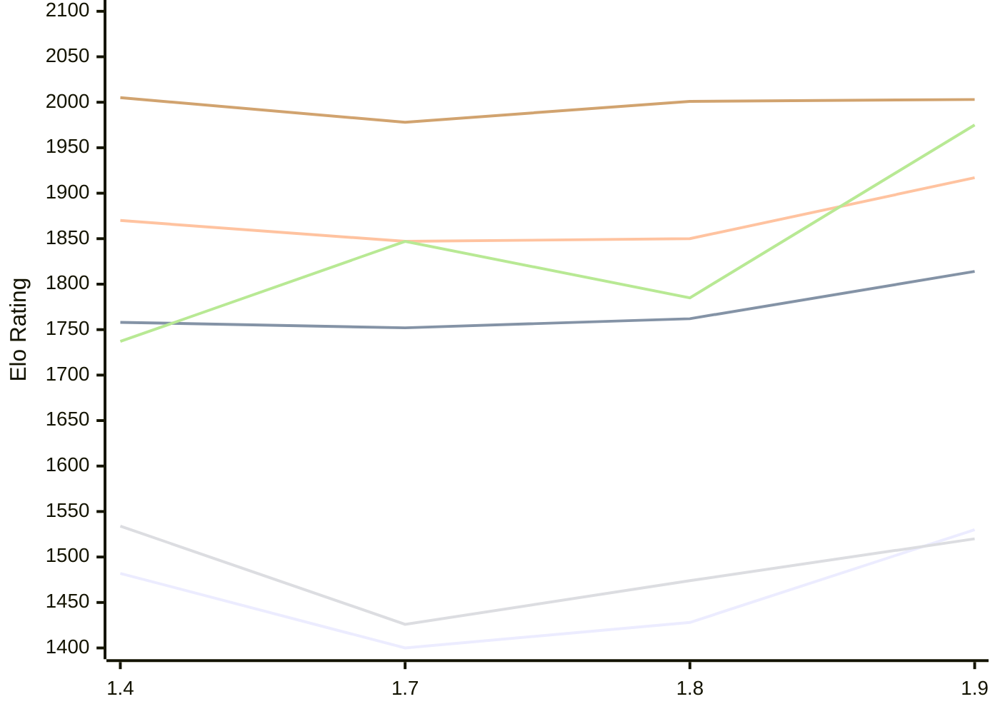

# Engine: Russell

Author: Dominic Fuentes

Home: https://github.com/stup1d1y-0bv10us/russell

## Elo Ratings E1 (Ultra 7 265T (1.50 GHz) - E-Core)

| Version | Published | STC 8.0+0.08s  | LTC 60.0+0.60s | VLTC 2m24s+1.12s | Comment |
| --- | --- | --- | --- | --- | --- |
| 1.9 | 2026-10-30 | 1530(+102) | 1814(+52) | 1917(+67) |  |
| 1.8 | 2026-10-23 | 1428(+28) | 1762(+10) | 1850(+3) |  |
| 1.7 | 2026-10-16 | 1400(-82) | 1752(-6) | 1847(-23) |  |
| 1.4 | 2026-10-06 | 1482 | 1758 | 1870 |  |
 | | | cElo (∆ prev) | cElo (∆ prev) | cElo (∆ prev) | 

## Elo Ratings P1 (Ultra 7 265T (1.50 GHz) - P-Core)

| Version | Published | STC 8.0+0.08s  | LTC 60.0+0.60s | VLTC 2m24s+1.12s | Comment |
| --- | --- | --- | --- | --- | --- |
| 1.9 | 2026-10-30 | 1520(+46) | 1975(+190) | 2003(+2) |  |
| 1.8 | 2026-10-23 | 1474(+48) | 1785(-62) | 2001(+23) |  |
| 1.7 | 2026-10-16 | 1426(-108) | 1847(+110) | 1978(-27) |  |
| 1.4 | 2026-10-06 | 1534 | 1737 | 2005 |  |
 | | | cElo (∆ prev) | cElo (∆ prev) | cElo (∆ prev) | 

## Elo Ratings T1 (i5-7500T 2.70GHz)

| Version | Published | STC 8.0+0.08s  | LTC 60.0+0.60s | VLTC 2m24s+1.12s | Comment |
| --- | --- | --- | --- | --- | --- |
| 1.4 | 2026-10-06 | 1534 | 1737 | 2005 |  |
 | | | cElo (∆ prev) | cElo (∆ prev) | cElo (∆ prev) | 

<a href="https://github.com/computer-chess-index/cci/issues/new?template=submit-version.yml&title=[VERSION]+Russell+<version>&body=###%20Engine%20name%0ARussell%0A%0A###%20Version%0A1.9" target="_blank">Submit new version</a>

 Test Conditions:

GUI/CLI: <a href=https://github.com/cutechess/cutechess target="_blank">Cute-Chess</a> 
Elo Calculation: <a href=https://www.remi-coulom.fr/Bayesian-Elo/ target="_blank">Bayesian-Elo</a> 
CPU for P1: Intel(R) Core(TM) Ultra 7 265T (1.50 GHz) - P-Core 
CPU for E1: Intel(R) Core(TM) Ultra 7 265T (1.50 GHz) - E-Core 
CPU for T1: Intel(R) Core(TM) i5-7500T 2.70GHz 
Opening book: 8_moves_v3 
\* STC: 8.0+0.08s, LTC: 60.0+0.60s, VLTC: 2m24s+1.12s

 Lists:
Ratings: <a href=https://github.com/computer-chess-index/cci/blob/main/lists/CCIRatings.csv target="_blank">Complete list</a>

Generated: 2026-11-05 05:42:13

## Ratings Verlauf E1 / P1

## Detailed Evaluation Results

| Version | Time Control | Variant | Elo  | Range +/- | Matches | Score | Average Opponent Elo | Draws |
| --- | --- |--- | --- | --- | --- | --- | --- | --- |
| 1.9 | VLTC (2m24s+1.12s) | P1 | 2003 | 54 | 112 | 54% | 1972 | 32% |
|  |  | E1 | 1917 | 39 | 208 | 50% | 1916 | 36% |
|  | LTC (60.0+0.60s) | P1 | 1975 | 49 | 136 | 49% | 1986 | 31% |
|  |  | E1 | 1814 | 36 | 260 | 53% | 1787 | 28% |
|  | STC (8.0+0.08s) | P1 | 1520 | 47 | 140 | 53% | 1497 | 37% |
|  |  | E1 | 1530 | 37 | 232 | 52% | 1515 | 32% |
| --- | --- |--- | --- | --- | --- | --- | --- | --- |
| 1.8 | VLTC (2m24s+1.12s) | E1 | 1850 | 37 | 232 | 51% | 1866 | 36% |
|  |  | P1 | 2001 | 55 | 108 | 53% | 1975 | 31% |
|  | LTC (60.0+0.60s) | E1 | 1762 | 38 | 224 | 49% | 1773 | 31% |
|  |  | P1 | 1785 | 48 | 148 | 51% | 1816 | 30% |
|  | STC (8.0+0.08s) | E1 | 1428 | 39 | 214 | 52% | 1412 | 31% |
|  |  | P1 | 1474 | 56 | 100 | 50% | 1474 | 32% |
| --- | --- |--- | --- | --- | --- | --- | --- | --- |
| 1.7 | VLTC (2m24s+1.12s) | P1 | 1978 | 53 | 120 | 43% | 2060 | 31% |
|  |  | E1 | 1847 | 39 | 214 | 49% | 1856 | 29% |
|  | LTC (60.0+0.60s) | P1 | 1847 | 54 | 108 | 51% | 1835 | 31% |
|  |  | E1 | 1752 | 40 | 208 | 52% | 1742 | 29% |
|  | STC (8.0+0.08s) | P1 | 1426 | 50 | 140 | 50% | 1451 | 25% |
|  |  | E1 | 1400 | 40 | 204 | 53% | 1377 | 28% |
| --- | --- |--- | --- | --- | --- | --- | --- | --- |
| 1.4 | VLTC (2m24s+1.12s) | E1 | 1870 | 39 | 222 | 55% | 1817 | 32% |
|  |  | P1 | 2005 | 50 | 144 | 55% | 1943 | 26% |
|  | LTC (60.0+0.60s) | P1 | 1737 | 60 | 120 | 69% | 1432 | 25% |
|  |  | E1 | 1758 | 41 | 210 | 57% | 1646 | 31% |
|  | STC (8.0+0.08s) | P1 | 1534 | 54 | 128 | 44% | 1655 | 27% |
|  |  | E1 | 1482 | 45 | 168 | 53% | 1461 | 30% |