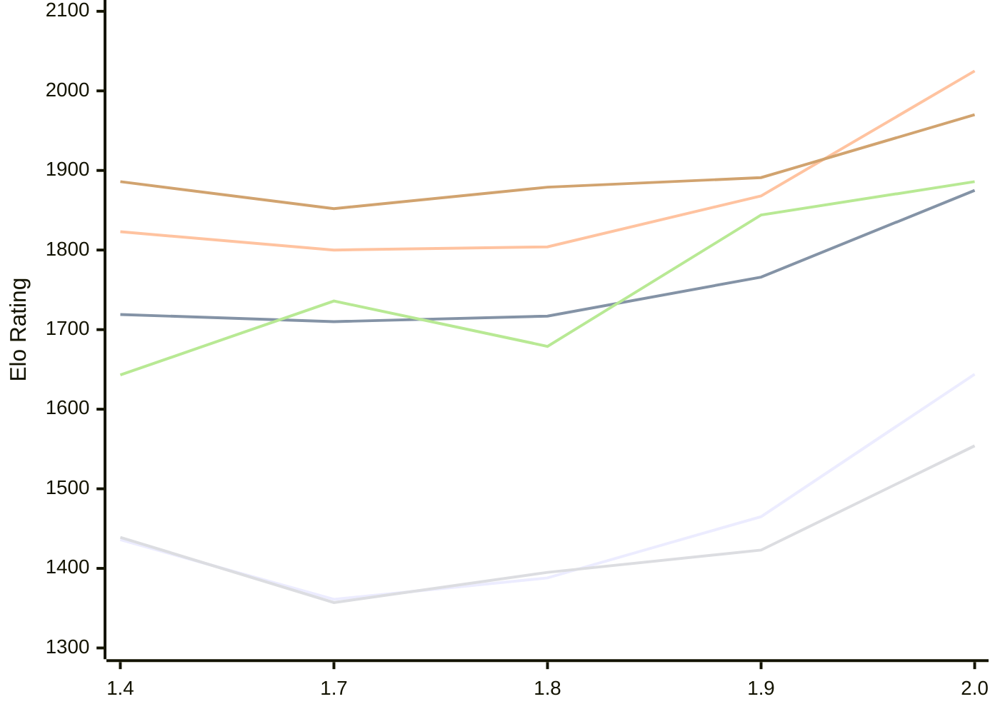

# Engine: Russell

Author: Dominic Fuentes

Home: https://github.com/stup1d1y-0bv10us/russell

## Elo Ratings E1 (Ultra 7 265T (1.50 GHz) - E-Core)

| Version | Published | STC 8.0+0.08s  | LTC 60.0+0.60s | VLTC 2m24s+1.12s | Comment |
| --- | --- | --- | --- | --- | --- |
| 2.0 | 2026-11-05 | 1644(+179) | 1875(+109) | 2025(+157) |  |
| 1.9 | 2026-10-30 | 1465(+77) | 1766(+49) | 1868(+64) |  |
| 1.8 | 2026-10-23 | 1388(+27) | 1717(+7) | 1804(+4) |  |
| 1.7 | 2026-10-16 | 1361(-75) | 1710(-9) | 1800(-23) |  |
| 1.4 | 2026-10-06 | 1436 | 1719 | 1823 |  |
 | | | cElo (∆ prev) | cElo (∆ prev) | cElo (∆ prev) | 

## Elo Ratings P1 (Ultra 7 265T (1.50 GHz) - P-Core)

| Version | Published | STC 8.0+0.08s  | LTC 60.0+0.60s | VLTC 2m24s+1.12s | Comment |
| --- | --- | --- | --- | --- | --- |
| 2.0 | 2026-11-05 | 1554(+131) | 1886(+42) | 1970(+79) |  |
| 1.9 | 2026-10-30 | 1423(+28) | 1844(+165) | 1891(+12) |  |
| 1.8 | 2026-10-23 | 1395(+38) | 1679(-57) | 1879(+27) |  |
| 1.7 | 2026-10-16 | 1357(-82) | 1736(+93) | 1852(-34) |  |
| 1.4 | 2026-10-06 | 1439 | 1643 | 1886 |  |
 | | | cElo (∆ prev) | cElo (∆ prev) | cElo (∆ prev) | 

## Elo Ratings T1 (i5-7500T 2.70GHz)

| Version | Published | STC 8.0+0.08s  | LTC 60.0+0.60s | VLTC 2m24s+1.12s | Comment |
| --- | --- | --- | --- | --- | --- |
| 1.4 | 2026-10-06 | 1439 | 1643 | 1886 |  |
 | | | cElo (∆ prev) | cElo (∆ prev) | cElo (∆ prev) | 

<a href="https://github.com/computer-chess-index/cci/issues/new?template=submit-version.yml&title=[VERSION]+Russell+<version>&body=###%20Engine%20name%0ARussell%0A%0A###%20Version%0A2.0" target="_blank">Submit new version</a>

 Test Conditions:

GUI/CLI: <a href=https://github.com/cutechess/cutechess target="_blank">Cute-Chess</a> 
Elo Calculation: <a href=https://www.remi-coulom.fr/Bayesian-Elo/ target="_blank">Bayesian-Elo</a> 
CPU for P1: Intel(R) Core(TM) Ultra 7 265T (1.50 GHz) - P-Core 
CPU for E1: Intel(R) Core(TM) Ultra 7 265T (1.50 GHz) - E-Core 
CPU for T1: Intel(R) Core(TM) i5-7500T 2.70GHz 
Opening book: 8_moves_v3 
\* STC: 8.0+0.08s, LTC: 60.0+0.60s, VLTC: 2m24s+1.12s

 Lists:
Ratings: <a href=https://github.com/computer-chess-index/cci/blob/main/lists/CCIRatings.csv target="_blank">Complete list</a>

Generated: 2026-11-27 05:42:59

## Ratings Verlauf E1 / P1

## Detailed Evaluation Results

| Version | Time Control | Variant | Elo  | Range +/- | Matches | Score | Average Opponent Elo | Draws |
| --- | --- |--- | --- | --- | --- | --- | --- | --- |
| 2.0 | VLTC (2m24s+1.12s) | P1 | 1970 | 39 | 204 | 53% | 1939 | 38% |
|  |  | E1 | 2025 | 36 | 250 | 50% | 2028 | 32% |
|  | LTC (60.0+0.60s) | E1 | 1875 | 32 | 300 | 52% | 1866 | 41% |
|  |  | P1 | 1886 | 44 | 164 | 50% | 1887 | 34% |
|  | STC (8.0+0.08s) | E1 | 1644 | 32 | 318 | 51% | 1635 | 31% |
|  |  | P1 | 1554 | 36 | 238 | 55% | 1504 | 41% |
| --- | --- |--- | --- | --- | --- | --- | --- | --- |
| 1.9 | VLTC (2m24s+1.12s) | P1 | 1891 | 46 | 152 | 55% | 1847 | 32% |
|  |  | E1 | 1868 | 36 | 252 | 51% | 1870 | 34% |
|  | LTC (60.0+0.60s) | P1 | 1844 | 41 | 196 | 47% | 1879 | 33% |
|  |  | E1 | 1766 | 33 | 304 | 52% | 1748 | 31% |
|  | STC (8.0+0.08s) | P1 | 1423 | 41 | 202 | 55% | 1376 | 33% |
|  |  | E1 | 1465 | 35 | 268 | 49% | 1470 | 31% |
| --- | --- |--- | --- | --- | --- | --- | --- | --- |
| 1.8 | VLTC (2m24s+1.12s) | P1 | 1879 | 55 | 108 | 53% | 1854 | 31% |
|  |  | E1 | 1804 | 37 | 232 | 51% | 1818 | 36% |
|  | LTC (60.0+0.60s) | P1 | 1679 | 48 | 148 | 51% | 1706 | 30% |
|  |  | E1 | 1717 | 38 | 224 | 49% | 1728 | 31% |
|  | STC (8.0+0.08s) | P1 | 1395 | 56 | 100 | 50% | 1393 | 32% |
|  |  | E1 | 1388 | 39 | 214 | 52% | 1372 | 31% |
| --- | --- |--- | --- | --- | --- | --- | --- | --- |
| 1.7 | VLTC (2m24s+1.12s) | P1 | 1852 | 53 | 120 | 43% | 1935 | 31% |
|  |  | E1 | 1800 | 39 | 214 | 49% | 1809 | 29% |
|  | LTC (60.0+0.60s) | P1 | 1736 | 54 | 108 | 51% | 1725 | 31% |
|  |  | E1 | 1710 | 40 | 208 | 52% | 1700 | 29% |
|  | STC (8.0+0.08s) | P1 | 1357 | 50 | 140 | 50% | 1380 | 25% |
|  |  | E1 | 1361 | 40 | 204 | 53% | 1339 | 28% |
| --- | --- |--- | --- | --- | --- | --- | --- | --- |
| 1.4 | VLTC (2m24s+1.12s) | P1 | 1886 | 50 | 144 | 55% | 1827 | 26% |
|  |  | E1 | 1823 | 39 | 222 | 55% | 1770 | 32% |
|  | LTC (60.0+0.60s) | P1 | 1643 | 59 | 120 | 69% | 1354 | 25% |
|  |  | E1 | 1719 | 41 | 210 | 57% | 1608 | 31% |
|  | STC (8.0+0.08s) | P1 | 1439 | 54 | 128 | 44% | 1555 | 27% |
|  |  | E1 | 1436 | 45 | 168 | 53% | 1415 | 30% |