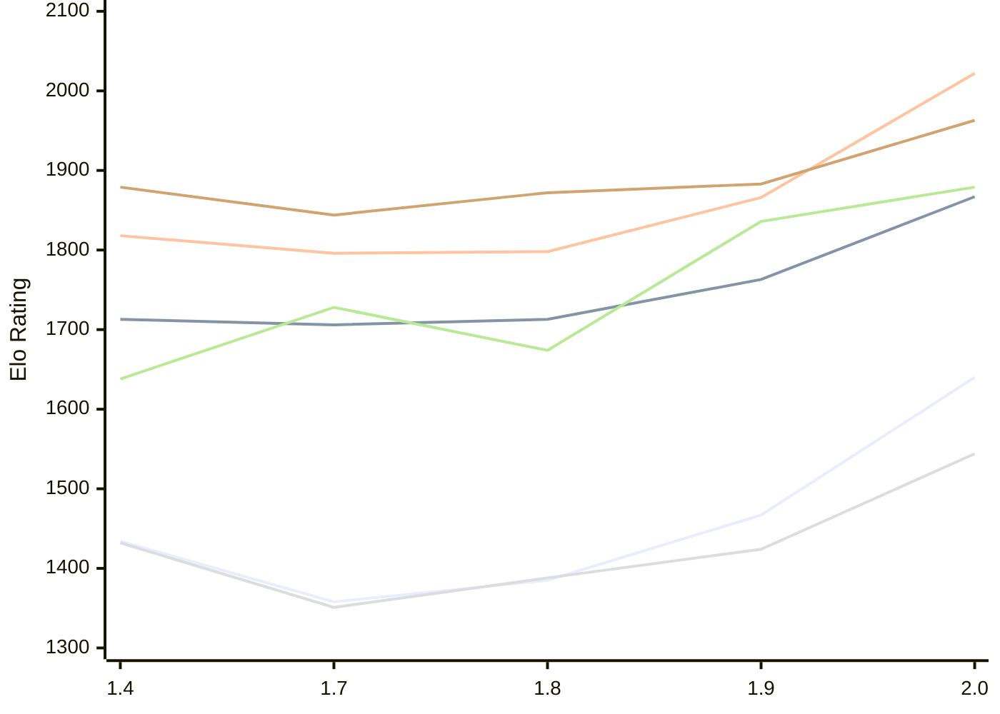

# Engine: Russell

Author: Dominic Fuentes

Home: https://github.com/stup1d1y-0bv10us/russell

## Elo Ratings E1 (Ultra 7 265T (1.50 GHz) - E-Core)

| Version | Published | STC 8.0+0.08s  | LTC 60.0+0.60s | VLTC 2m24s+1.12s | Comment |
| --- | --- | --- | --- | --- | --- |
| 2.0 | 2026-11-05 | 1640(+173) | 1867(+104) | 2022(+156) |  |
| 1.9 | 2026-10-30 | 1467(+82) | 1763(+50) | 1866(+68) |  |
| 1.8 | 2026-10-23 | 1385(+27) | 1713(+7) | 1798(+2) |  |
| 1.7 | 2026-10-16 | 1358(-76) | 1706(-7) | 1796(-22) |  |
| 1.4 | 2026-10-06 | 1434 | 1713 | 1818 |  |
 | | | cElo (∆ prev) | cElo (∆ prev) | cElo (∆ prev) | 

## Elo Ratings P1 (Ultra 7 265T (1.50 GHz) - P-Core)

| Version | Published | STC 8.0+0.08s  | LTC 60.0+0.60s | VLTC 2m24s+1.12s | Comment |
| --- | --- | --- | --- | --- | --- |
| 2.0 | 2026-11-05 | 1544(+120) | 1879(+43) | 1963(+80) |  |
| 1.9 | 2026-10-30 | 1424(+36) | 1836(+162) | 1883(+11) |  |
| 1.8 | 2026-10-23 | 1388(+37) | 1674(-54) | 1872(+28) |  |
| 1.7 | 2026-10-16 | 1351(-81) | 1728(+90) | 1844(-35) |  |
| 1.4 | 2026-10-06 | 1432 | 1638 | 1879 |  |
 | | | cElo (∆ prev) | cElo (∆ prev) | cElo (∆ prev) | 

## Elo Ratings T1 (i5-7500T 2.70GHz)

| Version | Published | STC 8.0+0.08s  | LTC 60.0+0.60s | VLTC 2m24s+1.12s | Comment |
| --- | --- | --- | --- | --- | --- |
| 1.4 | 2026-10-06 | 1432 | 1638 | 1879 |  |
 | | | cElo (∆ prev) | cElo (∆ prev) | cElo (∆ prev) | 

<a href="https://github.com/computer-chess-index/cci/issues/new?template=submit-version.yml&title=[VERSION]+Russell+<version>&body=###%20Engine%20name%0ARussell%0A%0A###%20Version%0A2.0" target="_blank">Submit new version</a>

 Test Conditions:

GUI/CLI: <a href=https://github.com/cutechess/cutechess target="_blank">Cute-Chess</a> 
Elo Calculation: <a href=https://www.remi-coulom.fr/Bayesian-Elo/ target="_blank">Bayesian-Elo</a> 
CPU for P1: Intel(R) Core(TM) Ultra 7 265T (1.50 GHz) - P-Core 
CPU for E1: Intel(R) Core(TM) Ultra 7 265T (1.50 GHz) - E-Core 
CPU for T1: Intel(R) Core(TM) i5-7500T 2.70GHz 
Opening book: 8_moves_v3 
\* STC: 8.0+0.08s, LTC: 60.0+0.60s, VLTC: 2m24s+1.12s

 Lists:
Ratings: <a href=https://github.com/computer-chess-index/cci/blob/main/lists/CCIRatings.csv target="_blank">Complete list</a>

Generated: 2026-11-23 05:42:35

## Ratings Verlauf E1 / P1

## Detailed Evaluation Results

| Version | Time Control | Variant | Elo  | Range +/- | Matches | Score | Average Opponent Elo | Draws |
| --- | --- |--- | --- | --- | --- | --- | --- | --- |
| 2.0 | VLTC (2m24s+1.12s) | P1 | 1963 | 39 | 204 | 53% | 1932 | 38% |
|  |  | E1 | 2022 | 36 | 246 | 50% | 2025 | 32% |
|  | LTC (60.0+0.60s) | P1 | 1879 | 44 | 164 | 50% | 1882 | 34% |
|  |  | E1 | 1867 | 32 | 292 | 51% | 1862 | 41% |
|  | STC (8.0+0.08s) | P1 | 1544 | 36 | 234 | 55% | 1499 | 41% |
|  |  | E1 | 1640 | 32 | 318 | 51% | 1634 | 31% |
| --- | --- |--- | --- | --- | --- | --- | --- | --- |
| 1.9 | VLTC (2m24s+1.12s) | P1 | 1883 | 46 | 152 | 55% | 1839 | 32% |
|  |  | E1 | 1866 | 36 | 252 | 51% | 1867 | 34% |
|  | LTC (60.0+0.60s) | P1 | 1836 | 42 | 188 | 47% | 1870 | 34% |
|  |  | E1 | 1763 | 34 | 300 | 53% | 1743 | 30% |
|  | STC (8.0+0.08s) | P1 | 1424 | 42 | 190 | 56% | 1368 | 34% |
|  |  | E1 | 1467 | 35 | 260 | 50% | 1467 | 32% |
| --- | --- |--- | --- | --- | --- | --- | --- | --- |
| 1.8 | VLTC (2m24s+1.12s) | P1 | 1872 | 55 | 108 | 53% | 1845 | 31% |
|  |  | E1 | 1798 | 37 | 232 | 51% | 1814 | 36% |
|  | LTC (60.0+0.60s) | P1 | 1674 | 48 | 148 | 51% | 1701 | 30% |
|  |  | E1 | 1713 | 38 | 224 | 49% | 1724 | 31% |
|  | STC (8.0+0.08s) | P1 | 1388 | 56 | 100 | 50% | 1388 | 32% |
|  |  | E1 | 1385 | 39 | 214 | 52% | 1369 | 31% |
| --- | --- |--- | --- | --- | --- | --- | --- | --- |
| 1.7 | VLTC (2m24s+1.12s) | E1 | 1796 | 39 | 214 | 49% | 1806 | 29% |
|  |  | P1 | 1844 | 53 | 120 | 43% | 1926 | 31% |
|  | LTC (60.0+0.60s) | E1 | 1706 | 40 | 208 | 52% | 1696 | 29% |
|  |  | P1 | 1728 | 54 | 108 | 51% | 1719 | 31% |
|  | STC (8.0+0.08s) | P1 | 1351 | 50 | 140 | 50% | 1373 | 25% |
|  |  | E1 | 1358 | 40 | 204 | 53% | 1337 | 28% |
| --- | --- |--- | --- | --- | --- | --- | --- | --- |
| 1.4 | VLTC (2m24s+1.12s) | P1 | 1879 | 50 | 144 | 55% | 1818 | 26% |
|  |  | E1 | 1818 | 39 | 222 | 55% | 1766 | 32% |
|  | LTC (60.0+0.60s) | P1 | 1638 | 59 | 120 | 69% | 1350 | 25% |
|  |  | E1 | 1713 | 41 | 210 | 57% | 1604 | 31% |
|  | STC (8.0+0.08s) | P1 | 1432 | 54 | 128 | 44% | 1548 | 27% |
|  |  | E1 | 1434 | 45 | 168 | 53% | 1413 | 30% |