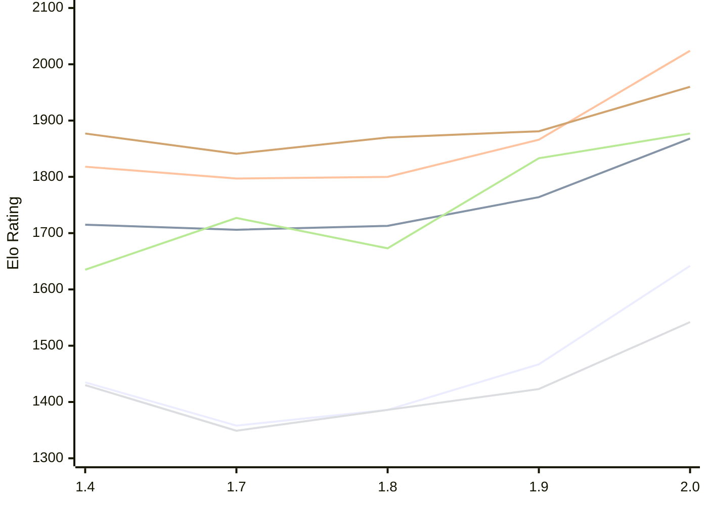

# Engine: Russell

Author: Dominic Fuentes

Home: https://github.com/stup1d1y-0bv10us/russell

## Elo Ratings E1 (Ultra 7 265T (1.50 GHz) - E-Core)

| Version | Published | STC 8.0+0.08s  | LTC 60.0+0.60s | VLTC 2m24s+1.12s | Comment |
| --- | --- | --- | --- | --- | --- |
| 2.0 | 2026-11-05 | 1642(+175) | 1868(+104) | 2024(+158) |  |
| 1.9 | 2026-10-30 | 1467(+81) | 1764(+51) | 1866(+66) |  |
| 1.8 | 2026-10-23 | 1386(+28) | 1713(+7) | 1800(+3) |  |
| 1.7 | 2026-10-16 | 1358(-77) | 1706(-9) | 1797(-21) |  |
| 1.4 | 2026-10-06 | 1435 | 1715 | 1818 |  |
 | | | cElo (∆ prev) | cElo (∆ prev) | cElo (∆ prev) | 

## Elo Ratings P1 (Ultra 7 265T (1.50 GHz) - P-Core)

| Version | Published | STC 8.0+0.08s  | LTC 60.0+0.60s | VLTC 2m24s+1.12s | Comment |
| --- | --- | --- | --- | --- | --- |
| 2.0 | 2026-11-05 | 1542(+119) | 1877(+44) | 1960(+79) |  |
| 1.9 | 2026-10-30 | 1423(+37) | 1833(+160) | 1881(+11) |  |
| 1.8 | 2026-10-23 | 1386(+37) | 1673(-54) | 1870(+29) |  |
| 1.7 | 2026-10-16 | 1349(-81) | 1727(+92) | 1841(-36) |  |
| 1.4 | 2026-10-06 | 1430 | 1635 | 1877 |  |
 | | | cElo (∆ prev) | cElo (∆ prev) | cElo (∆ prev) | 

## Elo Ratings T1 (i5-7500T 2.70GHz)

| Version | Published | STC 8.0+0.08s  | LTC 60.0+0.60s | VLTC 2m24s+1.12s | Comment |
| --- | --- | --- | --- | --- | --- |
| 1.4 | 2026-10-06 | 1430 | 1635 | 1877 |  |
 | | | cElo (∆ prev) | cElo (∆ prev) | cElo (∆ prev) | 

<a href="https://github.com/computer-chess-index/cci/issues/new?template=submit-version.yml&title=[VERSION]+Russell+<version>&body=###%20Engine%20name%0ARussell%0A%0A###%20Version%0A2.0" target="_blank">Submit new version</a>

 Test Conditions:

GUI/CLI: <a href=https://github.com/cutechess/cutechess target="_blank">Cute-Chess</a> 
Elo Calculation: <a href=https://www.remi-coulom.fr/Bayesian-Elo/ target="_blank">Bayesian-Elo</a> 
CPU for P1: Intel(R) Core(TM) Ultra 7 265T (1.50 GHz) - P-Core 
CPU for E1: Intel(R) Core(TM) Ultra 7 265T (1.50 GHz) - E-Core 
CPU for T1: Intel(R) Core(TM) i5-7500T 2.70GHz 
Opening book: 8_moves_v3 
\* STC: 8.0+0.08s, LTC: 60.0+0.60s, VLTC: 2m24s+1.12s

 Lists:
Ratings: <a href=https://github.com/computer-chess-index/cci/blob/main/lists/CCIRatings.csv target="_blank">Complete list</a>

Generated: 2026-11-22 05:42:30

## Ratings Verlauf E1 / P1

## Detailed Evaluation Results

| Version | Time Control | Variant | Elo  | Range +/- | Matches | Score | Average Opponent Elo | Draws |
| --- | --- |--- | --- | --- | --- | --- | --- | --- |
| 2.0 | VLTC (2m24s+1.12s) | P1 | 1960 | 39 | 204 | 53% | 1928 | 38% |
|  |  | E1 | 2024 | 36 | 246 | 50% | 2026 | 32% |
|  | LTC (60.0+0.60s) | P1 | 1877 | 44 | 164 | 50% | 1879 | 34% |
|  |  | E1 | 1868 | 32 | 292 | 51% | 1863 | 41% |
|  | STC (8.0+0.08s) | P1 | 1542 | 36 | 234 | 55% | 1496 | 41% |
|  |  | E1 | 1642 | 32 | 318 | 51% | 1634 | 31% |
| --- | --- |--- | --- | --- | --- | --- | --- | --- |
| 1.9 | VLTC (2m24s+1.12s) | E1 | 1866 | 36 | 252 | 51% | 1868 | 34% |
|  |  | P1 | 1881 | 46 | 152 | 55% | 1836 | 32% |
|  | LTC (60.0+0.60s) | P1 | 1833 | 41 | 188 | 47% | 1867 | 34% |
|  |  | E1 | 1764 | 34 | 300 | 53% | 1743 | 30% |
|  | STC (8.0+0.08s) | P1 | 1423 | 42 | 190 | 56% | 1365 | 34% |
|  |  | E1 | 1467 | 35 | 260 | 50% | 1469 | 32% |
| --- | --- |--- | --- | --- | --- | --- | --- | --- |
| 1.8 | VLTC (2m24s+1.12s) | P1 | 1870 | 55 | 108 | 53% | 1843 | 31% |
|  |  | E1 | 1800 | 37 | 232 | 51% | 1814 | 36% |
|  | LTC (60.0+0.60s) | P1 | 1673 | 48 | 148 | 51% | 1700 | 30% |
|  |  | E1 | 1713 | 38 | 224 | 49% | 1724 | 31% |
|  | STC (8.0+0.08s) | P1 | 1386 | 56 | 100 | 50% | 1385 | 32% |
|  |  | E1 | 1386 | 39 | 214 | 52% | 1369 | 31% |
| --- | --- |--- | --- | --- | --- | --- | --- | --- |
| 1.7 | VLTC (2m24s+1.12s) | P1 | 1841 | 53 | 120 | 43% | 1924 | 31% |
|  |  | E1 | 1797 | 39 | 214 | 49% | 1806 | 29% |
|  | LTC (60.0+0.60s) | P1 | 1727 | 54 | 108 | 51% | 1716 | 31% |
|  |  | E1 | 1706 | 40 | 208 | 52% | 1696 | 29% |
|  | STC (8.0+0.08s) | P1 | 1349 | 50 | 140 | 50% | 1372 | 25% |
|  |  | E1 | 1358 | 40 | 204 | 53% | 1337 | 28% |
| --- | --- |--- | --- | --- | --- | --- | --- | --- |
| 1.4 | VLTC (2m24s+1.12s) | P1 | 1877 | 50 | 144 | 55% | 1816 | 26% |
|  |  | E1 | 1818 | 39 | 222 | 55% | 1766 | 32% |
|  | LTC (60.0+0.60s) | P1 | 1635 | 59 | 120 | 69% | 1349 | 25% |
|  |  | E1 | 1715 | 41 | 210 | 57% | 1604 | 31% |
|  | STC (8.0+0.08s) | E1 | 1435 | 45 | 168 | 53% | 1413 | 30% |
|  |  | P1 | 1430 | 54 | 128 | 44% | 1546 | 27% |