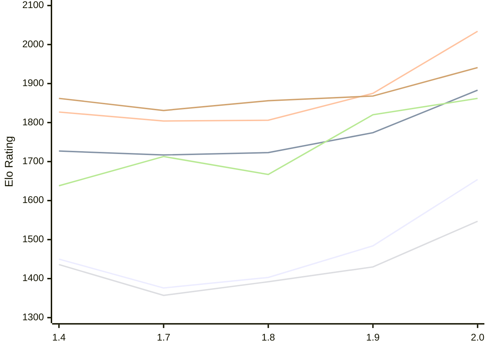

# Engine: Russell

Author: Dominic Fuentes

Home: https://github.com/stup1d1y-0bv10us/russell

## Elo Ratings E1 (Ultra 7 265T (1.50 GHz) - E-Core)

| Version | Published | STC 8.0+0.08s  | LTC 60.0+0.60s | VLTC 2m24s+1.12s | Comment |
| --- | --- | --- | --- | --- | --- |
| 2.0 | 2026-11-05 | 1654(+170) | 1883(+109) | 2034(+159) |  |
| 1.9 | 2026-10-30 | 1484(+81) | 1774(+51) | 1875(+69) |  |
| 1.8 | 2026-10-23 | 1403(+27) | 1723(+6) | 1806(+2) |  |
| 1.7 | 2026-10-16 | 1376(-74) | 1717(-10) | 1804(-23) |  |
| 1.4 | 2026-10-06 | 1450 | 1727 | 1827 |  |
 | | | cElo (∆ prev) | cElo (∆ prev) | cElo (∆ prev) | 

## Elo Ratings P1 (Ultra 7 265T (1.50 GHz) - P-Core)

| Version | Published | STC 8.0+0.08s  | LTC 60.0+0.60s | VLTC 2m24s+1.12s | Comment |
| --- | --- | --- | --- | --- | --- |
| 2.0 | 2026-11-05 | 1547(+117) | 1862(+42) | 1941(+73) |  |
| 1.9 | 2026-10-30 | 1430(+38) | 1820(+153) | 1868(+12) |  |
| 1.8 | 2026-10-23 | 1392(+35) | 1667(-46) | 1856(+25) |  |
| 1.7 | 2026-10-16 | 1357(-79) | 1713(+75) | 1831(-31) |  |
| 1.4 | 2026-10-06 | 1436 | 1638 | 1862 |  |
 | | | cElo (∆ prev) | cElo (∆ prev) | cElo (∆ prev) | 

## Elo Ratings T1 (i5-7500T 2.70GHz)

| Version | Published | STC 8.0+0.08s  | LTC 60.0+0.60s | VLTC 2m24s+1.12s | Comment |
| --- | --- | --- | --- | --- | --- |
| 1.4 | 2026-10-06 | 1436 | 1638 | 1862 |  |
 | | | cElo (∆ prev) | cElo (∆ prev) | cElo (∆ prev) | 

<a href="https://github.com/computer-chess-index/cci/issues/new?template=submit-version.yml&title=[VERSION]+Russell+<version>&body=###%20Engine%20name%0ARussell%0A%0A###%20Version%0A2.0" target="_blank">Submit new version</a>

 Test Conditions:

GUI/CLI: <a href=https://github.com/cutechess/cutechess target="_blank">Cute-Chess</a> 
Elo Calculation: <a href=https://www.remi-coulom.fr/Bayesian-Elo/ target="_blank">Bayesian-Elo</a> 
CPU for P1: Intel(R) Core(TM) Ultra 7 265T (1.50 GHz) - P-Core 
CPU for E1: Intel(R) Core(TM) Ultra 7 265T (1.50 GHz) - E-Core 
CPU for T1: Intel(R) Core(TM) i5-7500T 2.70GHz 
Opening book: 8_moves_v3 
\* STC: 8.0+0.08s, LTC: 60.0+0.60s, VLTC: 2m24s+1.12s

 Lists:
Ratings: <a href=https://github.com/computer-chess-index/cci/blob/main/lists/CCIRatings.csv target="_blank">Complete list</a>

Generated: 2026-11-16 05:42:27

## Ratings Verlauf E1 / P1

## Detailed Evaluation Results

| Version | Time Control | Variant | Elo  | Range +/- | Matches | Score | Average Opponent Elo | Draws |
| --- | --- |--- | --- | --- | --- | --- | --- | --- |
| 2.0 | VLTC (2m24s+1.12s) | E1 | 2034 | 37 | 238 | 50% | 2032 | 32% |
|  |  | P1 | 1941 | 40 | 196 | 53% | 1916 | 37% |
|  | LTC (60.0+0.60s) | P1 | 1862 | 45 | 156 | 49% | 1870 | 33% |
|  |  | E1 | 1883 | 33 | 284 | 52% | 1872 | 40% |
|  | STC (8.0+0.08s) | P1 | 1547 | 38 | 218 | 56% | 1496 | 39% |
|  |  | E1 | 1654 | 32 | 314 | 51% | 1647 | 30% |
| --- | --- |--- | --- | --- | --- | --- | --- | --- |
| 1.9 | VLTC (2m24s+1.12s) | P1 | 1868 | 48 | 140 | 55% | 1821 | 32% |
|  |  | E1 | 1875 | 36 | 252 | 51% | 1878 | 34% |
|  | LTC (60.0+0.60s) | P1 | 1820 | 45 | 162 | 47% | 1858 | 34% |
|  |  | E1 | 1774 | 34 | 300 | 53% | 1754 | 30% |
|  | STC (8.0+0.08s) | P1 | 1430 | 42 | 182 | 56% | 1369 | 35% |
|  |  | E1 | 1484 | 35 | 260 | 50% | 1484 | 32% |
| --- | --- |--- | --- | --- | --- | --- | --- | --- |
| 1.8 | VLTC (2m24s+1.12s) | P1 | 1856 | 55 | 108 | 53% | 1829 | 31% |
|  |  | E1 | 1806 | 37 | 232 | 51% | 1823 | 36% |
|  | LTC (60.0+0.60s) | P1 | 1667 | 48 | 148 | 51% | 1694 | 30% |
|  |  | E1 | 1723 | 38 | 224 | 49% | 1735 | 31% |
|  | STC (8.0+0.08s) | P1 | 1392 | 56 | 100 | 50% | 1391 | 32% |
|  |  | E1 | 1403 | 39 | 214 | 52% | 1386 | 31% |
| --- | --- |--- | --- | --- | --- | --- | --- | --- |
| 1.7 | VLTC (2m24s+1.12s) | E1 | 1804 | 39 | 214 | 49% | 1813 | 29% |
|  |  | P1 | 1831 | 53 | 120 | 43% | 1912 | 31% |
|  | LTC (60.0+0.60s) | E1 | 1717 | 40 | 208 | 52% | 1706 | 29% |
|  |  | P1 | 1713 | 54 | 108 | 51% | 1702 | 31% |
|  | STC (8.0+0.08s) | E1 | 1376 | 40 | 204 | 53% | 1354 | 28% |
|  |  | P1 | 1357 | 50 | 140 | 50% | 1378 | 25% |
| --- | --- |--- | --- | --- | --- | --- | --- | --- |
| 1.4 | VLTC (2m24s+1.12s) | P1 | 1862 | 50 | 144 | 55% | 1802 | 26% |
|  |  | E1 | 1827 | 39 | 222 | 55% | 1774 | 32% |
|  | LTC (60.0+0.60s) | P1 | 1638 | 59 | 120 | 69% | 1350 | 25% |
|  |  | E1 | 1727 | 41 | 210 | 57% | 1616 | 31% |
|  | STC (8.0+0.08s) | P1 | 1436 | 53 | 128 | 44% | 1550 | 27% |
|  |  | E1 | 1450 | 45 | 168 | 53% | 1430 | 30% |