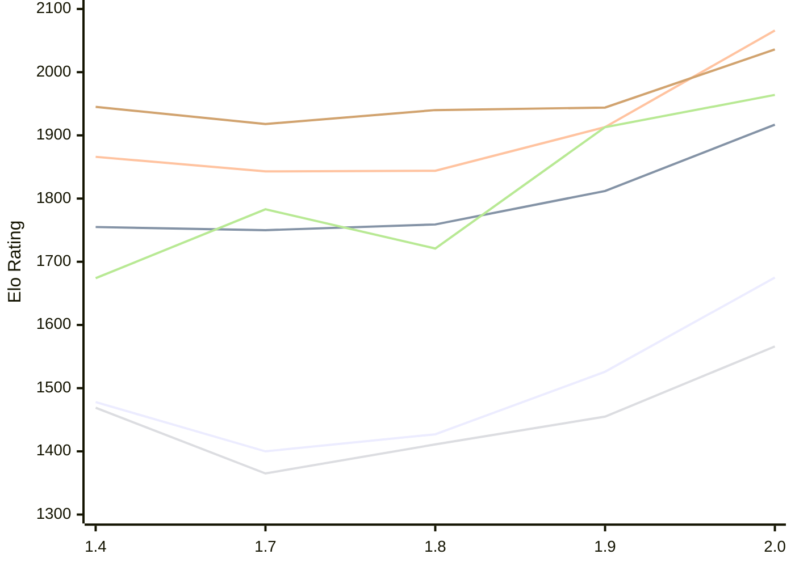

# Engine: Russell

Author: Dominic Fuentes

Home: https://github.com/stup1d1y-0bv10us/russell

## Elo Ratings E1 (Ultra 7 265T (1.50 GHz) - E-Core)

| Version | Published | STC 8.0+0.08s  | LTC 60.0+0.60s | VLTC 2m24s+1.12s | Comment |
| --- | --- | --- | --- | --- | --- |
| 2.0 | 2026-11-05 | 1675(+149) | 1917(+105) | 2066(+153) |  |
| 1.9 | 2026-10-30 | 1526(+99) | 1812(+53) | 1913(+69) |  |
| 1.8 | 2026-10-23 | 1427(+27) | 1759(+9) | 1844(+1) |  |
| 1.7 | 2026-10-16 | 1400(-78) | 1750(-5) | 1843(-23) |  |
| 1.4 | 2026-10-06 | 1478 | 1755 | 1866 |  |
 | | | cElo (∆ prev) | cElo (∆ prev) | cElo (∆ prev) | 

## Elo Ratings P1 (Ultra 7 265T (1.50 GHz) - P-Core)

| Version | Published | STC 8.0+0.08s  | LTC 60.0+0.60s | VLTC 2m24s+1.12s | Comment |
| --- | --- | --- | --- | --- | --- |
| 2.0 | 2026-11-05 | 1566(+111) | 1964(+51) | 2036(+92) |  |
| 1.9 | 2026-10-30 | 1455(+44) | 1913(+192) | 1944(+4) |  |
| 1.8 | 2026-10-23 | 1411(+46) | 1721(-62) | 1940(+22) |  |
| 1.7 | 2026-10-16 | 1365(-104) | 1783(+109) | 1918(-27) |  |
| 1.4 | 2026-10-06 | 1469 | 1674 | 1945 |  |
 | | | cElo (∆ prev) | cElo (∆ prev) | cElo (∆ prev) | 

## Elo Ratings T1 (i5-7500T 2.70GHz)

| Version | Published | STC 8.0+0.08s  | LTC 60.0+0.60s | VLTC 2m24s+1.12s | Comment |
| --- | --- | --- | --- | --- | --- |
| 1.4 | 2026-10-06 | 1469 | 1674 | 1945 |  |
 | | | cElo (∆ prev) | cElo (∆ prev) | cElo (∆ prev) | 

<a href="https://github.com/computer-chess-index/cci/issues/new?template=submit-version.yml&title=[VERSION]+Russell+<version>&body=###%20Engine%20name%0ARussell%0A%0A###%20Version%0A2.0" target="_blank">Submit new version</a>

 Test Conditions:

GUI/CLI: <a href=https://github.com/cutechess/cutechess target="_blank">Cute-Chess</a> 
Elo Calculation: <a href=https://www.remi-coulom.fr/Bayesian-Elo/ target="_blank">Bayesian-Elo</a> 
CPU for P1: Intel(R) Core(TM) Ultra 7 265T (1.50 GHz) - P-Core 
CPU for E1: Intel(R) Core(TM) Ultra 7 265T (1.50 GHz) - E-Core 
CPU for T1: Intel(R) Core(TM) i5-7500T 2.70GHz 
Opening book: 8_moves_v3 
\* STC: 8.0+0.08s, LTC: 60.0+0.60s, VLTC: 2m24s+1.12s

 Lists:
Ratings: <a href=https://github.com/computer-chess-index/cci/blob/main/lists/CCIRatings.csv target="_blank">Complete list</a>

Generated: 2026-11-09 05:42:25

## Ratings Verlauf E1 / P1

## Detailed Evaluation Results

| Version | Time Control | Variant | Elo  | Range +/- | Matches | Score | Average Opponent Elo | Draws |
| --- | --- |--- | --- | --- | --- | --- | --- | --- |
| 2.0 | VLTC (2m24s+1.12s) | P1 | 2036 | 42 | 168 | 52% | 2018 | 40% |
|  |  | E1 | 2066 | 39 | 218 | 50% | 2064 | 32% |
|  | LTC (60.0+0.60s) | P1 | 1964 | 50 | 124 | 49% | 1974 | 34% |
|  |  | E1 | 1917 | 37 | 220 | 52% | 1905 | 40% |
|  | STC (8.0+0.08s) | P1 | 1566 | 46 | 148 | 56% | 1512 | 41% |
|  |  | E1 | 1675 | 35 | 266 | 50% | 1675 | 30% |
| --- | --- |--- | --- | --- | --- | --- | --- | --- |
| 1.9 | VLTC (2m24s+1.12s) | P1 | 1944 | 52 | 116 | 53% | 1913 | 34% |
|  |  | E1 | 1913 | 39 | 212 | 51% | 1909 | 35% |
|  | LTC (60.0+0.60s) | P1 | 1913 | 49 | 136 | 49% | 1925 | 31% |
|  |  | E1 | 1812 | 36 | 264 | 54% | 1782 | 28% |
|  | STC (8.0+0.08s) | P1 | 1455 | 47 | 140 | 53% | 1434 | 37% |
|  |  | E1 | 1526 | 37 | 236 | 51% | 1513 | 32% |
| --- | --- |--- | --- | --- | --- | --- | --- | --- |
| 1.8 | VLTC (2m24s+1.12s) | P1 | 1940 | 55 | 108 | 53% | 1913 | 31% |
|  |  | E1 | 1844 | 37 | 232 | 51% | 1860 | 36% |
|  | LTC (60.0+0.60s) | P1 | 1721 | 48 | 148 | 51% | 1752 | 30% |
|  |  | E1 | 1759 | 38 | 224 | 49% | 1770 | 31% |
|  | STC (8.0+0.08s) | E1 | 1427 | 39 | 214 | 52% | 1411 | 31% |
|  |  | P1 | 1411 | 56 | 100 | 50% | 1409 | 32% |
| --- | --- |--- | --- | --- | --- | --- | --- | --- |
| 1.7 | VLTC (2m24s+1.12s) | P1 | 1918 | 53 | 120 | 43% | 2002 | 31% |
|  |  | E1 | 1843 | 39 | 214 | 49% | 1852 | 29% |
|  | LTC (60.0+0.60s) | P1 | 1783 | 54 | 108 | 51% | 1773 | 31% |
|  |  | E1 | 1750 | 40 | 208 | 52% | 1737 | 29% |
|  | STC (8.0+0.08s) | P1 | 1365 | 50 | 140 | 50% | 1391 | 25% |
|  |  | E1 | 1400 | 40 | 204 | 53% | 1377 | 28% |
| --- | --- |--- | --- | --- | --- | --- | --- | --- |
| 1.4 | VLTC (2m24s+1.12s) | E1 | 1866 | 39 | 222 | 55% | 1813 | 32% |
|  |  | P1 | 1945 | 50 | 144 | 55% | 1883 | 26% |
|  | LTC (60.0+0.60s) | E1 | 1755 | 41 | 210 | 57% | 1643 | 31% |
|  |  | P1 | 1674 | 60 | 120 | 69% | 1378 | 25% |
|  | STC (8.0+0.08s) | E1 | 1478 | 45 | 168 | 53% | 1457 | 30% |
|  |  | P1 | 1469 | 54 | 128 | 44% | 1592 | 27% |