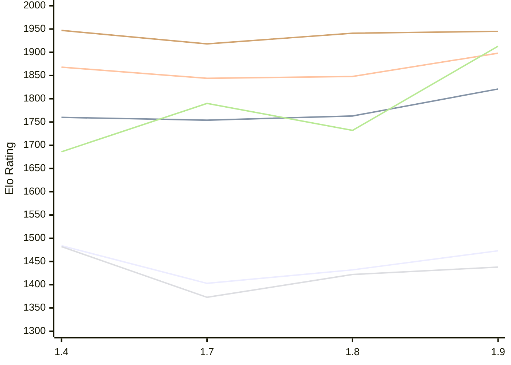

# Engine: Russell

Author: Dominic Fuentes

Home: https://github.com/stup1d1y-0bv10us/russell

## Elo Ratings E1 (Ultra 7 265T (1.50 GHz) - E-Core)

| Version | Published | STC 8.0+0.08s  | LTC 60.0+0.60s | VLTC 2m24s+1.12s | Comment |
| --- | --- | --- | --- | --- | --- |
| 1.9 | 2026-10-30 | 1473(+41) | 1821(+58) | 1898(+50) |  |
| 1.8 | 2026-10-23 | 1432(+29) | 1763(+9) | 1848(+4) |  |
| 1.7 | 2026-10-16 | 1403(-81) | 1754(-6) | 1844(-24) |  |
| 1.4 | 2026-10-06 | 1484 | 1760 | 1868 |  |
 | | | cElo (∆ prev) | cElo (∆ prev) | cElo (∆ prev) | 

## Elo Ratings P1 (Ultra 7 265T (1.50 GHz) - P-Core)

| Version | Published | STC 8.0+0.08s  | LTC 60.0+0.60s | VLTC 2m24s+1.12s | Comment |
| --- | --- | --- | --- | --- | --- |
| 1.9 | 2026-10-30 | 1438(+16) | 1913(+181) | 1945(+4) |  |
| 1.8 | 2026-10-23 | 1422(+49) | 1732(-58) | 1941(+23) |  |
| 1.7 | 2026-10-16 | 1373(-109) | 1790(+104) | 1918(-29) |  |
| 1.4 | 2026-10-06 | 1482 | 1686 | 1947 |  |
 | | | cElo (∆ prev) | cElo (∆ prev) | cElo (∆ prev) | 

## Elo Ratings T1 (i5-7500T 2.70GHz)

| Version | Published | STC 8.0+0.08s  | LTC 60.0+0.60s | VLTC 2m24s+1.12s | Comment |
| --- | --- | --- | --- | --- | --- |
| 1.4 | 2026-10-06 | 1482 | 1686 | 1947 |  |
 | | | cElo (∆ prev) | cElo (∆ prev) | cElo (∆ prev) | 

<a href="https://github.com/computer-chess-index/cci/issues/new?template=submit-version.yml&title=[VERSION]+Russell+<version>&body=###%20Engine%20name%0ARussell%0A%0A###%20Version%0A1.9" target="_blank">Submit new version</a>

 Test Conditions:

GUI/CLI: <a href=https://github.com/cutechess/cutechess target="_blank">Cute-Chess</a> 
Elo Calculation: <a href=https://www.remi-coulom.fr/Bayesian-Elo/ target="_blank">Bayesian-Elo</a> 
CPU for P1: Intel(R) Core(TM) Ultra 7 265T (1.50 GHz) - P-Core 
CPU for E1: Intel(R) Core(TM) Ultra 7 265T (1.50 GHz) - E-Core 
CPU for T1: Intel(R) Core(TM) i5-7500T 2.70GHz 
Opening book: 8_moves_v3 
\* STC: 8.0+0.08s, LTC: 60.0+0.60s, VLTC: 2m24s+1.12s

 Lists:
Ratings: <a href=https://github.com/computer-chess-index/cci/blob/main/lists/CCIRatings.csv target="_blank">Complete list</a>

Generated: 2026-11-02 19:27:28

## Ratings Verlauf E1 / P1

## Detailed Evaluation Results

| Version | Time Control | Variant | Elo  | Range +/- | Matches | Score | Average Opponent Elo | Draws |
| --- | --- |--- | --- | --- | --- | --- | --- | --- |
| 1.9 | VLTC (2m24s+1.12s) | P1 | 1945 | 63 | 80 | 55% | 1902 | 35% |
|  |  | E1 | 1898 | 48 | 132 | 49% | 1910 | 37% |
|  | LTC (60.0+0.60s) | P1 | 1913 | 57 | 100 | 47% | 1937 | 30% |
|  |  | E1 | 1821 | 42 | 192 | 57% | 1763 | 29% |
|  | STC (8.0+0.08s) | P1 | 1438 | 65 | 72 | 53% | 1419 | 39% |
|  |  | E1 | 1473 | 50 | 128 | 47% | 1497 | 34% |
| --- | --- |--- | --- | --- | --- | --- | --- | --- |
| 1.8 | VLTC (2m24s+1.12s) | E1 | 1848 | 37 | 232 | 51% | 1864 | 36% |
|  |  | P1 | 1941 | 55 | 108 | 53% | 1916 | 31% |
|  | LTC (60.0+0.60s) | E1 | 1763 | 38 | 224 | 49% | 1774 | 31% |
|  |  | P1 | 1732 | 48 | 148 | 51% | 1763 | 30% |
|  | STC (8.0+0.08s) | E1 | 1432 | 39 | 214 | 52% | 1416 | 31% |
|  |  | P1 | 1422 | 56 | 100 | 50% | 1422 | 32% |
| --- | --- |--- | --- | --- | --- | --- | --- | --- |
| 1.7 | VLTC (2m24s+1.12s) | P1 | 1918 | 53 | 120 | 43% | 2002 | 31% |
|  |  | E1 | 1844 | 39 | 214 | 49% | 1854 | 29% |
|  | LTC (60.0+0.60s) | P1 | 1790 | 54 | 108 | 51% | 1779 | 31% |
|  |  | E1 | 1754 | 40 | 208 | 52% | 1743 | 29% |
|  | STC (8.0+0.08s) | P1 | 1373 | 50 | 140 | 50% | 1399 | 25% |
|  |  | E1 | 1403 | 40 | 204 | 53% | 1381 | 28% |
| --- | --- |--- | --- | --- | --- | --- | --- | --- |
| 1.4 | VLTC (2m24s+1.12s) | E1 | 1868 | 39 | 222 | 55% | 1817 | 32% |
|  |  | P1 | 1947 | 50 | 144 | 55% | 1885 | 26% |
|  | LTC (60.0+0.60s) | P1 | 1686 | 60 | 120 | 69% | 1386 | 25% |
|  |  | E1 | 1760 | 41 | 210 | 57% | 1647 | 31% |
|  | STC (8.0+0.08s) | P1 | 1482 | 54 | 128 | 44% | 1602 | 27% |
|  |  | E1 | 1484 | 45 | 168 | 53% | 1462 | 30% |