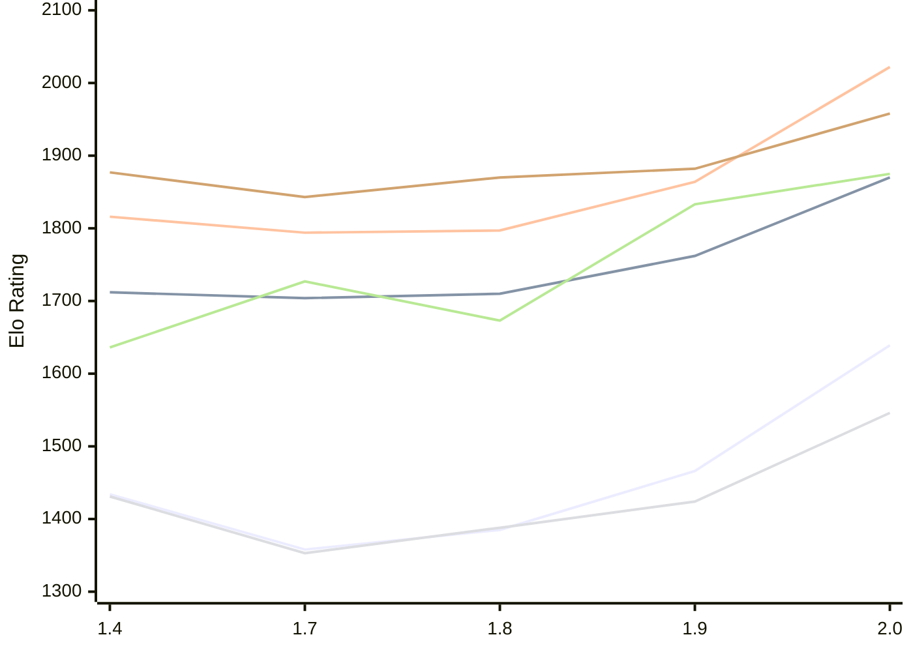

# Engine: Russell

Author: Dominic Fuentes

Home: https://github.com/stup1d1y-0bv10us/russell

## Elo Ratings E1 (Ultra 7 265T (1.50 GHz) - E-Core)

| Version | Published | STC 8.0+0.08s  | LTC 60.0+0.60s | VLTC 2m24s+1.12s | Comment |
| --- | --- | --- | --- | --- | --- |
| 2.0 | 2026-11-05 | 1639(+173) | 1870(+108) | 2022(+158) |  |
| 1.9 | 2026-10-30 | 1466(+81) | 1762(+52) | 1864(+67) |  |
| 1.8 | 2026-10-23 | 1385(+27) | 1710(+6) | 1797(+3) |  |
| 1.7 | 2026-10-16 | 1358(-76) | 1704(-8) | 1794(-22) |  |
| 1.4 | 2026-10-06 | 1434 | 1712 | 1816 |  |
 | | | cElo (∆ prev) | cElo (∆ prev) | cElo (∆ prev) | 

## Elo Ratings P1 (Ultra 7 265T (1.50 GHz) - P-Core)

| Version | Published | STC 8.0+0.08s  | LTC 60.0+0.60s | VLTC 2m24s+1.12s | Comment |
| --- | --- | --- | --- | --- | --- |
| 2.0 | 2026-11-05 | 1546(+122) | 1875(+42) | 1958(+76) |  |
| 1.9 | 2026-10-30 | 1424(+36) | 1833(+160) | 1882(+12) |  |
| 1.8 | 2026-10-23 | 1388(+35) | 1673(-54) | 1870(+27) |  |
| 1.7 | 2026-10-16 | 1353(-78) | 1727(+91) | 1843(-34) |  |
| 1.4 | 2026-10-06 | 1431 | 1636 | 1877 |  |
 | | | cElo (∆ prev) | cElo (∆ prev) | cElo (∆ prev) | 

## Elo Ratings T1 (i5-7500T 2.70GHz)

| Version | Published | STC 8.0+0.08s  | LTC 60.0+0.60s | VLTC 2m24s+1.12s | Comment |
| --- | --- | --- | --- | --- | --- |
| 1.4 | 2026-10-06 | 1431 | 1636 | 1877 |  |
 | | | cElo (∆ prev) | cElo (∆ prev) | cElo (∆ prev) | 

<a href="https://github.com/computer-chess-index/cci/issues/new?template=submit-version.yml&title=[VERSION]+Russell+<version>&body=###%20Engine%20name%0ARussell%0A%0A###%20Version%0A2.0" target="_blank">Submit new version</a>

 Test Conditions:

GUI/CLI: <a href=https://github.com/cutechess/cutechess target="_blank">Cute-Chess</a> 
Elo Calculation: <a href=https://www.remi-coulom.fr/Bayesian-Elo/ target="_blank">Bayesian-Elo</a> 
CPU for P1: Intel(R) Core(TM) Ultra 7 265T (1.50 GHz) - P-Core 
CPU for E1: Intel(R) Core(TM) Ultra 7 265T (1.50 GHz) - E-Core 
CPU for T1: Intel(R) Core(TM) i5-7500T 2.70GHz 
Opening book: 8_moves_v3 
\* STC: 8.0+0.08s, LTC: 60.0+0.60s, VLTC: 2m24s+1.12s

 Lists:
Ratings: <a href=https://github.com/computer-chess-index/cci/blob/main/lists/CCIRatings.csv target="_blank">Complete list</a>

Generated: 2026-11-21 05:42:22

## Ratings Verlauf E1 / P1

## Detailed Evaluation Results

| Version | Time Control | Variant | Elo  | Range +/- | Matches | Score | Average Opponent Elo | Draws |
| --- | --- |--- | --- | --- | --- | --- | --- | --- |
| 2.0 | VLTC (2m24s+1.12s) | E1 | 2022 | 36 | 246 | 50% | 2025 | 32% |
|  |  | P1 | 1958 | 39 | 200 | 53% | 1928 | 38% |
|  | LTC (60.0+0.60s) | E1 | 1870 | 33 | 288 | 51% | 1862 | 41% |
|  |  | P1 | 1875 | 45 | 160 | 50% | 1881 | 34% |
|  | STC (8.0+0.08s) | E1 | 1639 | 32 | 318 | 51% | 1632 | 31% |
|  |  | P1 | 1546 | 37 | 230 | 55% | 1497 | 40% |
| --- | --- |--- | --- | --- | --- | --- | --- | --- |
| 1.9 | VLTC (2m24s+1.12s) | P1 | 1882 | 46 | 152 | 55% | 1837 | 32% |
|  |  | E1 | 1864 | 36 | 252 | 51% | 1867 | 34% |
|  | LTC (60.0+0.60s) | P1 | 1833 | 41 | 188 | 47% | 1867 | 34% |
|  |  | E1 | 1762 | 34 | 300 | 53% | 1740 | 30% |
|  | STC (8.0+0.08s) | P1 | 1424 | 42 | 190 | 56% | 1366 | 34% |
|  |  | E1 | 1466 | 35 | 260 | 50% | 1467 | 32% |
| --- | --- |--- | --- | --- | --- | --- | --- | --- |
| 1.8 | VLTC (2m24s+1.12s) | P1 | 1870 | 55 | 108 | 53% | 1843 | 31% |
|  |  | E1 | 1797 | 37 | 232 | 51% | 1812 | 36% |
|  | LTC (60.0+0.60s) | P1 | 1673 | 48 | 148 | 51% | 1700 | 30% |
|  |  | E1 | 1710 | 38 | 224 | 49% | 1723 | 31% |
|  | STC (8.0+0.08s) | P1 | 1388 | 56 | 100 | 50% | 1388 | 32% |
|  |  | E1 | 1385 | 39 | 214 | 52% | 1369 | 31% |
| --- | --- |--- | --- | --- | --- | --- | --- | --- |
| 1.7 | VLTC (2m24s+1.12s) | P1 | 1843 | 53 | 120 | 43% | 1924 | 31% |
|  |  | E1 | 1794 | 39 | 214 | 49% | 1804 | 29% |
|  | LTC (60.0+0.60s) | P1 | 1727 | 54 | 108 | 51% | 1717 | 31% |
|  |  | E1 | 1704 | 40 | 208 | 52% | 1693 | 29% |
|  | STC (8.0+0.08s) | E1 | 1358 | 40 | 204 | 53% | 1335 | 28% |
|  |  | P1 | 1353 | 50 | 140 | 50% | 1376 | 25% |
| --- | --- |--- | --- | --- | --- | --- | --- | --- |
| 1.4 | VLTC (2m24s+1.12s) | P1 | 1877 | 50 | 144 | 55% | 1816 | 26% |
|  |  | E1 | 1816 | 39 | 222 | 55% | 1764 | 32% |
|  | LTC (60.0+0.60s) | P1 | 1636 | 59 | 120 | 69% | 1350 | 25% |
|  |  | E1 | 1712 | 41 | 210 | 57% | 1602 | 31% |
|  | STC (8.0+0.08s) | P1 | 1431 | 54 | 128 | 44% | 1547 | 27% |
|  |  | E1 | 1434 | 45 | 168 | 53% | 1412 | 30% |