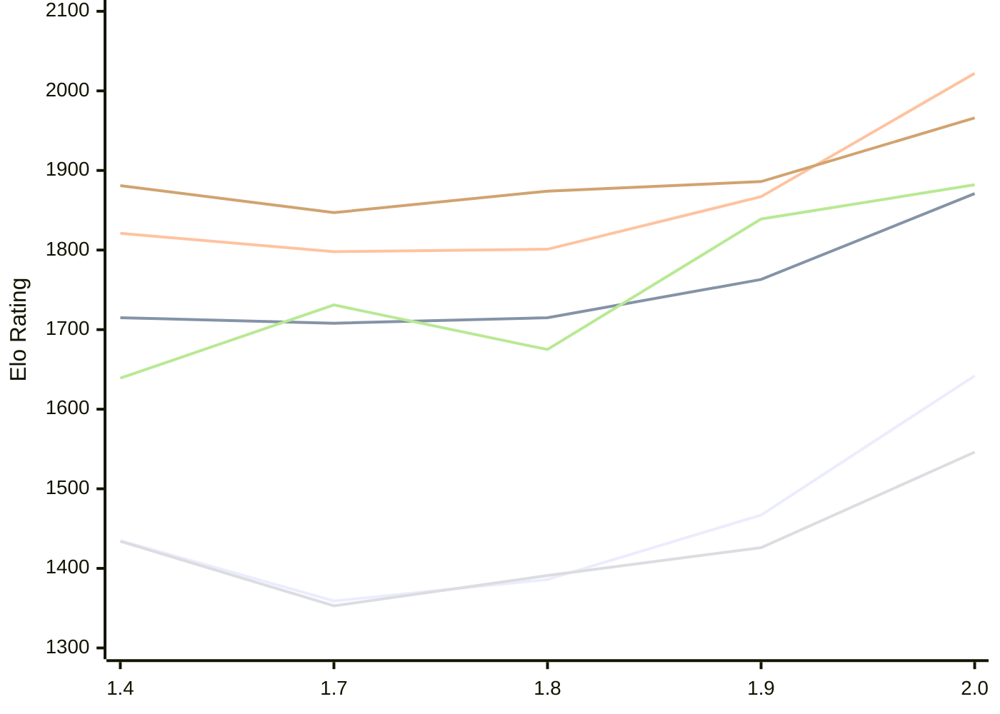

# Engine: Russell

Author: Dominic Fuentes

Home: https://github.com/stup1d1y-0bv10us/russell

## Elo Ratings E1 (Ultra 7 265T (1.50 GHz) - E-Core)

| Version | Published | STC 8.0+0.08s  | LTC 60.0+0.60s | VLTC 2m24s+1.12s | Comment |
| --- | --- | --- | --- | --- | --- |
| 2.0 | 2026-11-05 | 1642(+175) | 1871(+108) | 2022(+155) |  |
| 1.9 | 2026-10-30 | 1467(+81) | 1763(+48) | 1867(+66) |  |
| 1.8 | 2026-10-23 | 1386(+27) | 1715(+7) | 1801(+3) |  |
| 1.7 | 2026-10-16 | 1359(-76) | 1708(-7) | 1798(-23) |  |
| 1.4 | 2026-10-06 | 1435 | 1715 | 1821 |  |
 | | | cElo (∆ prev) | cElo (∆ prev) | cElo (∆ prev) | 

## Elo Ratings P1 (Ultra 7 265T (1.50 GHz) - P-Core)

| Version | Published | STC 8.0+0.08s  | LTC 60.0+0.60s | VLTC 2m24s+1.12s | Comment |
| --- | --- | --- | --- | --- | --- |
| 2.0 | 2026-11-05 | 1546(+120) | 1882(+43) | 1966(+80) |  |
| 1.9 | 2026-10-30 | 1426(+35) | 1839(+164) | 1886(+12) |  |
| 1.8 | 2026-10-23 | 1391(+38) | 1675(-56) | 1874(+27) |  |
| 1.7 | 2026-10-16 | 1353(-81) | 1731(+92) | 1847(-34) |  |
| 1.4 | 2026-10-06 | 1434 | 1639 | 1881 |  |
 | | | cElo (∆ prev) | cElo (∆ prev) | cElo (∆ prev) | 

## Elo Ratings T1 (i5-7500T 2.70GHz)

| Version | Published | STC 8.0+0.08s  | LTC 60.0+0.60s | VLTC 2m24s+1.12s | Comment |
| --- | --- | --- | --- | --- | --- |
| 1.4 | 2026-10-06 | 1434 | 1639 | 1881 |  |
 | | | cElo (∆ prev) | cElo (∆ prev) | cElo (∆ prev) | 

<a href="https://github.com/computer-chess-index/cci/issues/new?template=submit-version.yml&title=[VERSION]+Russell+<version>&body=###%20Engine%20name%0ARussell%0A%0A###%20Version%0A2.0" target="_blank">Submit new version</a>

 Test Conditions:

GUI/CLI: <a href=https://github.com/cutechess/cutechess target="_blank">Cute-Chess</a> 
Elo Calculation: <a href=https://www.remi-coulom.fr/Bayesian-Elo/ target="_blank">Bayesian-Elo</a> 
CPU for P1: Intel(R) Core(TM) Ultra 7 265T (1.50 GHz) - P-Core 
CPU for E1: Intel(R) Core(TM) Ultra 7 265T (1.50 GHz) - E-Core 
CPU for T1: Intel(R) Core(TM) i5-7500T 2.70GHz 
Opening book: 8_moves_v3 
\* STC: 8.0+0.08s, LTC: 60.0+0.60s, VLTC: 2m24s+1.12s

 Lists:
Ratings: <a href=https://github.com/computer-chess-index/cci/blob/main/lists/CCIRatings.csv target="_blank">Complete list</a>

Generated: 2026-11-24 05:42:42

## Ratings Verlauf E1 / P1

## Detailed Evaluation Results

| Version | Time Control | Variant | Elo  | Range +/- | Matches | Score | Average Opponent Elo | Draws |
| --- | --- |--- | --- | --- | --- | --- | --- | --- |
| 2.0 | VLTC (2m24s+1.12s) | P1 | 1966 | 39 | 204 | 53% | 1933 | 38% |
|  |  | E1 | 2022 | 36 | 250 | 50% | 2025 | 32% |
|  | LTC (60.0+0.60s) | P1 | 1882 | 44 | 164 | 50% | 1883 | 34% |
|  |  | E1 | 1871 | 32 | 296 | 51% | 1864 | 41% |
|  | STC (8.0+0.08s) | P1 | 1546 | 36 | 234 | 55% | 1500 | 41% |
|  |  | E1 | 1642 | 32 | 318 | 51% | 1635 | 31% |
| --- | --- |--- | --- | --- | --- | --- | --- | --- |
| 1.9 | VLTC (2m24s+1.12s) | E1 | 1867 | 36 | 252 | 51% | 1868 | 34% |
|  |  | P1 | 1886 | 46 | 152 | 55% | 1841 | 32% |
|  | LTC (60.0+0.60s) | P1 | 1839 | 42 | 188 | 47% | 1872 | 34% |
|  |  | E1 | 1763 | 33 | 304 | 52% | 1746 | 31% |
|  | STC (8.0+0.08s) | P1 | 1426 | 42 | 190 | 56% | 1368 | 34% |
|  |  | E1 | 1467 | 36 | 260 | 50% | 1467 | 32% |
| --- | --- |--- | --- | --- | --- | --- | --- | --- |
| 1.8 | VLTC (2m24s+1.12s) | P1 | 1874 | 55 | 108 | 53% | 1847 | 31% |
|  |  | E1 | 1801 | 37 | 232 | 51% | 1816 | 36% |
|  | LTC (60.0+0.60s) | P1 | 1675 | 48 | 148 | 51% | 1702 | 30% |
|  |  | E1 | 1715 | 38 | 224 | 49% | 1727 | 31% |
|  | STC (8.0+0.08s) | P1 | 1391 | 56 | 100 | 50% | 1389 | 32% |
|  |  | E1 | 1386 | 39 | 214 | 52% | 1370 | 31% |
| --- | --- |--- | --- | --- | --- | --- | --- | --- |
| 1.7 | VLTC (2m24s+1.12s) | P1 | 1847 | 53 | 120 | 43% | 1928 | 31% |
|  |  | E1 | 1798 | 39 | 214 | 49% | 1808 | 29% |
|  | LTC (60.0+0.60s) | P1 | 1731 | 54 | 108 | 51% | 1720 | 31% |
|  |  | E1 | 1708 | 40 | 208 | 52% | 1697 | 29% |
|  | STC (8.0+0.08s) | P1 | 1353 | 50 | 140 | 50% | 1376 | 25% |
|  |  | E1 | 1359 | 40 | 204 | 53% | 1338 | 28% |
| --- | --- |--- | --- | --- | --- | --- | --- | --- |
| 1.4 | VLTC (2m24s+1.12s) | P1 | 1881 | 50 | 144 | 55% | 1821 | 26% |
|  |  | E1 | 1821 | 39 | 222 | 55% | 1769 | 32% |
|  | LTC (60.0+0.60s) | P1 | 1639 | 59 | 120 | 69% | 1351 | 25% |
|  |  | E1 | 1715 | 41 | 210 | 57% | 1605 | 31% |
|  | STC (8.0+0.08s) | E1 | 1435 | 45 | 168 | 53% | 1413 | 30% |
|  |  | P1 | 1434 | 54 | 128 | 44% | 1550 | 27% |