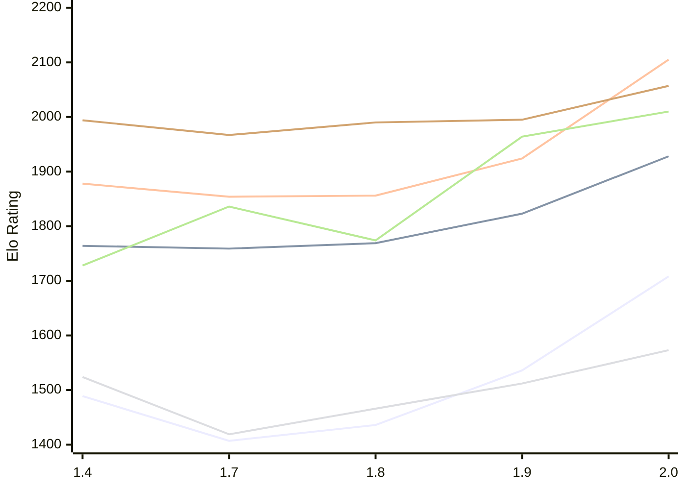

# Engine: Russell

Author: Dominic Fuentes

Home: https://github.com/stup1d1y-0bv10us/russell

## Elo Ratings E1 (Ultra 7 265T (1.50 GHz) - E-Core)

| Version | Published | STC 8.0+0.08s  | LTC 60.0+0.60s | VLTC 2m24s+1.12s | Comment |
| --- | --- | --- | --- | --- | --- |
| 2.0 | 2026-11-05 | 1708(+172) | 1928(+105) | 2105(+181) |  |
| 1.9 | 2026-10-30 | 1536(+100) | 1823(+54) | 1924(+68) |  |
| 1.8 | 2026-10-23 | 1436(+29) | 1769(+10) | 1856(+2) |  |
| 1.7 | 2026-10-16 | 1407(-82) | 1759(-5) | 1854(-24) |  |
| 1.4 | 2026-10-06 | 1489 | 1764 | 1878 |  |
 | | | cElo (∆ prev) | cElo (∆ prev) | cElo (∆ prev) | 

## Elo Ratings P1 (Ultra 7 265T (1.50 GHz) - P-Core)

| Version | Published | STC 8.0+0.08s  | LTC 60.0+0.60s | VLTC 2m24s+1.12s | Comment |
| --- | --- | --- | --- | --- | --- |
| 2.0 | 2026-11-05 | 1573(+61) | 2010(+46) | 2057(+62) |  |
| 1.9 | 2026-10-30 | 1512(+46) | 1964(+190) | 1995(+5) |  |
| 1.8 | 2026-10-23 | 1466(+47) | 1774(-62) | 1990(+23) |  |
| 1.7 | 2026-10-16 | 1419(-105) | 1836(+108) | 1967(-27) |  |
| 1.4 | 2026-10-06 | 1524 | 1728 | 1994 |  |
 | | | cElo (∆ prev) | cElo (∆ prev) | cElo (∆ prev) | 

## Elo Ratings T1 (i5-7500T 2.70GHz)

| Version | Published | STC 8.0+0.08s  | LTC 60.0+0.60s | VLTC 2m24s+1.12s | Comment |
| --- | --- | --- | --- | --- | --- |
| 1.4 | 2026-10-06 | 1524 | 1728 | 1994 |  |
 | | | cElo (∆ prev) | cElo (∆ prev) | cElo (∆ prev) | 

<a href="https://github.com/computer-chess-index/cci/issues/new?template=submit-version.yml&title=[VERSION]+Russell+<version>&body=###%20Engine%20name%0ARussell%0A%0A###%20Version%0A2.0" target="_blank">Submit new version</a>

 Test Conditions:

GUI/CLI: <a href=https://github.com/cutechess/cutechess target="_blank">Cute-Chess</a> 
Elo Calculation: <a href=https://www.remi-coulom.fr/Bayesian-Elo/ target="_blank">Bayesian-Elo</a> 
CPU for P1: Intel(R) Core(TM) Ultra 7 265T (1.50 GHz) - P-Core 
CPU for E1: Intel(R) Core(TM) Ultra 7 265T (1.50 GHz) - E-Core 
CPU for T1: Intel(R) Core(TM) i5-7500T 2.70GHz 
Opening book: 8_moves_v3 
\* STC: 8.0+0.08s, LTC: 60.0+0.60s, VLTC: 2m24s+1.12s

 Lists:
Ratings: <a href=https://github.com/computer-chess-index/cci/blob/main/lists/CCIRatings.csv target="_blank">Complete list</a>

Generated: 2026-11-06 05:42:12

## Ratings Verlauf E1 / P1

## Detailed Evaluation Results

| Version | Time Control | Variant | Elo  | Range +/- | Matches | Score | Average Opponent Elo | Draws |
| --- | --- |--- | --- | --- | --- | --- | --- | --- |
| 2.0 | VLTC (2m24s+1.12s) | P1 | 2057 | 60 | 84 | 51% | 2053 | 37% |
|  |  | E1 | 2105 | 54 | 104 | 54% | 2066 | 39% |
|  | LTC (60.0+0.60s) | P1 | 2010 | 63 | 76 | 49% | 2024 | 39% |
|  |  | E1 | 1928 | 56 | 96 | 54% | 1898 | 39% |
|  | STC (8.0+0.08s) | P1 | 1573 | 67 | 70 | 57% | 1509 | 37% |
|  |  | E1 | 1708 | 54 | 110 | 51% | 1697 | 35% |
| --- | --- |--- | --- | --- | --- | --- | --- | --- |
| 1.9 | VLTC (2m24s+1.12s) | P1 | 1995 | 52 | 116 | 53% | 1964 | 34% |
|  |  | E1 | 1924 | 39 | 208 | 50% | 1922 | 36% |
|  | LTC (60.0+0.60s) | E1 | 1823 | 36 | 264 | 54% | 1793 | 28% |
|  |  | P1 | 1964 | 49 | 136 | 49% | 1976 | 31% |
|  | STC (8.0+0.08s) | E1 | 1536 | 37 | 232 | 52% | 1521 | 32% |
|  |  | P1 | 1512 | 47 | 140 | 53% | 1489 | 37% |
| --- | --- |--- | --- | --- | --- | --- | --- | --- |
| 1.8 | VLTC (2m24s+1.12s) | P1 | 1990 | 55 | 108 | 53% | 1964 | 31% |
|  |  | E1 | 1856 | 37 | 232 | 51% | 1872 | 36% |
|  | LTC (60.0+0.60s) | P1 | 1774 | 48 | 148 | 51% | 1805 | 30% |
|  |  | E1 | 1769 | 38 | 224 | 49% | 1779 | 31% |
|  | STC (8.0+0.08s) | P1 | 1466 | 56 | 100 | 50% | 1466 | 32% |
|  |  | E1 | 1436 | 39 | 214 | 52% | 1420 | 31% |
| --- | --- |--- | --- | --- | --- | --- | --- | --- |
| 1.7 | VLTC (2m24s+1.12s) | P1 | 1967 | 53 | 120 | 43% | 2049 | 31% |
|  |  | E1 | 1854 | 39 | 214 | 49% | 1863 | 29% |
|  | LTC (60.0+0.60s) | P1 | 1836 | 54 | 108 | 51% | 1825 | 31% |
|  |  | E1 | 1759 | 40 | 208 | 52% | 1748 | 29% |
|  | STC (8.0+0.08s) | P1 | 1419 | 50 | 140 | 50% | 1443 | 25% |
|  |  | E1 | 1407 | 40 | 204 | 53% | 1385 | 28% |
| --- | --- |--- | --- | --- | --- | --- | --- | --- |
| 1.4 | VLTC (2m24s+1.12s) | P1 | 1994 | 50 | 144 | 55% | 1932 | 26% |
|  |  | E1 | 1878 | 39 | 222 | 55% | 1825 | 32% |
|  | LTC (60.0+0.60s) | P1 | 1728 | 60 | 120 | 69% | 1423 | 25% |
|  |  | E1 | 1764 | 41 | 210 | 57% | 1651 | 31% |
|  | STC (8.0+0.08s) | P1 | 1524 | 54 | 128 | 44% | 1647 | 27% |
|  |  | E1 | 1489 | 45 | 168 | 53% | 1467 | 30% |