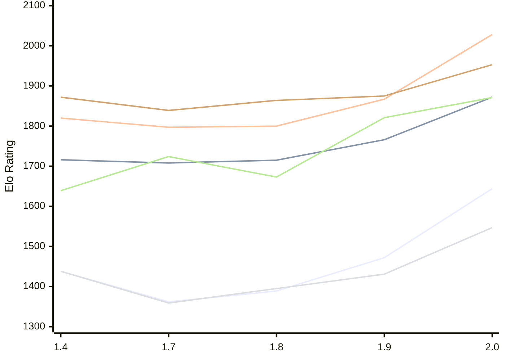

# Engine: Russell

Author: Dominic Fuentes

Home: https://github.com/stup1d1y-0bv10us/russell

## Elo Ratings E1 (Ultra 7 265T (1.50 GHz) - E-Core)

| Version | Published | STC 8.0+0.08s  | LTC 60.0+0.60s | VLTC 2m24s+1.12s | Comment |
| --- | --- | --- | --- | --- | --- |
| 2.0 | 2026-11-05 | 1644(+172) | 1872(+106) | 2028(+161) |  |
| 1.9 | 2026-10-30 | 1472(+83) | 1766(+51) | 1867(+67) |  |
| 1.8 | 2026-10-23 | 1389(+27) | 1715(+7) | 1800(+3) |  |
| 1.7 | 2026-10-16 | 1362(-76) | 1708(-8) | 1797(-23) |  |
| 1.4 | 2026-10-06 | 1438 | 1716 | 1820 |  |
 | | | cElo (∆ prev) | cElo (∆ prev) | cElo (∆ prev) | 

## Elo Ratings P1 (Ultra 7 265T (1.50 GHz) - P-Core)

| Version | Published | STC 8.0+0.08s  | LTC 60.0+0.60s | VLTC 2m24s+1.12s | Comment |
| --- | --- | --- | --- | --- | --- |
| 2.0 | 2026-11-05 | 1547(+116) | 1871(+50) | 1953(+78) |  |
| 1.9 | 2026-10-30 | 1431(+36) | 1821(+148) | 1875(+11) |  |
| 1.8 | 2026-10-23 | 1395(+36) | 1673(-51) | 1864(+25) |  |
| 1.7 | 2026-10-16 | 1359(-79) | 1724(+85) | 1839(-33) |  |
| 1.4 | 2026-10-06 | 1438 | 1639 | 1872 |  |
 | | | cElo (∆ prev) | cElo (∆ prev) | cElo (∆ prev) | 

## Elo Ratings T1 (i5-7500T 2.70GHz)

| Version | Published | STC 8.0+0.08s  | LTC 60.0+0.60s | VLTC 2m24s+1.12s | Comment |
| --- | --- | --- | --- | --- | --- |
| 1.4 | 2026-10-06 | 1438 | 1639 | 1872 |  |
 | | | cElo (∆ prev) | cElo (∆ prev) | cElo (∆ prev) | 

<a href="https://github.com/computer-chess-index/cci/issues/new?template=submit-version.yml&title=[VERSION]+Russell+<version>&body=###%20Engine%20name%0ARussell%0A%0A###%20Version%0A2.0" target="_blank">Submit new version</a>

 Test Conditions:

GUI/CLI: <a href=https://github.com/cutechess/cutechess target="_blank">Cute-Chess</a> 
Elo Calculation: <a href=https://www.remi-coulom.fr/Bayesian-Elo/ target="_blank">Bayesian-Elo</a> 
CPU for P1: Intel(R) Core(TM) Ultra 7 265T (1.50 GHz) - P-Core 
CPU for E1: Intel(R) Core(TM) Ultra 7 265T (1.50 GHz) - E-Core 
CPU for T1: Intel(R) Core(TM) i5-7500T 2.70GHz 
Opening book: 8_moves_v3 
\* STC: 8.0+0.08s, LTC: 60.0+0.60s, VLTC: 2m24s+1.12s

 Lists:
Ratings: <a href=https://github.com/computer-chess-index/cci/blob/main/lists/CCIRatings.csv target="_blank">Complete list</a>

Generated: 2026-11-19 05:42:52

## Ratings Verlauf E1 / P1

## Detailed Evaluation Results

| Version | Time Control | Variant | Elo  | Range +/- | Matches | Score | Average Opponent Elo | Draws |
| --- | --- |--- | --- | --- | --- | --- | --- | --- |
| 2.0 | VLTC (2m24s+1.12s) | P1 | 1953 | 39 | 200 | 53% | 1924 | 38% |
|  |  | E1 | 2028 | 37 | 242 | 50% | 2026 | 32% |
|  | LTC (60.0+0.60s) | P1 | 1871 | 45 | 160 | 50% | 1877 | 34% |
|  |  | E1 | 1872 | 33 | 288 | 51% | 1864 | 41% |
|  | STC (8.0+0.08s) | P1 | 1547 | 37 | 230 | 55% | 1499 | 40% |
|  |  | E1 | 1644 | 32 | 318 | 51% | 1636 | 31% |
| --- | --- |--- | --- | --- | --- | --- | --- | --- |
| 1.9 | VLTC (2m24s+1.12s) | E1 | 1867 | 36 | 252 | 51% | 1870 | 34% |
|  |  | P1 | 1875 | 47 | 148 | 55% | 1832 | 32% |
|  | LTC (60.0+0.60s) | P1 | 1821 | 43 | 176 | 46% | 1864 | 32% |
|  |  | E1 | 1766 | 34 | 300 | 53% | 1744 | 30% |
|  | STC (8.0+0.08s) | P1 | 1431 | 42 | 182 | 56% | 1370 | 35% |
|  |  | E1 | 1472 | 35 | 260 | 50% | 1472 | 32% |
| --- | --- |--- | --- | --- | --- | --- | --- | --- |
| 1.8 | VLTC (2m24s+1.12s) | P1 | 1864 | 55 | 108 | 53% | 1837 | 31% |
|  |  | E1 | 1800 | 37 | 232 | 51% | 1816 | 36% |
|  | LTC (60.0+0.60s) | P1 | 1673 | 48 | 148 | 51% | 1698 | 30% |
|  |  | E1 | 1715 | 38 | 224 | 49% | 1725 | 31% |
|  | STC (8.0+0.08s) | P1 | 1395 | 56 | 100 | 50% | 1395 | 32% |
|  |  | E1 | 1389 | 39 | 214 | 52% | 1373 | 31% |
| --- | --- |--- | --- | --- | --- | --- | --- | --- |
| 1.7 | VLTC (2m24s+1.12s) | P1 | 1839 | 53 | 120 | 43% | 1920 | 31% |
|  |  | E1 | 1797 | 39 | 214 | 49% | 1808 | 29% |
|  | LTC (60.0+0.60s) | P1 | 1724 | 54 | 108 | 51% | 1713 | 31% |
|  |  | E1 | 1708 | 40 | 208 | 52% | 1697 | 29% |
|  | STC (8.0+0.08s) | P1 | 1359 | 50 | 140 | 50% | 1381 | 25% |
|  |  | E1 | 1362 | 40 | 204 | 53% | 1341 | 28% |
| --- | --- |--- | --- | --- | --- | --- | --- | --- |
| 1.4 | VLTC (2m24s+1.12s) | P1 | 1872 | 50 | 144 | 55% | 1813 | 26% |
|  |  | E1 | 1820 | 39 | 222 | 55% | 1767 | 32% |
|  | LTC (60.0+0.60s) | P1 | 1639 | 59 | 120 | 69% | 1351 | 25% |
|  |  | E1 | 1716 | 41 | 210 | 57% | 1607 | 31% |
|  | STC (8.0+0.08s) | E1 | 1438 | 45 | 168 | 53% | 1418 | 30% |
|  |  | P1 | 1438 | 54 | 128 | 44% | 1553 | 27% |