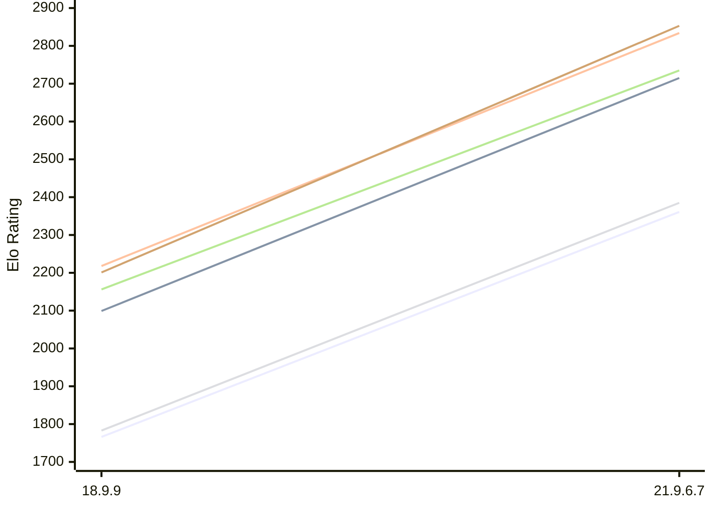

# Engine: RuthIron

Author: Emre Kalkan

Home: https://github.com/themreKalkan/RuthIron

## Elo Ratings E1 (Ultra 7 265T (1.50 GHz) - E-Core)

| Version | Published | STC 8.0+0.08s  | LTC 60.0+0.60s | VLTC 2m24s+1.12s | Comment |
| --- | --- | --- | --- | --- | --- |
| 21.9.6.7 | 2026-02-28 | 2361(+595) | 2715(+616) | 2834(+616) |  |
| 18.9.9 | 2026-01-16 | 1766 | 2099 | 2218 | Loses on time |
 | | | cElo (∆ prev) | cElo (∆ prev) | cElo (∆ prev) | 

## Elo Ratings P1 (Ultra 7 265T (1.50 GHz) - P-Core)

| Version | Published | STC 8.0+0.08s  | LTC 60.0+0.60s | VLTC 2m24s+1.12s | Comment |
| --- | --- | --- | --- | --- | --- |
| 21.9.6.7 | 2026-02-28 | 2385(+602) | 2735(+579) | 2853(+652) |  |
| 18.9.9 | 2026-01-16 | 1783 | 2156 | 2201 | Loses on time |
 | | | cElo (∆ prev) | cElo (∆ prev) | cElo (∆ prev) | 

## Elo Ratings T1 (i5-7500T 2.70GHz)

| Version | Published | STC 8.0+0.08s  | LTC 60.0+0.60s | VLTC 2m24s+1.12s | Comment |
| --- | --- | --- | --- | --- | --- |
| 21.9.6.7 | 2026-02-28 | 2415 | 2754 | 2861 |  |
 | | | cElo (∆ prev) | cElo (∆ prev) | cElo (∆ prev) | 

<a href="https://github.com/computer-chess-index/cci/issues/new?template=submit-version.yml&title=[VERSION]+RuthIron+<version>&body=###%20Engine%20name%0ARuthIron%0A%0A###%20Version%0A21.9.6.7" target="_blank">Submit new version</a>

 Test Conditions:

GUI/CLI: <a href=https://github.com/cutechess/cutechess target="_blank">Cute-Chess</a> 
Elo Calculation: <a href=https://www.remi-coulom.fr/Bayesian-Elo/ target="_blank">Bayesian-Elo</a> 
CPU for P1: Intel(R) Core(TM) Ultra 7 265T (1.50 GHz) - P-Core 
CPU for E1: Intel(R) Core(TM) Ultra 7 265T (1.50 GHz) - E-Core 
CPU for T1: Intel(R) Core(TM) i5-7500T 2.70GHz 
Opening book: 8_moves_v3 
\* STC: 8.0+0.08s, LTC: 60.0+0.60s, VLTC: 2m24s+1.12s

 Lists:
Ratings: <a href=https://github.com/computer-chess-index/cci/blob/main/lists/CCIRatings.csv target="_blank">Complete list</a>

Generated: 2026-11-26 05:43:06

## Ratings Verlauf E1 / P1

## Detailed Evaluation Results

| Version | Time Control | Variant | Elo  | Range +/- | Matches | Score | Average Opponent Elo | Draws |
| --- | --- |--- | --- | --- | --- | --- | --- | --- |
| 21.9.6.7 | VLTC (2m24s+1.12s) | T1 | 2861 | 24 | 534 | 50% | 2861 | 41% |
|  |  | P1 | 2853 | 31 | 320 | 49% | 2876 | 43% |
|  |  | E1 | 2834 | 30 | 382 | 50% | 2816 | 33% |
|  | LTC (60.0+0.60s) | T1 | 2754 | 24 | 564 | 50% | 2758 | 38% |
|  |  | P1 | 2735 | 34 | 296 | 50% | 2730 | 34% |
|  |  | E1 | 2715 | 28 | 452 | 49% | 2704 | 30% |
|  | STC (8.0+0.08s) | T1 | 2415 | 23 | 686 | 49% | 2433 | 28% |
|  |  | P1 | 2385 | 33 | 310 | 47% | 2426 | 33% |
|  |  | E1 | 2361 | 29 | 390 | 47% | 2394 | 31% |
| --- | --- |--- | --- | --- | --- | --- | --- | --- |
| 18.9.9 | VLTC (2m24s+1.12s) | E1 | 2218 | 59 | 106 | 48% | 2241 | 19% |
|  |  | P1 | 2201 | 66 | 88 | 49% | 2186 | 22% |
|  | LTC (60.0+0.60s) | E1 | 2099 | 47 | 158 | 45% | 2169 | 24% |
|  |  | P1 | 2156 | 58 | 114 | 46% | 2206 | 21% |
|  | STC (8.0+0.08s) | P1 | 1783 | 53 | 134 | 47% | 1836 | 19% |
|  |  | E1 | 1766 | 53 | 124 | 42% | 1863 | 27% |