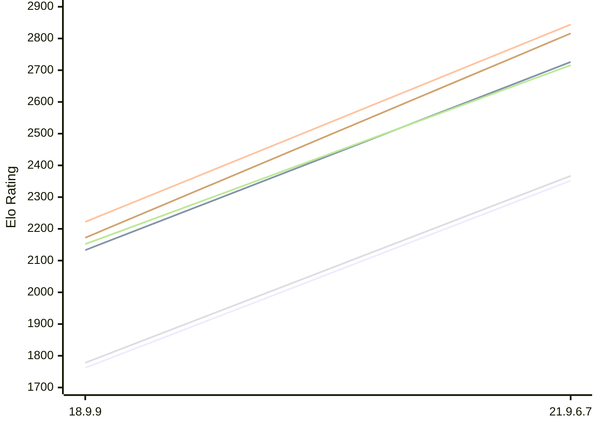

# Engine: RuthIron

Author: Emre Kalkan

Home: https://github.com/themreKalkan/RuthIron

## Elo Ratings E1 (Ultra 7 265T (1.50 GHz) - E-Core)

| Version | Published | STC 8.0+0.08s  | LTC 60.0+0.60s | VLTC 2m24s+1.12s | Comment |
| --- | --- | --- | --- | --- | --- |
| 21.9.6.7 | 2026-02-28 | 2352(+590) | 2726(+593) | 2844(+622) |  |
| 18.9.9 | 2026-01-16 | 1762 | 2133 | 2222 | Loses on time |
 | | | cElo (∆ prev) | cElo (∆ prev) | cElo (∆ prev) | 

## Elo Ratings P1 (Ultra 7 265T (1.50 GHz) - P-Core)

| Version | Published | STC 8.0+0.08s  | LTC 60.0+0.60s | VLTC 2m24s+1.12s | Comment |
| --- | --- | --- | --- | --- | --- |
| 21.9.6.7 | 2026-02-28 | 2367(+589) | 2716(+564) | 2816(+644) |  |
| 18.9.9 | 2026-01-16 | 1778 | 2152 | 2172 | Loses on time |
 | | | cElo (∆ prev) | cElo (∆ prev) | cElo (∆ prev) | 

## Elo Ratings T1 (i5-7500T 2.70GHz)

| Version | Published | STC 8.0+0.08s  | LTC 60.0+0.60s | VLTC 2m24s+1.12s | Comment |
| --- | --- | --- | --- | --- | --- |
| 21.9.6.7 | 2026-02-28 | 2415 | 2754 | 2861 |  |
 | | | cElo (∆ prev) | cElo (∆ prev) | cElo (∆ prev) | 

<a href="https://github.com/computer-chess-index/cci/issues/new?template=submit-version.yml&title=[VERSION]+RuthIron+<version>&body=###%20Engine%20name%0ARuthIron%0A%0A###%20Version%0A21.9.6.7" target="_blank">Submit new version</a>

 Test Conditions:

GUI/CLI: <a href=https://github.com/cutechess/cutechess target="_blank">Cute-Chess</a> 
Elo Calculation: <a href=https://www.remi-coulom.fr/Bayesian-Elo/ target="_blank">Bayesian-Elo</a> 
CPU for P1: Intel(R) Core(TM) Ultra 7 265T (1.50 GHz) - P-Core 
CPU for E1: Intel(R) Core(TM) Ultra 7 265T (1.50 GHz) - E-Core 
CPU for T1: Intel(R) Core(TM) i5-7500T 2.70GHz 
Opening book: 8_moves_v3 
\* STC: 8.0+0.08s, LTC: 60.0+0.60s, VLTC: 2m24s+1.12s

 Lists:
Ratings: <a href=https://github.com/computer-chess-index/cci/blob/main/lists/CCIRatings.csv target="_blank">Complete list</a>

Generated: 2026-11-17 05:42:50

## Ratings Verlauf E1 / P1

## Detailed Evaluation Results

| Version | Time Control | Variant | Elo  | Range +/- | Matches | Score | Average Opponent Elo | Draws |
| --- | --- |--- | --- | --- | --- | --- | --- | --- |
| 21.9.6.7 | VLTC (2m24s+1.12s) | T1 | 2861 | 24 | 534 | 50% | 2861 | 41% |
|  |  | P1 | 2816 | 33 | 286 | 50% | 2832 | 42% |
|  |  | E1 | 2844 | 31 | 346 | 51% | 2819 | 33% |
|  | LTC (60.0+0.60s) | T1 | 2754 | 24 | 564 | 50% | 2758 | 38% |
|  |  | P1 | 2716 | 36 | 260 | 52% | 2693 | 35% |
|  |  | E1 | 2726 | 29 | 404 | 51% | 2691 | 31% |
|  | STC (8.0+0.08s) | P1 | 2367 | 35 | 270 | 48% | 2400 | 33% |
|  |  | E1 | 2352 | 30 | 364 | 46% | 2398 | 31% |
|  |  | T1 | 2415 | 23 | 686 | 49% | 2433 | 28% |
| --- | --- |--- | --- | --- | --- | --- | --- | --- |
| 18.9.9 | VLTC (2m24s+1.12s) | P1 | 2172 | 69 | 80 | 49% | 2156 | 21% |
|  |  | E1 | 2222 | 61 | 98 | 48% | 2244 | 19% |
|  | LTC (60.0+0.60s) | P1 | 2152 | 73 | 70 | 46% | 2194 | 24% |
|  |  | E1 | 2133 | 56 | 114 | 46% | 2194 | 23% |
|  | STC (8.0+0.08s) | P1 | 1778 | 62 | 98 | 47% | 1829 | 17% |
|  |  | E1 | 1762 | 56 | 116 | 41% | 1872 | 24% |