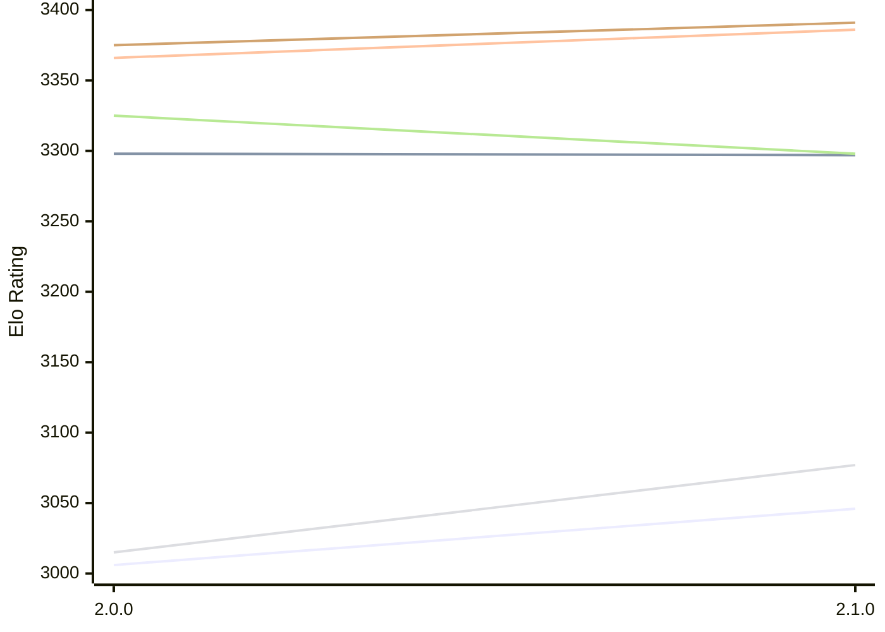

# Engine: Sapling

Author: Timothy Jones

Home: https://github.com/Timmoth/Sapling

## Elo Ratings E1 (Ultra 7 265T (1.50 GHz) - E-Core)

| Version | Published | STC 8.0+0.08s  | LTC 60.0+0.60s | VLTC 2m24s+1.12s | Comment |
| --- | --- | --- | --- | --- | --- |
| 2.1.0 | 2026-10-31 | 3046(+40) | 3297(-1) | 3386(+20) |  |
| 2.0.0 | 2026-10-21 | 3006 | 3298 | 3366 |  |
 | | | cElo (∆ prev) | cElo (∆ prev) | cElo (∆ prev) | 

## Elo Ratings P1 (Ultra 7 265T (1.50 GHz) - P-Core)

| Version | Published | STC 8.0+0.08s  | LTC 60.0+0.60s | VLTC 2m24s+1.12s | Comment |
| --- | --- | --- | --- | --- | --- |
| 2.1.0 | 2026-10-31 | 3077(+62) | 3298(-27) | 3391(+16) |  |
| 2.0.0 | 2026-10-21 | 3015 | 3325 | 3375 |  |
 | | | cElo (∆ prev) | cElo (∆ prev) | cElo (∆ prev) | 

## Elo Ratings T1 (i5-7500T 2.70GHz)

| Version | Published | STC 8.0+0.08s  | LTC 60.0+0.60s | VLTC 2m24s+1.12s | Comment |
| --- | --- | --- | --- | --- | --- |
| 2.0.0 | 2026-10-21 | 3015 | 3325 | 3375 |  |
 | | | cElo (∆ prev) | cElo (∆ prev) | cElo (∆ prev) | 

<a href="https://github.com/computer-chess-index/cci/issues/new?template=submit-version.yml&title=[VERSION]+Sapling+<version>&body=###%20Engine%20name%0ASapling%0A%0A###%20Version%0A2.1.0" target="_blank">Submit new version</a>

 Test Conditions:

GUI/CLI: <a href=https://github.com/cutechess/cutechess target="_blank">Cute-Chess</a> 
Elo Calculation: <a href=https://www.remi-coulom.fr/Bayesian-Elo/ target="_blank">Bayesian-Elo</a> 
CPU for P1: Intel(R) Core(TM) Ultra 7 265T (1.50 GHz) - P-Core 
CPU for E1: Intel(R) Core(TM) Ultra 7 265T (1.50 GHz) - E-Core 
CPU for T1: Intel(R) Core(TM) i5-7500T 2.70GHz 
Opening book: 8_moves_v3 
\* STC: 8.0+0.08s, LTC: 60.0+0.60s, VLTC: 2m24s+1.12s

 Lists:
Ratings: <a href=https://github.com/computer-chess-index/cci/blob/main/lists/CCIRatings.csv target="_blank">Complete list</a>

Generated: 2026-11-13 05:42:43

## Ratings Verlauf E1 / P1

## Detailed Evaluation Results

| Version | Time Control | Variant | Elo  | Range +/- | Matches | Score | Average Opponent Elo | Draws |
| --- | --- |--- | --- | --- | --- | --- | --- | --- |
| 2.1.0 | VLTC (2m24s+1.12s) | P1 | 3391 | 40 | 156 | 49% | 3395 | 74% |
|  |  | E1 | 3386 | 29 | 296 | 50% | 3387 | 74% |
|  | LTC (60.0+0.60s) | P1 | 3298 | 35 | 220 | 51% | 3293 | 61% |
|  |  | E1 | 3297 | 28 | 326 | 49% | 3308 | 68% |
|  | STC (8.0+0.08s) | P1 | 3077 | 41 | 162 | 53% | 3055 | 58% |
|  |  | E1 | 3046 | 33 | 264 | 51% | 3035 | 50% |
| --- | --- |--- | --- | --- | --- | --- | --- | --- |
| 2.0.0 | VLTC (2m24s+1.12s) | P1 | 3375 | 38 | 254 | 67% | 2731 | 47% |
|  |  | E1 | 3366 | 32 | 320 | 62% | 2961 | 52% |
|  | LTC (60.0+0.60s) | E1 | 3298 | 29 | 384 | 62% | 2965 | 54% |
|  |  | P1 | 3325 | 42 | 218 | 69% | 2622 | 44% |
|  | STC (8.0+0.08s) | E1 | 3006 | 35 | 276 | 57% | 2719 | 42% |
|  |  | P1 | 3015 | 43 | 220 | 68% | 2427 | 39% |