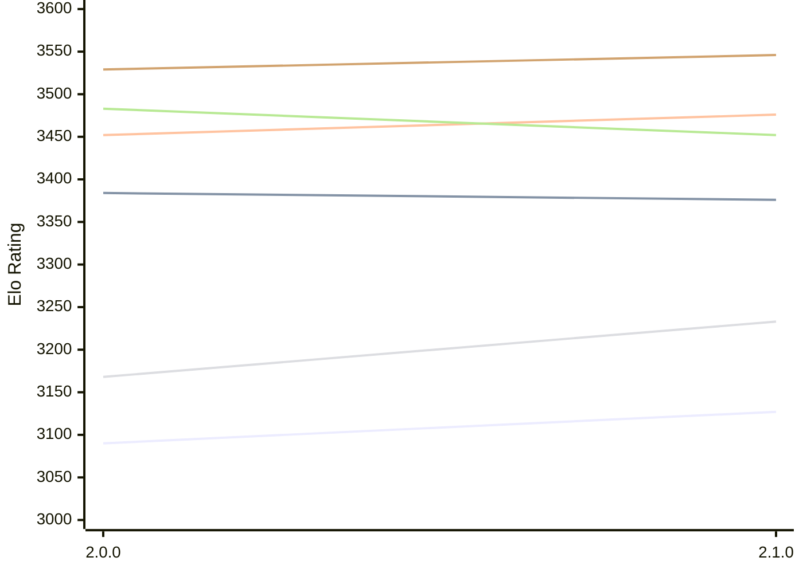

# Engine: Sapling

Author: Timothy Jones

Home: https://github.com/Timmoth/Sapling

## Elo Ratings E1 (Ultra 7 265T (1.50 GHz) - E-Core)

| Version | Published | STC 8.0+0.08s  | LTC 60.0+0.60s | VLTC 2m24s+1.12s | Comment |
| --- | --- | --- | --- | --- | --- |
| 2.1.0 | 2026-10-31 | 3127(+37) | 3376(-8) | 3476(+24) |  |
| 2.0.0 | 2026-10-21 | 3090 | 3384 | 3452 |  |
 | | | cElo (∆ prev) | cElo (∆ prev) | cElo (∆ prev) | 

## Elo Ratings P1 (Ultra 7 265T (1.50 GHz) - P-Core)

| Version | Published | STC 8.0+0.08s  | LTC 60.0+0.60s | VLTC 2m24s+1.12s | Comment |
| --- | --- | --- | --- | --- | --- |
| 2.1.0 | 2026-10-31 | 3233(+65) | 3452(-31) | 3546(+17) |  |
| 2.0.0 | 2026-10-21 | 3168 | 3483 | 3529 |  |
 | | | cElo (∆ prev) | cElo (∆ prev) | cElo (∆ prev) | 

## Elo Ratings T1 (i5-7500T 2.70GHz)

| Version | Published | STC 8.0+0.08s  | LTC 60.0+0.60s | VLTC 2m24s+1.12s | Comment |
| --- | --- | --- | --- | --- | --- |
| 2.0.0 | 2026-10-21 | 3168 | 3483 | 3529 |  |
 | | | cElo (∆ prev) | cElo (∆ prev) | cElo (∆ prev) | 

<a href="https://github.com/computer-chess-index/cci/issues/new?template=submit-version.yml&title=[VERSION]+Sapling+<version>&body=###%20Engine%20name%0ASapling%0A%0A###%20Version%0A2.1.0" target="_blank">Submit new version</a>

 Test Conditions:

GUI/CLI: <a href=https://github.com/cutechess/cutechess target="_blank">Cute-Chess</a> 
Elo Calculation: <a href=https://www.remi-coulom.fr/Bayesian-Elo/ target="_blank">Bayesian-Elo</a> 
CPU for P1: Intel(R) Core(TM) Ultra 7 265T (1.50 GHz) - P-Core 
CPU for E1: Intel(R) Core(TM) Ultra 7 265T (1.50 GHz) - E-Core 
CPU for T1: Intel(R) Core(TM) i5-7500T 2.70GHz 
Opening book: 8_moves_v3 
\* STC: 8.0+0.08s, LTC: 60.0+0.60s, VLTC: 2m24s+1.12s

 Lists:
Ratings: <a href=https://github.com/computer-chess-index/cci/blob/main/lists/CCIRatings.csv target="_blank">Complete list</a>

Generated: 2026-11-08 05:42:05

## Ratings Verlauf E1 / P1

## Detailed Evaluation Results

| Version | Time Control | Variant | Elo  | Range +/- | Matches | Score | Average Opponent Elo | Draws |
| --- | --- |--- | --- | --- | --- | --- | --- | --- |
| 2.1.0 | VLTC (2m24s+1.12s) | P1 | 3546 | 41 | 144 | 50% | 3549 | 73% |
|  |  | E1 | 3476 | 30 | 268 | 50% | 3474 | 73% |
|  | LTC (60.0+0.60s) | P1 | 3452 | 35 | 216 | 51% | 3445 | 61% |
|  |  | E1 | 3376 | 29 | 306 | 48% | 3394 | 68% |
|  | STC (8.0+0.08s) | P1 | 3233 | 42 | 150 | 54% | 3208 | 59% |
|  |  | E1 | 3127 | 35 | 232 | 52% | 3113 | 51% |
| --- | --- |--- | --- | --- | --- | --- | --- | --- |
| 2.0.0 | VLTC (2m24s+1.12s) | E1 | 3452 | 32 | 320 | 62% | 3033 | 52% |
|  |  | P1 | 3529 | 38 | 254 | 67% | 2850 | 47% |
|  | LTC (60.0+0.60s) | E1 | 3384 | 29 | 380 | 62% | 3036 | 53% |
|  |  | P1 | 3483 | 43 | 214 | 70% | 2722 | 44% |
|  | STC (8.0+0.08s) | E1 | 3090 | 35 | 272 | 57% | 2786 | 42% |
|  |  | P1 | 3168 | 43 | 220 | 68% | 2542 | 39% |