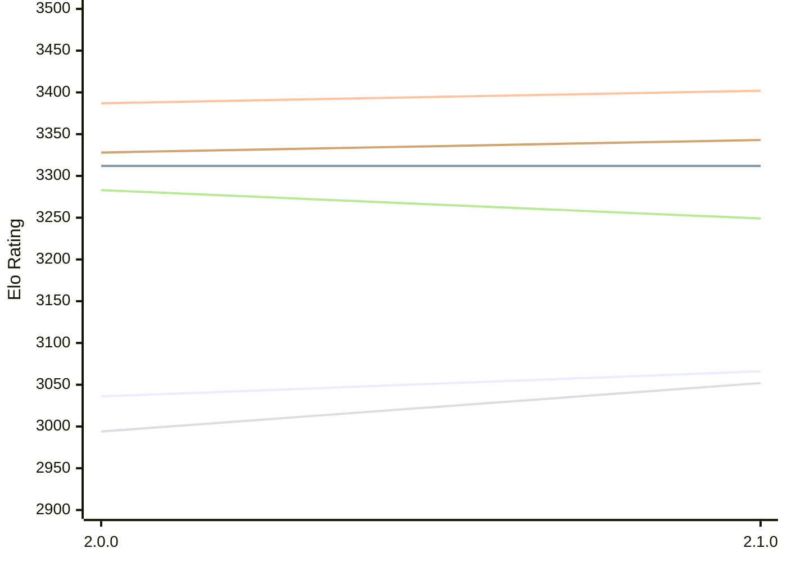

# Engine: Sapling

Author: Timothy Jones

Home: https://github.com/Timmoth/Sapling

## Elo Ratings E1 (Ultra 7 265T (1.50 GHz) - E-Core)

| Version | Published | STC 8.0+0.08s  | LTC 60.0+0.60s | VLTC 2m24s+1.12s | Comment |
| --- | --- | --- | --- | --- | --- |
| 2.1.0 | 2026-10-31 | 3066(+30) | 3312(0) | 3402(+15) |  |
| 2.0.0 | 2026-10-21 | 3036 | 3312 | 3387 |  |
 | | | cElo (∆ prev) | cElo (∆ prev) | cElo (∆ prev) | 

## Elo Ratings P1 (Ultra 7 265T (1.50 GHz) - P-Core)

| Version | Published | STC 8.0+0.08s  | LTC 60.0+0.60s | VLTC 2m24s+1.12s | Comment |
| --- | --- | --- | --- | --- | --- |
| 2.1.0 | 2026-10-31 | 3052(+58) | 3249(-34) | 3343(+15) |  |
| 2.0.0 | 2026-10-21 | 2994 | 3283 | 3328 |  |
 | | | cElo (∆ prev) | cElo (∆ prev) | cElo (∆ prev) | 

## Elo Ratings T1 (i5-7500T 2.70GHz)

| Version | Published | STC 8.0+0.08s  | LTC 60.0+0.60s | VLTC 2m24s+1.12s | Comment |
| --- | --- | --- | --- | --- | --- |
| 2.0.0 | 2026-10-21 | 2994 | 3283 | 3328 |  |
 | | | cElo (∆ prev) | cElo (∆ prev) | cElo (∆ prev) | 

<a href="https://github.com/computer-chess-index/cci/issues/new?template=submit-version.yml&title=[VERSION]+Sapling+<version>&body=###%20Engine%20name%0ASapling%0A%0A###%20Version%0A2.1.0" target="_blank">Submit new version</a>

 Test Conditions:

GUI/CLI: <a href=https://github.com/cutechess/cutechess target="_blank">Cute-Chess</a> 
Elo Calculation: <a href=https://www.remi-coulom.fr/Bayesian-Elo/ target="_blank">Bayesian-Elo</a> 
CPU for P1: Intel(R) Core(TM) Ultra 7 265T (1.50 GHz) - P-Core 
CPU for E1: Intel(R) Core(TM) Ultra 7 265T (1.50 GHz) - E-Core 
CPU for T1: Intel(R) Core(TM) i5-7500T 2.70GHz 
Opening book: 8_moves_v3 
\* STC: 8.0+0.08s, LTC: 60.0+0.60s, VLTC: 2m24s+1.12s

 Lists:
Ratings: <a href=https://github.com/computer-chess-index/cci/blob/main/lists/CCIRatings.csv target="_blank">Complete list</a>

Generated: 2026-11-19 05:43:03

## Ratings Verlauf E1 / P1

## Detailed Evaluation Results

| Version | Time Control | Variant | Elo  | Range +/- | Matches | Score | Average Opponent Elo | Draws |
| --- | --- |--- | --- | --- | --- | --- | --- | --- |
| 2.1.0 | VLTC (2m24s+1.12s) | E1 | 3402 | 28 | 304 | 50% | 3406 | 73% |
|  |  | P1 | 3343 | 39 | 160 | 49% | 3352 | 74% |
|  | LTC (60.0+0.60s) | E1 | 3312 | 27 | 342 | 48% | 3325 | 68% |
|  |  | P1 | 3249 | 33 | 236 | 51% | 3245 | 61% |
|  | STC (8.0+0.08s) | P1 | 3052 | 40 | 170 | 53% | 3033 | 58% |
|  |  | E1 | 3066 | 32 | 280 | 51% | 3055 | 50% |
| --- | --- |--- | --- | --- | --- | --- | --- | --- |
| 2.0.0 | VLTC (2m24s+1.12s) | P1 | 3328 | 38 | 254 | 67% | 2699 | 47% |
|  |  | E1 | 3387 | 31 | 340 | 62% | 2996 | 53% |
|  | LTC (60.0+0.60s) | P1 | 3283 | 40 | 230 | 69% | 2628 | 46% |
|  |  | E1 | 3312 | 27 | 412 | 61% | 3001 | 53% |
|  | STC (8.0+0.08s) | P1 | 2994 | 41 | 232 | 67% | 2448 | 39% |
|  |  | E1 | 3036 | 34 | 294 | 57% | 2753 | 43% |