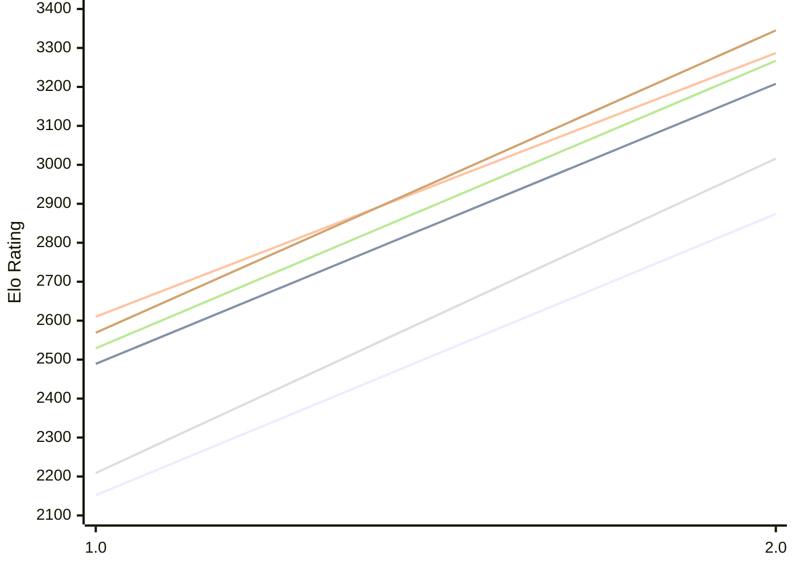

# Engine: Scarlet

Author: Evan Guerra

Home: https://github.com/EIG520/scarlet

## Elo Ratings E1 (Ultra 7 265T (1.50 GHz) - E-Core)

| Version | Published | STC 8.0+0.08s  | LTC 60.0+0.60s | VLTC 2m24s+1.12s | Comment |
| --- | --- | --- | --- | --- | --- |
| 2.0 | 2026-10-13 | 2874(+722) | 3208(+719) | 3287(+677) |  |
| 1.0 | 2026-07-26 | 2152 | 2489 | 2610 |  |
 | | | cElo (∆ prev) | cElo (∆ prev) | cElo (∆ prev) | 

## Elo Ratings P1 (Ultra 7 265T (1.50 GHz) - P-Core)

| Version | Published | STC 8.0+0.08s  | LTC 60.0+0.60s | VLTC 2m24s+1.12s | Comment |
| --- | --- | --- | --- | --- | --- |
| 2.0 | 2026-10-13 | 3016(+807) | 3267(+738) | 3345(+776) |  |
| 1.0 | 2026-07-26 | 2209 | 2529 | 2569 |  |
 | | | cElo (∆ prev) | cElo (∆ prev) | cElo (∆ prev) | 

## Elo Ratings T1 (i5-7500T 2.70GHz)

| Version | Published | STC 8.0+0.08s  | LTC 60.0+0.60s | VLTC 2m24s+1.12s | Comment |
| --- | --- | --- | --- | --- | --- |
| 1.0 | 2026-07-26 | 2194 | 2468 | 2520 |  |
 | | | cElo (∆ prev) | cElo (∆ prev) | cElo (∆ prev) | 

<a href="https://github.com/computer-chess-index/cci/issues/new?template=submit-version.yml&title=[VERSION]+Scarlet+<version>&body=###%20Engine%20name%0AScarlet%0A%0A###%20Version%0A1.0" target="_blank">Submit new version</a>

 Test Conditions:

GUI/CLI: <a href=https://github.com/cutechess/cutechess target="_blank">Cute-Chess</a> 
Elo Calculation: <a href=https://www.remi-coulom.fr/Bayesian-Elo/ target="_blank">Bayesian-Elo</a> 
CPU for P1: Intel(R) Core(TM) Ultra 7 265T (1.50 GHz) - P-Core 
CPU for E1: Intel(R) Core(TM) Ultra 7 265T (1.50 GHz) - E-Core 
CPU for T1: Intel(R) Core(TM) i5-7500T 2.70GHz 
Opening book: 8_moves_v3 
\* STC: 8.0+0.08s, LTC: 60.0+0.60s, VLTC: 2m24s+1.12s

 Lists:
Ratings: <a href=https://github.com/computer-chess-index/cci/blob/main/lists/CCIRatings.csv target="_blank">Complete list</a>

Generated: 2026-11-11 05:42:26

## Ratings Verlauf E1 / P1

## Detailed Evaluation Results

| Version | Time Control | Variant | Elo  | Range +/- | Matches | Score | Average Opponent Elo | Draws |
| --- | --- |--- | --- | --- | --- | --- | --- | --- |
| 2.0 | VLTC (2m24s+1.12s) | P1 | 3345 | 35 | 244 | 53% | 3302 | 50% |
|  |  | E1 | 3287 | 29 | 356 | 53% | 3256 | 50% |
|  | LTC (60.0+0.60s) | P1 | 3267 | 39 | 208 | 54% | 3217 | 40% |
|  |  | E1 | 3208 | 30 | 340 | 52% | 3175 | 45% |
|  | STC (8.0+0.08s) | P1 | 3016 | 33 | 302 | 47% | 3029 | 37% |
|  |  | E1 | 2874 | 30 | 380 | 55% | 2813 | 28% |
| --- | --- |--- | --- | --- | --- | --- | --- | --- |
| 1.0 | VLTC (2m24s+1.12s) | T1 | 2520 | 37 | 252 | 50% | 2525 | 24% |
|  |  | P1 | 2569 | 45 | 194 | 45% | 2635 | 20% |
|  |  | E1 | 2610 | 39 | 238 | 48% | 2631 | 26% |
|  | LTC (60.0+0.60s) | P1 | 2529 | 46 | 180 | 48% | 2568 | 22% |
|  |  | E1 | 2489 | 38 | 246 | 50% | 2481 | 26% |
|  |  | T1 | 2468 | 37 | 250 | 51% | 2437 | 25% |
|  | STC (8.0+0.08s) | P1 | 2209 | 44 | 184 | 49% | 2215 | 21% |
|  |  | E1 | 2152 | 36 | 276 | 47% | 2183 | 21% |
|  |  | T1 | 2194 | 39 | 244 | 50% | 2187 | 18% |