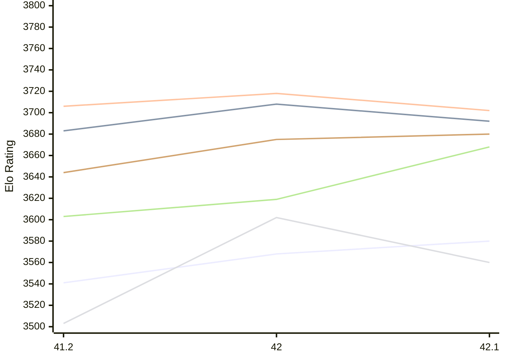
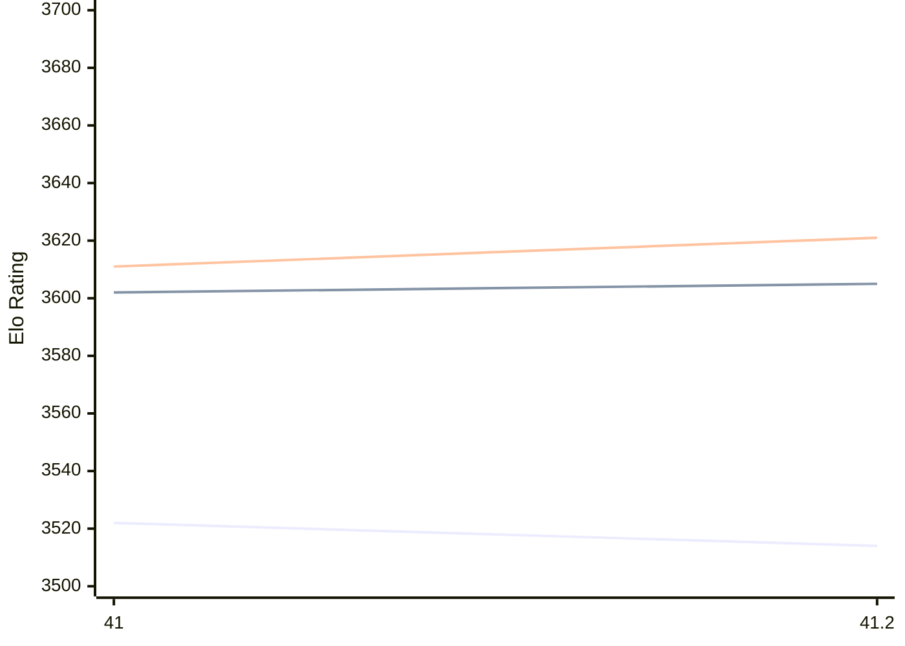

# Engine: Shashchess

Author: Andrea Manzo

Home: https://github.com/amchess/ShashChess

## Elo Ratings E1 (Ultra 7 265T (1.50 GHz) - E-Core)

| Version | Published | STC 8.0+0.08s  | LTC 60.0+0.60s | VLTC 2m24s+1.12s | Comment |
| --- | --- | --- | --- | --- | --- |
| 42.1 | 2026-11-08 | 3580(+12) | 3692(-16) | 3702(-16) |  |
| 42 | 2026-11-05 | 3568(+27) | 3708(+25) | 3718(+12) |  |
| 41.2 | 2026-03-31 | 3541 | 3683 | 3706 |  |
 | | | cElo (∆ prev) | cElo (∆ prev) | cElo (∆ prev) | 

## Elo Ratings P1 (Ultra 7 265T (1.50 GHz) - P-Core)

| Version | Published | STC 8.0+0.08s  | LTC 60.0+0.60s | VLTC 2m24s+1.12s | Comment |
| --- | --- | --- | --- | --- | --- |
| 42.1 | 2026-11-08 | 3560(-42) | 3668(+49) | 3680(+5) |  |
| 42 | 2026-11-05 | 3602(+99) | 3619(+16) | 3675(+31) |  |
| 41.2 | 2026-03-31 | 3503 | 3603 | 3644 |  |
 | | | cElo (∆ prev) | cElo (∆ prev) | cElo (∆ prev) | 

## Elo Ratings T1 (i5-7500T 2.70GHz)

| Version | Published | STC 8.0+0.08s  | LTC 60.0+0.60s | VLTC 2m24s+1.12s | Comment |
| --- | --- | --- | --- | --- | --- |
| 41.2 | 2026-03-31 | 3514(-8) | 3605(+3) | 3621(+10) |  |
| 41 | 2026-03-05 | 3522 | 3602 | 3611 |  |
 | | | cElo (∆ prev) | cElo (∆ prev) | cElo (∆ prev) | 

<a href="https://github.com/computer-chess-index/cci/issues/new?template=submit-version.yml&title=[VERSION]+Shashchess+<version>&body=###%20Engine%20name%0AShashchess%0A%0A###%20Version%0A41.2" target="_blank">Submit new version</a>

 Test Conditions:

GUI/CLI: <a href=https://github.com/cutechess/cutechess target="_blank">Cute-Chess</a> 
Elo Calculation: <a href=https://www.remi-coulom.fr/Bayesian-Elo/ target="_blank">Bayesian-Elo</a> 
CPU for P1: Intel(R) Core(TM) Ultra 7 265T (1.50 GHz) - P-Core 
CPU for E1: Intel(R) Core(TM) Ultra 7 265T (1.50 GHz) - E-Core 
CPU for T1: Intel(R) Core(TM) i5-7500T 2.70GHz 
Opening book: 8_moves_v3 
\* STC: 8.0+0.08s, LTC: 60.0+0.60s, VLTC: 2m24s+1.12s

 Lists:
Ratings: <a href=https://github.com/computer-chess-index/cci/blob/main/lists/CCIRatings.csv target="_blank">Complete list</a>

Generated: 2026-11-14 05:42:27

## Ratings Verlauf E1 / P1

## Ratings Verlauf T1

## Detailed Evaluation Results

| Version | Time Control | Variant | Elo  | Range +/- | Matches | Score | Average Opponent Elo | Draws |
| --- | --- |--- | --- | --- | --- | --- | --- | --- |
| 42.1 | VLTC (2m24s+1.12s) | P1 | 3680 | 70 | 44 | 51% | 3673 | 93% |
|  |  | E1 | 3702 | 37 | 168 | 53% | 3683 | 87% |
|  | LTC (60.0+0.60s) | P1 | 3668 | 53 | 80 | 52% | 3654 | 89% |
|  |  | E1 | 3692 | 35 | 176 | 51% | 3684 | 94% |
|  | STC (8.0+0.08s) | P1 | 3560 | 45 | 116 | 50% | 3561 | 84% |
|  |  | E1 | 3580 | 30 | 272 | 52% | 3563 | 79% |
| --- | --- |--- | --- | --- | --- | --- | --- | --- |
| 42 | VLTC (2m24s+1.12s) | P1 | 3675 | 60 | 60 | 52% | 3665 | 97% |
|  |  | E1 | 3718 | 42 | 128 | 54% | 3690 | 85% |
|  | LTC (60.0+0.60s) | P1 | 3619 | 64 | 52 | 51% | 3613 | 98% |
|  |  | E1 | 3708 | 39 | 144 | 53% | 3688 | 92% |
|  | STC (8.0+0.08s) | P1 | 3602 | 45 | 112 | 47% | 3622 | 87% |
|  |  | E1 | 3568 | 37 | 172 | 49% | 3572 | 83% |
| --- | --- |--- | --- | --- | --- | --- | --- | --- |
| 41.2 | VLTC (2m24s+1.12s) | P1 | 3644 | 42 | 158 | 64% | 3402 | 70% |
|  |  | E1 | 3706 | 32 | 252 | 60% | 3572 | 79% |
|  |  | T1 | 3621 | 32 | 228 | 55% | 3586 | 86% |
|  | LTC (60.0+0.60s) | P1 | 3603 | 32 | 274 | 64% | 3294 | 71% |
|  |  | E1 | 3683 | 30 | 280 | 58% | 3521 | 79% |
|  |  | T1 | 3605 | 30 | 244 | 52% | 3587 | 90% |
|  | STC (8.0+0.08s) | E1 | 3541 | 28 | 316 | 47% | 3557 | 76% |
|  |  | T1 | 3514 | 19 | 626 | 51% | 3509 | 83% |
|  |  | P1 | 3503 | 33 | 212 | 48% | 3513 | 82% |
| --- | --- |--- | --- | --- | --- | --- | --- | --- |
| 41 | VLTC (2m24s+1.12s) | T1 | 3611 | 34 | 198 | 56% | 3565 | 84% |
|  | LTC (60.0+0.60s) | T1 | 3602 | 39 | 156 | 54% | 3567 | 87% |
|  | STC (8.0+0.08s) | T1 | 3522 | 26 | 358 | 51% | 3509 | 78% |