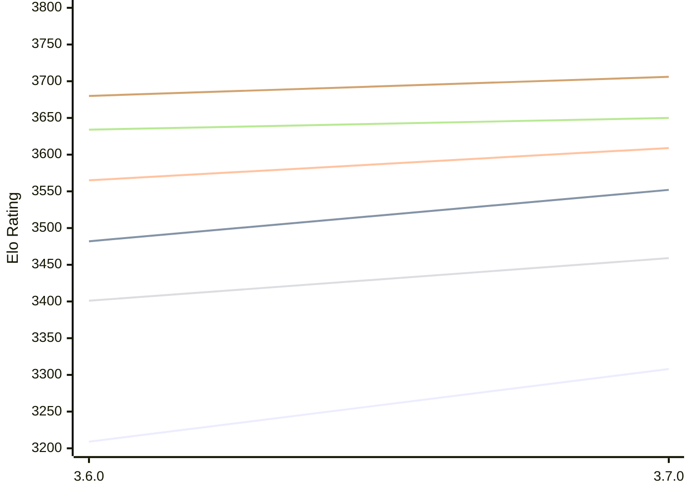

# Engine: Simplechess

Author: Sam Moore

Home: https://github.com/LinkLikesLattes/SimpleChess

## Elo Ratings E1 (Ultra 7 265T (1.50 GHz) - E-Core)

| Version | Published | STC 8.0+0.08s  | LTC 60.0+0.60s | VLTC 2m24s+1.12s | Comment |
| --- | --- | --- | --- | --- | --- |
| 3.7.0 | 2026-11-06 | 3308(+99) | 3552(+70) | 3609(+44) |  |
| 3.6.0 | 2026-10-19 | 3209 | 3482 | 3565 |  |
 | | | cElo (∆ prev) | cElo (∆ prev) | cElo (∆ prev) | 

## Elo Ratings P1 (Ultra 7 265T (1.50 GHz) - P-Core)

| Version | Published | STC 8.0+0.08s  | LTC 60.0+0.60s | VLTC 2m24s+1.12s | Comment |
| --- | --- | --- | --- | --- | --- |
| 3.7.0 | 2026-11-06 | 3459(+58) | 3650(+16) | 3706(+26) |  |
| 3.6.0 | 2026-10-19 | 3401 | 3634 | 3680 |  |
 | | | cElo (∆ prev) | cElo (∆ prev) | cElo (∆ prev) | 

## Elo Ratings T1 (i5-7500T 2.70GHz)

| Version | Published | STC 8.0+0.08s  | LTC 60.0+0.60s | VLTC 2m24s+1.12s | Comment |
| --- | --- | --- | --- | --- | --- |
| 3.6.0 | 2026-10-19 | 3401 | 3634 | 3680 |  |
 | | | cElo (∆ prev) | cElo (∆ prev) | cElo (∆ prev) | 

<a href="https://github.com/computer-chess-index/cci/issues/new?template=submit-version.yml&title=[VERSION]+Simplechess+<version>&body=###%20Engine%20name%0ASimplechess%0A%0A###%20Version%0A3.7.0" target="_blank">Submit new version</a>

 Test Conditions:

GUI/CLI: <a href=https://github.com/cutechess/cutechess target="_blank">Cute-Chess</a> 
Elo Calculation: <a href=https://www.remi-coulom.fr/Bayesian-Elo/ target="_blank">Bayesian-Elo</a> 
CPU for P1: Intel(R) Core(TM) Ultra 7 265T (1.50 GHz) - P-Core 
CPU for E1: Intel(R) Core(TM) Ultra 7 265T (1.50 GHz) - E-Core 
CPU for T1: Intel(R) Core(TM) i5-7500T 2.70GHz 
Opening book: 8_moves_v3 
\* STC: 8.0+0.08s, LTC: 60.0+0.60s, VLTC: 2m24s+1.12s

 Lists:
Ratings: <a href=https://github.com/computer-chess-index/cci/blob/main/lists/CCIRatings.csv target="_blank">Complete list</a>

Generated: 2026-11-07 05:42:24

## Ratings Verlauf E1 / P1

## Detailed Evaluation Results

| Version | Time Control | Variant | Elo  | Range +/- | Matches | Score | Average Opponent Elo | Draws |
| --- | --- |--- | --- | --- | --- | --- | --- | --- |
| 3.7.0 | VLTC (2m24s+1.12s) | P1 | 3706 | 54 | 84 | 51% | 3699 | 74% |
|  |  | E1 | 3609 | 38 | 168 | 50% | 3605 | 72% |
|  | LTC (60.0+0.60s) | P1 | 3650 | 45 | 122 | 45% | 3686 | 71% |
|  |  | E1 | 3552 | 39 | 172 | 49% | 3559 | 66% |
|  | STC (8.0+0.08s) | P1 | 3459 | 39 | 170 | 49% | 3465 | 65% |
|  |  | E1 | 3308 | 33 | 254 | 55% | 3267 | 54% |
| --- | --- |--- | --- | --- | --- | --- | --- | --- |
| 3.6.0 | VLTC (2m24s+1.12s) | E1 | 3565 | 32 | 276 | 54% | 3486 | 63% |
|  |  | P1 | 3680 | 40 | 172 | 59% | 3561 | 68% |
|  | LTC (60.0+0.60s) | E1 | 3482 | 30 | 326 | 53% | 3403 | 53% |
|  |  | P1 | 3634 | 38 | 200 | 58% | 3480 | 63% |
|  | STC (8.0+0.08s) | E1 | 3209 | 33 | 298 | 57% | 3016 | 42% |
|  |  | P1 | 3401 | 37 | 244 | 57% | 3173 | 42% |