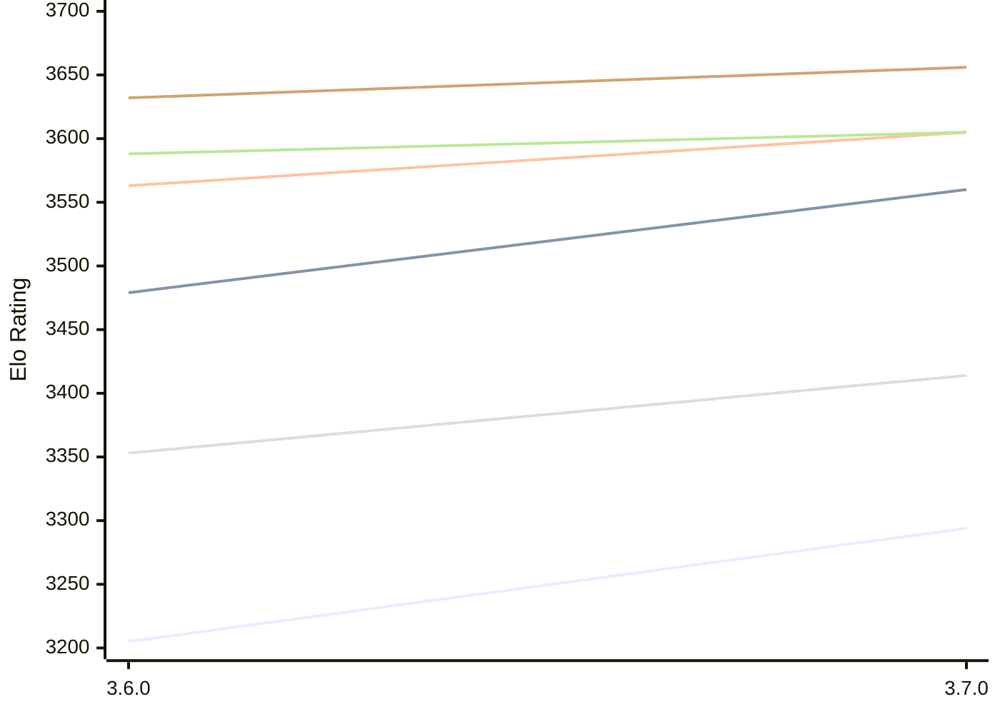

# Engine: Simplechess

Author: Sam Moore

Home: https://github.com/LinkLikesLattes/SimpleChess

## Elo Ratings E1 (Ultra 7 265T (1.50 GHz) - E-Core)

| Version | Published | STC 8.0+0.08s  | LTC 60.0+0.60s | VLTC 2m24s+1.12s | Comment |
| --- | --- | --- | --- | --- | --- |
| 3.7.0 | 2026-11-06 | 3294(+89) | 3560(+81) | 3605(+42) |  |
| 3.6.0 | 2026-10-19 | 3205 | 3479 | 3563 |  |
 | | | cElo (∆ prev) | cElo (∆ prev) | cElo (∆ prev) | 

## Elo Ratings P1 (Ultra 7 265T (1.50 GHz) - P-Core)

| Version | Published | STC 8.0+0.08s  | LTC 60.0+0.60s | VLTC 2m24s+1.12s | Comment |
| --- | --- | --- | --- | --- | --- |
| 3.7.0 | 2026-11-06 | 3414(+61) | 3605(+17) | 3656(+24) |  |
| 3.6.0 | 2026-10-19 | 3353 | 3588 | 3632 |  |
 | | | cElo (∆ prev) | cElo (∆ prev) | cElo (∆ prev) | 

## Elo Ratings T1 (i5-7500T 2.70GHz)

| Version | Published | STC 8.0+0.08s  | LTC 60.0+0.60s | VLTC 2m24s+1.12s | Comment |
| --- | --- | --- | --- | --- | --- |
| 3.6.0 | 2026-10-19 | 3353 | 3588 | 3632 |  |
 | | | cElo (∆ prev) | cElo (∆ prev) | cElo (∆ prev) | 

<a href="https://github.com/computer-chess-index/cci/issues/new?template=submit-version.yml&title=[VERSION]+Simplechess+<version>&body=###%20Engine%20name%0ASimplechess%0A%0A###%20Version%0A3.7.0" target="_blank">Submit new version</a>

 Test Conditions:

GUI/CLI: <a href=https://github.com/cutechess/cutechess target="_blank">Cute-Chess</a> 
Elo Calculation: <a href=https://www.remi-coulom.fr/Bayesian-Elo/ target="_blank">Bayesian-Elo</a> 
CPU for P1: Intel(R) Core(TM) Ultra 7 265T (1.50 GHz) - P-Core 
CPU for E1: Intel(R) Core(TM) Ultra 7 265T (1.50 GHz) - E-Core 
CPU for T1: Intel(R) Core(TM) i5-7500T 2.70GHz 
Opening book: 8_moves_v3 
\* STC: 8.0+0.08s, LTC: 60.0+0.60s, VLTC: 2m24s+1.12s

 Lists:
Ratings: <a href=https://github.com/computer-chess-index/cci/blob/main/lists/CCIRatings.csv target="_blank">Complete list</a>

Generated: 2026-11-11 05:42:37

## Ratings Verlauf E1 / P1

## Detailed Evaluation Results

| Version | Time Control | Variant | Elo  | Range +/- | Matches | Score | Average Opponent Elo | Draws |
| --- | --- |--- | --- | --- | --- | --- | --- | --- |
| 3.7.0 | VLTC (2m24s+1.12s) | P1 | 3656 | 46 | 116 | 50% | 3653 | 73% |
|  |  | E1 | 3605 | 36 | 192 | 51% | 3599 | 73% |
|  | LTC (60.0+0.60s) | P1 | 3605 | 38 | 172 | 47% | 3626 | 72% |
|  |  | E1 | 3560 | 32 | 252 | 50% | 3559 | 68% |
|  | STC (8.0+0.08s) | P1 | 3414 | 37 | 190 | 49% | 3420 | 66% |
|  |  | E1 | 3294 | 28 | 344 | 52% | 3276 | 56% |
| --- | --- |--- | --- | --- | --- | --- | --- | --- |
| 3.6.0 | VLTC (2m24s+1.12s) | P1 | 3632 | 40 | 172 | 59% | 3513 | 68% |
|  |  | E1 | 3563 | 32 | 276 | 54% | 3484 | 63% |
|  | LTC (60.0+0.60s) | P1 | 3588 | 38 | 200 | 58% | 3434 | 63% |
|  |  | E1 | 3479 | 30 | 326 | 53% | 3401 | 53% |
|  | STC (8.0+0.08s) | P1 | 3353 | 37 | 244 | 57% | 3125 | 42% |
|  |  | E1 | 3205 | 33 | 298 | 57% | 3013 | 42% |