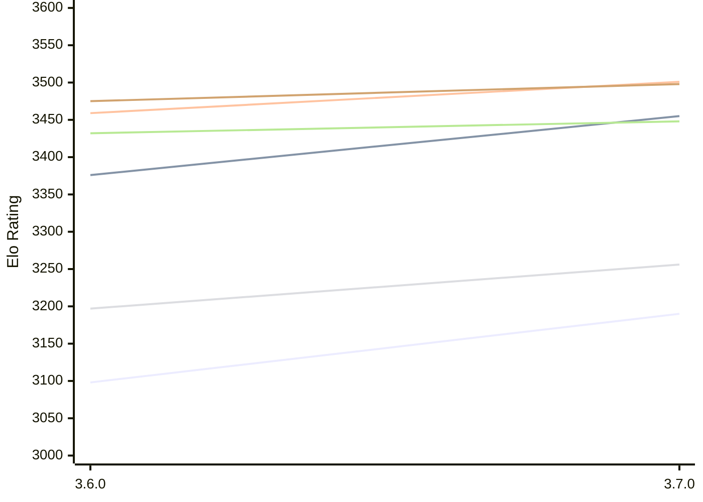

# Engine: Simplechess

Author: Sam Moore

Home: https://github.com/LinkLikesLattes/SimpleChess

## Elo Ratings E1 (Ultra 7 265T (1.50 GHz) - E-Core)

| Version | Published | STC 8.0+0.08s  | LTC 60.0+0.60s | VLTC 2m24s+1.12s | Comment |
| --- | --- | --- | --- | --- | --- |
| 3.7.0 | 2026-11-06 | 3190(+92) | 3455(+79) | 3501(+42) |  |
| 3.6.0 | 2026-10-19 | 3098 | 3376 | 3459 |  |
 | | | cElo (∆ prev) | cElo (∆ prev) | cElo (∆ prev) | 

## Elo Ratings P1 (Ultra 7 265T (1.50 GHz) - P-Core)

| Version | Published | STC 8.0+0.08s  | LTC 60.0+0.60s | VLTC 2m24s+1.12s | Comment |
| --- | --- | --- | --- | --- | --- |
| 3.7.0 | 2026-11-06 | 3256(+59) | 3448(+16) | 3498(+23) |  |
| 3.6.0 | 2026-10-19 | 3197 | 3432 | 3475 |  |
 | | | cElo (∆ prev) | cElo (∆ prev) | cElo (∆ prev) | 

## Elo Ratings T1 (i5-7500T 2.70GHz)

| Version | Published | STC 8.0+0.08s  | LTC 60.0+0.60s | VLTC 2m24s+1.12s | Comment |
| --- | --- | --- | --- | --- | --- |
| 3.6.0 | 2026-10-19 | 3197 | 3432 | 3475 |  |
 | | | cElo (∆ prev) | cElo (∆ prev) | cElo (∆ prev) | 

<a href="https://github.com/computer-chess-index/cci/issues/new?template=submit-version.yml&title=[VERSION]+Simplechess+<version>&body=###%20Engine%20name%0ASimplechess%0A%0A###%20Version%0A3.7.0" target="_blank">Submit new version</a>

 Test Conditions:

GUI/CLI: <a href=https://github.com/cutechess/cutechess target="_blank">Cute-Chess</a> 
Elo Calculation: <a href=https://www.remi-coulom.fr/Bayesian-Elo/ target="_blank">Bayesian-Elo</a> 
CPU for P1: Intel(R) Core(TM) Ultra 7 265T (1.50 GHz) - P-Core 
CPU for E1: Intel(R) Core(TM) Ultra 7 265T (1.50 GHz) - E-Core 
CPU for T1: Intel(R) Core(TM) i5-7500T 2.70GHz 
Opening book: 8_moves_v3 
\* STC: 8.0+0.08s, LTC: 60.0+0.60s, VLTC: 2m24s+1.12s

 Lists:
Ratings: <a href=https://github.com/computer-chess-index/cci/blob/main/lists/CCIRatings.csv target="_blank">Complete list</a>

Generated: 2026-11-13 05:42:57

## Ratings Verlauf E1 / P1

## Detailed Evaluation Results

| Version | Time Control | Variant | Elo  | Range +/- | Matches | Score | Average Opponent Elo | Draws |
| --- | --- |--- | --- | --- | --- | --- | --- | --- |
| 3.7.0 | VLTC (2m24s+1.12s) | P1 | 3498 | 45 | 120 | 50% | 3497 | 74% |
|  |  | E1 | 3501 | 35 | 200 | 51% | 3495 | 73% |
|  | LTC (60.0+0.60s) | P1 | 3448 | 38 | 172 | 47% | 3471 | 72% |
|  |  | E1 | 3455 | 32 | 256 | 50% | 3455 | 68% |
|  | STC (8.0+0.08s) | P1 | 3256 | 36 | 194 | 49% | 3263 | 65% |
|  |  | E1 | 3190 | 28 | 344 | 52% | 3173 | 56% |
| --- | --- |--- | --- | --- | --- | --- | --- | --- |
| 3.6.0 | VLTC (2m24s+1.12s) | E1 | 3459 | 32 | 276 | 54% | 3380 | 63% |
|  |  | P1 | 3475 | 40 | 172 | 59% | 3357 | 68% |
|  | LTC (60.0+0.60s) | E1 | 3376 | 30 | 330 | 53% | 3299 | 53% |
|  |  | P1 | 3432 | 38 | 200 | 58% | 3281 | 63% |
|  | STC (8.0+0.08s) | E1 | 3098 | 32 | 318 | 56% | 2916 | 42% |
|  |  | P1 | 3197 | 37 | 244 | 57% | 2984 | 42% |