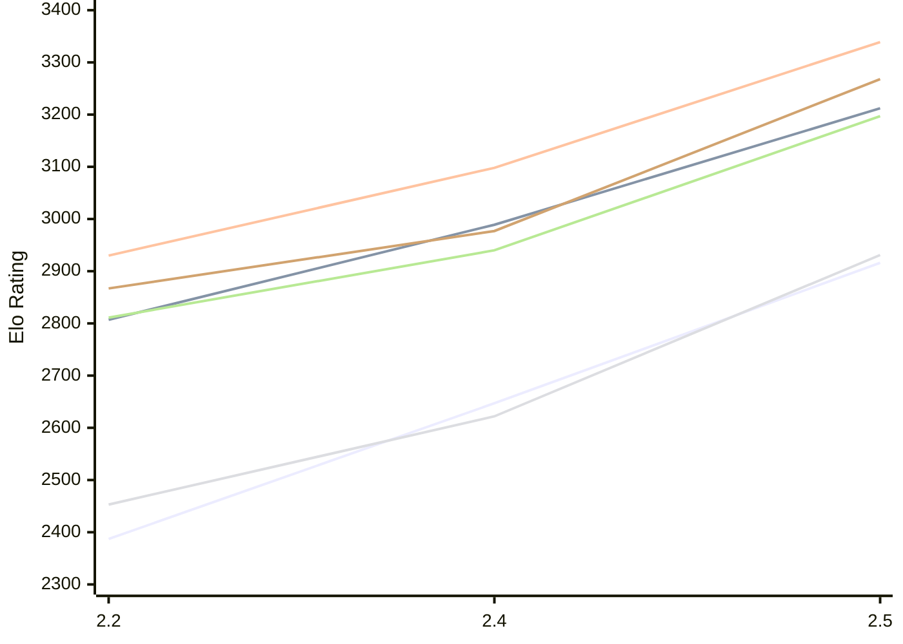
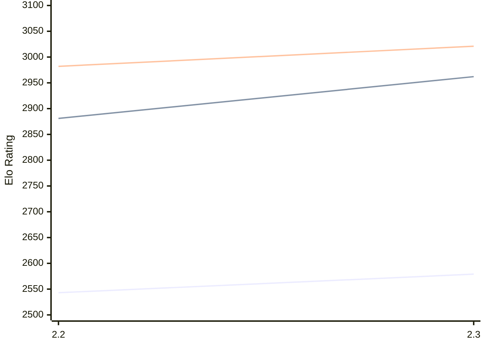

# Engine: Sloth

Author: William Sjolund

Home: https://github.com/Williamguttn/Sloth

## Elo Ratings E1 (Ultra 7 265T (1.50 GHz) - E-Core)

| Version | Published | STC 8.0+0.08s  | LTC 60.0+0.60s | VLTC 2m24s+1.12s | Comment |
| --- | --- | --- | --- | --- | --- |
| 2.5 | 2026-11-03 | 2916(+269) | 3212(+223) | 3339(+241) |  |
| 2.4 | 2026-10-09 | 2647(+260) | 2989(+182) | 3098(+168) |  |
| 2.2 | 2026-08-28 | 2387 | 2807 | 2930 |  |
 | | | cElo (∆ prev) | cElo (∆ prev) | cElo (∆ prev) | 

## Elo Ratings P1 (Ultra 7 265T (1.50 GHz) - P-Core)

| Version | Published | STC 8.0+0.08s  | LTC 60.0+0.60s | VLTC 2m24s+1.12s | Comment |
| --- | --- | --- | --- | --- | --- |
| 2.5 | 2026-11-03 | 2931(+309) | 3197(+257) | 3268(+291) |  |
| 2.4 | 2026-10-09 | 2622(+169) | 2940(+129) | 2977(+110) |  |
| 2.2 | 2026-08-28 | 2453 | 2811 | 2867 |  |
 | | | cElo (∆ prev) | cElo (∆ prev) | cElo (∆ prev) | 

## Elo Ratings T1 (i5-7500T 2.70GHz)

| Version | Published | STC 8.0+0.08s  | LTC 60.0+0.60s | VLTC 2m24s+1.12s | Comment |
| --- | --- | --- | --- | --- | --- |
| 2.3 | 2026-09-22 | 2579(+36) | 2962(+81) | 3021(+39) |  |
| 2.2 | 2026-08-28 | 2543 | 2881 | 2982 |  |
 | | | cElo (∆ prev) | cElo (∆ prev) | cElo (∆ prev) | 

<a href="https://github.com/computer-chess-index/cci/issues/new?template=submit-version.yml&title=[VERSION]+Sloth+<version>&body=###%20Engine%20name%0ASloth%0A%0A###%20Version%0A2.3" target="_blank">Submit new version</a>

 Test Conditions:

GUI/CLI: <a href=https://github.com/cutechess/cutechess target="_blank">Cute-Chess</a> 
Elo Calculation: <a href=https://www.remi-coulom.fr/Bayesian-Elo/ target="_blank">Bayesian-Elo</a> 
CPU for P1: Intel(R) Core(TM) Ultra 7 265T (1.50 GHz) - P-Core 
CPU for E1: Intel(R) Core(TM) Ultra 7 265T (1.50 GHz) - E-Core 
CPU for T1: Intel(R) Core(TM) i5-7500T 2.70GHz 
Opening book: 8_moves_v3 
\* STC: 8.0+0.08s, LTC: 60.0+0.60s, VLTC: 2m24s+1.12s

 Lists:
Ratings: <a href=https://github.com/computer-chess-index/cci/blob/main/lists/CCIRatings.csv target="_blank">Complete list</a>

Generated: 2026-11-14 05:42:35

## Ratings Verlauf E1 / P1

## Ratings Verlauf T1

## Detailed Evaluation Results

| Version | Time Control | Variant | Elo  | Range +/- | Matches | Score | Average Opponent Elo | Draws |
| --- | --- |--- | --- | --- | --- | --- | --- | --- |
| 2.5 | VLTC (2m24s+1.12s) | P1 | 3268 | 39 | 168 | 52% | 3252 | 65% |
|  |  | E1 | 3339 | 31 | 276 | 51% | 3329 | 62% |
|  | LTC (60.0+0.60s) | P1 | 3197 | 39 | 176 | 53% | 3173 | 61% |
|  |  | E1 | 3212 | 30 | 312 | 52% | 3195 | 58% |
|  | STC (8.0+0.08s) | P1 | 2931 | 39 | 194 | 53% | 2903 | 48% |
|  |  | E1 | 2916 | 34 | 274 | 55% | 2869 | 37% |
| --- | --- |--- | --- | --- | --- | --- | --- | --- |
| 2.4 | VLTC (2m24s+1.12s) | E1 | 3098 | 32 | 284 | 50% | 3098 | 50% |
|  |  | P1 | 2977 | 39 | 182 | 48% | 2996 | 55% |
|  | LTC (60.0+0.60s) | E1 | 2989 | 33 | 286 | 51% | 2973 | 41% |
|  |  | P1 | 2940 | 38 | 196 | 51% | 2936 | 47% |
|  | STC (8.0+0.08s) | E1 | 2647 | 33 | 292 | 51% | 2633 | 34% |
|  |  | P1 | 2622 | 36 | 240 | 51% | 2615 | 40% |
| --- | --- |--- | --- | --- | --- | --- | --- | --- |
| 2.3 | VLTC (2m24s+1.12s) | T1 | 3021 | 36 | 218 | 51% | 3011 | 55% |
|  | LTC (60.0+0.60s) | T1 | 2962 | 37 | 210 | 51% | 2958 | 47% |
|  | STC (8.0+0.08s) | T1 | 2579 | 42 | 190 | 48% | 2596 | 29% |
| --- | --- |--- | --- | --- | --- | --- | --- | --- |
| 2.2 | VLTC (2m24s+1.12s) | T1 | 2982 | 33 | 280 | 51% | 2965 | 43% |
|  |  | P1 | 2867 | 38 | 208 | 47% | 2882 | 47% |
|  |  | E1 | 2930 | 33 | 282 | 47% | 2952 | 43% |
|  | LTC (60.0+0.60s) | P1 | 2811 | 39 | 194 | 49% | 2816 | 46% |
|  |  | E1 | 2807 | 34 | 274 | 46% | 2832 | 39% |
|  |  | T1 | 2881 | 35 | 246 | 53% | 2853 | 46% |
|  | STC (8.0+0.08s) | P1 | 2453 | 44 | 180 | 50% | 2453 | 26% |
|  |  | E1 | 2387 | 35 | 280 | 41% | 2475 | 29% |
|  |  | T1 | 2543 | 33 | 304 | 48% | 2560 | 31% |