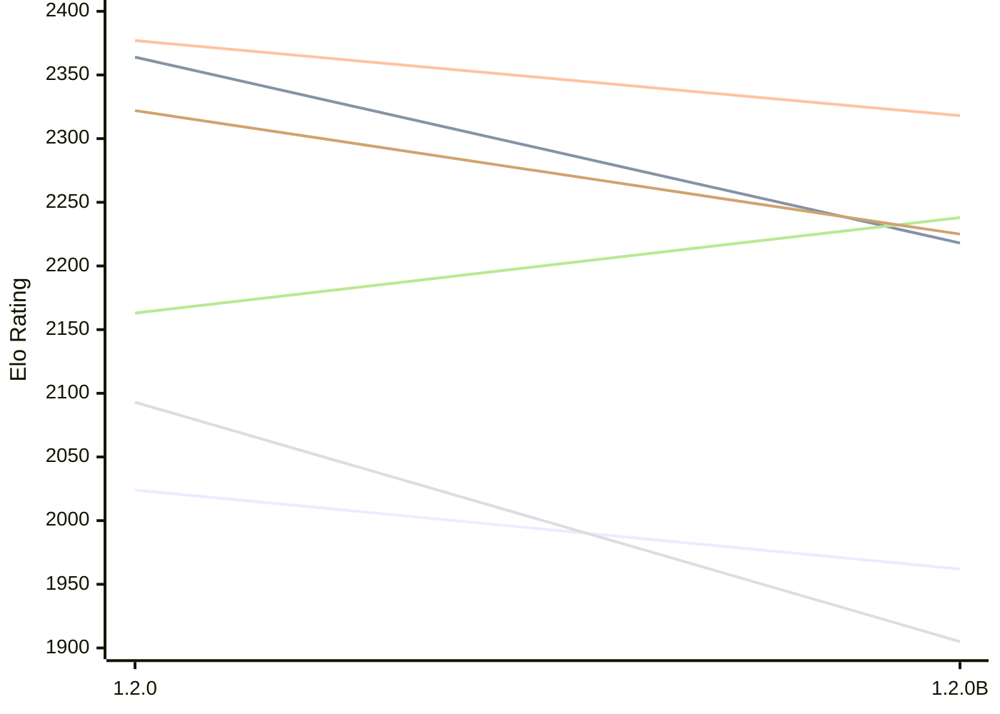
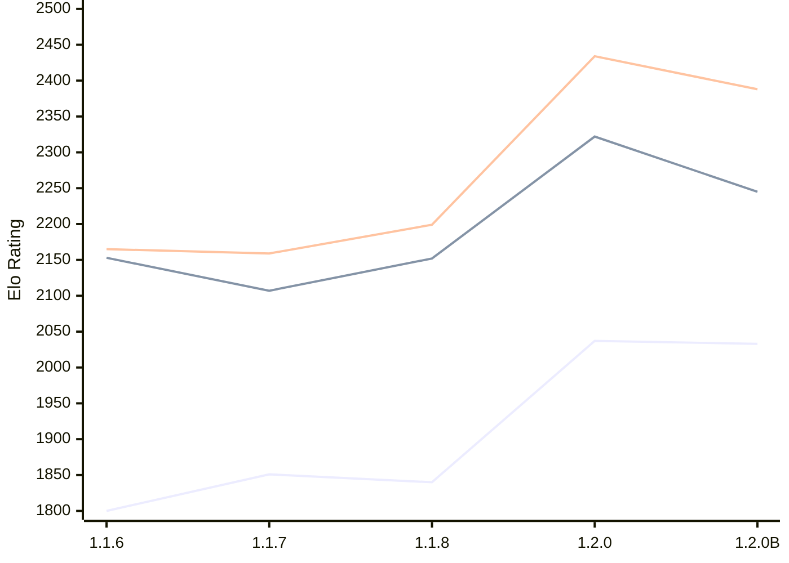

# Engine: Soomi

Author: Otto Laukkanen

Home: https://github.com/Koma1867/Soomi-V1-Chess-engine-in-golang

## Elo Ratings E1 (Ultra 7 265T (1.50 GHz) - E-Core)

| Version | Published | STC 8.0+0.08s  | LTC 60.0+0.60s | VLTC 2m24s+1.12s | Comment |
| --- | --- | --- | --- | --- | --- |
| 1.2.0B | 2026-04-24 | 1962(-62) | 2218(-146) | 2318(-59) |  |
| 1.2.0 | 2025-12-31 | 2024 | 2364 | 2377 |  |
 | | | cElo (∆ prev) | cElo (∆ prev) | cElo (∆ prev) | 

## Elo Ratings P1 (Ultra 7 265T (1.50 GHz) - P-Core)

| Version | Published | STC 8.0+0.08s  | LTC 60.0+0.60s | VLTC 2m24s+1.12s | Comment |
| --- | --- | --- | --- | --- | --- |
| 1.2.0B | 2026-04-24 | 1905(-188) | 2238(+75) | 2225(-97) |  |
| 1.2.0 | 2025-12-31 | 2093 | 2163 | 2322 |  |
 | | | cElo (∆ prev) | cElo (∆ prev) | cElo (∆ prev) | 

## Elo Ratings T1 (i5-7500T 2.70GHz)

| Version | Published | STC 8.0+0.08s  | LTC 60.0+0.60s | VLTC 2m24s+1.12s | Comment |
| --- | --- | --- | --- | --- | --- |
| 1.2.0B | 2026-04-24 | 2033(-4) | 2245(-77) | 2388(-46) |  |
| 1.2.0 | 2025-12-31 | 2037(+197) | 2322(+170) | 2434(+235) |  |
| 1.1.8 | 2025-12-16 | 1840(-11) | 2152(+45) | 2199(+40) |  |
| 1.1.7 | 2025-12-07 | 1851(+51) | 2107(-46) | 2159(-6) |  |
| 1.1.6 | 2025-11-30 | 1800 | 2153 | 2165 |  |
 | | | cElo (∆ prev) | cElo (∆ prev) | cElo (∆ prev) | 

<a href="https://github.com/computer-chess-index/cci/issues/new?template=submit-version.yml&title=[VERSION]+Soomi+<version>&body=###%20Engine%20name%0ASoomi%0A%0A###%20Version%0A1.2.0B" target="_blank">Submit new version</a>

 Test Conditions:

GUI/CLI: <a href=https://github.com/cutechess/cutechess target="_blank">Cute-Chess</a> 
Elo Calculation: <a href=https://www.remi-coulom.fr/Bayesian-Elo/ target="_blank">Bayesian-Elo</a> 
CPU for P1: Intel(R) Core(TM) Ultra 7 265T (1.50 GHz) - P-Core 
CPU for E1: Intel(R) Core(TM) Ultra 7 265T (1.50 GHz) - E-Core 
CPU for T1: Intel(R) Core(TM) i5-7500T 2.70GHz 
Opening book: 8_moves_v3 
\* STC: 8.0+0.08s, LTC: 60.0+0.60s, VLTC: 2m24s+1.12s

 Lists:
Ratings: <a href=https://github.com/computer-chess-index/cci/blob/main/lists/CCIRatings.csv target="_blank">Complete list</a>

Generated: 2026-11-13 05:43:08

## Ratings Verlauf E1 / P1

## Ratings Verlauf T1

## Detailed Evaluation Results

| Version | Time Control | Variant | Elo  | Range +/- | Matches | Score | Average Opponent Elo | Draws |
| --- | --- |--- | --- | --- | --- | --- | --- | --- |
| 1.2.0B | VLTC (2m24s+1.12s) | E1 | 2318 | 32 | 356 | 53% | 2264 | 24% |
|  |  | T1 | 2388 | 28 | 448 | 51% | 2379 | 26% |
|  |  | P1 | 2225 | 40 | 236 | 56% | 2144 | 21% |
|  | LTC (60.0+0.60s) | T1 | 2245 | 28 | 468 | 49% | 2249 | 22% |
|  |  | P1 | 2238 | 39 | 224 | 50% | 2248 | 28% |
|  |  | E1 | 2218 | 33 | 356 | 50% | 2232 | 18% |
|  | STC (8.0+0.08s) | T1 | 2033 | 26 | 524 | 50% | 2021 | 24% |
|  |  | P1 | 1905 | 40 | 220 | 47% | 1926 | 23% |
|  |  | E1 | 1962 | 32 | 326 | 49% | 1976 | 25% |
| --- | --- |--- | --- | --- | --- | --- | --- | --- |
| 1.2.0 | VLTC (2m24s+1.12s) | T1 | 2434 | 26 | 516 | 54% | 2400 | 23% |
|  |  | P1 | 2322 | 137 | 20 | 38% | 2464 | 25% |
|  |  | E1 | 2377 | 115 | 28 | 41% | 2495 | 18% |
|  | LTC (60.0+0.60s) | T1 | 2322 | 27 | 460 | 50% | 2325 | 26% |
|  |  | P1 | 2163 | 134 | 24 | 50% | 2164 | 17% |
|  |  | E1 | 2364 | 119 | 32 | 44% | 2438 | 25% |
|  | STC (8.0+0.08s) | T1 | 2037 | 26 | 502 | 50% | 2037 | 23% |
|  |  | P1 | 2093 | 166 | 20 | 18% | 2522 | 15% |
|  |  | E1 | 2024 | 141 | 28 | 29% | 2403 | 14% |
| --- | --- |--- | --- | --- | --- | --- | --- | --- |
| 1.1.8 | VLTC (2m24s+1.12s) | T1 | 2199 | 45 | 180 | 47% | 2229 | 19% |
|  | LTC (60.0+0.60s) | T1 | 2152 | 42 | 192 | 50% | 2152 | 28% |
|  | STC (8.0+0.08s) | T1 | 1840 | 47 | 164 | 48% | 1860 | 20% |
| --- | --- |--- | --- | --- | --- | --- | --- | --- |
| 1.1.7 | VLTC (2m24s+1.12s) | T1 | 2159 | 46 | 160 | 52% | 2147 | 28% |
|  | LTC (60.0+0.60s) | T1 | 2107 | 46 | 160 | 53% | 2079 | 26% |
|  | STC (8.0+0.08s) | T1 | 1851 | 50 | 140 | 55% | 1797 | 22% |
| --- | --- |--- | --- | --- | --- | --- | --- | --- |
| 1.1.6 | VLTC (2m24s+1.12s) | T1 | 2165 | 50 | 152 | 43% | 2252 | 18% |
|  | LTC (60.0+0.60s) | T1 | 2153 | 46 | 168 | 46% | 2195 | 24% |
|  | STC (8.0+0.08s) | T1 | 1800 | 60 | 104 | 48% | 1832 | 18% |