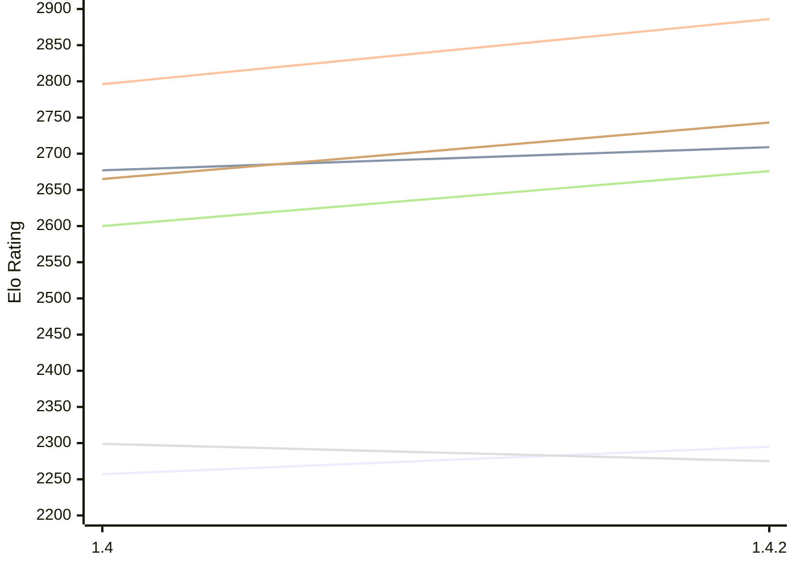
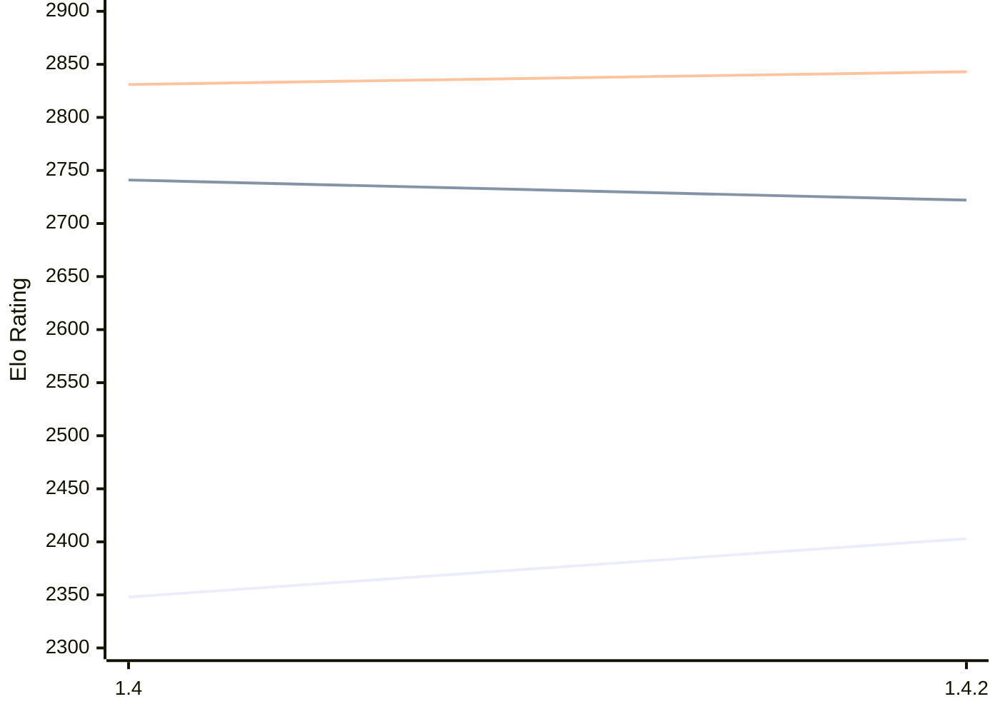

# Engine: Spike

Author: Volker Böhm, Ralf Schäfer

Home: https://github.com/Mangar2/Spike

## Elo Ratings E1 (Ultra 7 265T (1.50 GHz) - E-Core)

| Version | Published | STC 8.0+0.08s  | LTC 60.0+0.60s | VLTC 2m24s+1.12s | Comment |
| --- | --- | --- | --- | --- | --- |
| 1.4.2 | 2026-08-28 | 2295(+38) | 2709(+32) | 2886(+90) |  |
| 1.4 | 2011-02-01 | 2257 | 2677 | 2796 |  |
 | | | cElo (∆ prev) | cElo (∆ prev) | cElo (∆ prev) | 

## Elo Ratings P1 (Ultra 7 265T (1.50 GHz) - P-Core)

| Version | Published | STC 8.0+0.08s  | LTC 60.0+0.60s | VLTC 2m24s+1.12s | Comment |
| --- | --- | --- | --- | --- | --- |
| 1.4.2 | 2026-08-28 | 2275(-24) | 2676(+76) | 2743(+78) |  |
| 1.4 | 2011-02-01 | 2299 | 2600 | 2665 |  |
 | | | cElo (∆ prev) | cElo (∆ prev) | cElo (∆ prev) | 

## Elo Ratings T1 (i5-7500T 2.70GHz)

| Version | Published | STC 8.0+0.08s  | LTC 60.0+0.60s | VLTC 2m24s+1.12s | Comment |
| --- | --- | --- | --- | --- | --- |
| 1.4.2 | 2026-08-28 | 2403(+55) | 2722(-19) | 2843(+12) |  |
| 1.4 | 2011-02-01 | 2348 | 2741 | 2831 |  |
 | | | cElo (∆ prev) | cElo (∆ prev) | cElo (∆ prev) | 

<a href="https://github.com/computer-chess-index/cci/issues/new?template=submit-version.yml&title=[VERSION]+Spike+<version>&body=###%20Engine%20name%0ASpike%0A%0A###%20Version%0A1.4.2" target="_blank">Submit new version</a>

 Test Conditions:

GUI/CLI: <a href=https://github.com/cutechess/cutechess target="_blank">Cute-Chess</a> 
Elo Calculation: <a href=https://www.remi-coulom.fr/Bayesian-Elo/ target="_blank">Bayesian-Elo</a> 
CPU for P1: Intel(R) Core(TM) Ultra 7 265T (1.50 GHz) - P-Core 
CPU for E1: Intel(R) Core(TM) Ultra 7 265T (1.50 GHz) - E-Core 
CPU for T1: Intel(R) Core(TM) i5-7500T 2.70GHz 
Opening book: 8_moves_v3 
\* STC: 8.0+0.08s, LTC: 60.0+0.60s, VLTC: 2m24s+1.12s

 Lists:
Ratings: <a href=https://github.com/computer-chess-index/cci/blob/main/lists/CCIRatings.csv target="_blank">Complete list</a>

Generated: 2026-11-18 05:43:39

## Ratings Verlauf E1 / P1

## Ratings Verlauf T1

## Detailed Evaluation Results

| Version | Time Control | Variant | Elo  | Range +/- | Matches | Score | Average Opponent Elo | Draws |
| --- | --- |--- | --- | --- | --- | --- | --- | --- |
| 1.4.2 | VLTC (2m24s+1.12s) | T1 | 2843 | 35 | 258 | 51% | 2839 | 35% |
|  |  | P1 | 2743 | 33 | 314 | 45% | 2795 | 31% |
|  |  | E1 | 2886 | 28 | 414 | 52% | 2865 | 34% |
|  | LTC (60.0+0.60s) | T1 | 2722 | 34 | 282 | 51% | 2718 | 29% |
|  |  | P1 | 2676 | 33 | 304 | 50% | 2677 | 32% |
|  |  | E1 | 2709 | 29 | 392 | 46% | 2750 | 32% |
|  | STC (8.0+0.08s) | P1 | 2275 | 37 | 252 | 48% | 2299 | 28% |
|  |  | E1 | 2295 | 29 | 430 | 48% | 2302 | 24% |
|  |  | T1 | 2403 | 35 | 276 | 51% | 2395 | 30% |
| --- | --- |--- | --- | --- | --- | --- | --- | --- |
| 1.4 | VLTC (2m24s+1.12s) | T1 | 2831 | 45 | 164 | 51% | 2830 | 32% |
|  |  | P1 | 2665 | 65 | 84 | 51% | 2620 | 27% |
|  |  | E1 | 2796 | 62 | 96 | 53% | 2718 | 23% |
|  | LTC (60.0+0.60s) | P1 | 2600 | 74 | 72 | 55% | 2427 | 21% |
|  |  | T1 | 2741 | 48 | 144 | 50% | 2738 | 27% |
|  |  | E1 | 2677 | 56 | 120 | 55% | 2556 | 21% |
|  | STC (8.0+0.08s) | P1 | 2299 | 68 | 88 | 45% | 2249 | 27% |
|  |  | T1 | 2348 | 32 | 404 | 45% | 2417 | 23% |
|  |  | E1 | 2257 | 58 | 116 | 52% | 2203 | 18% |