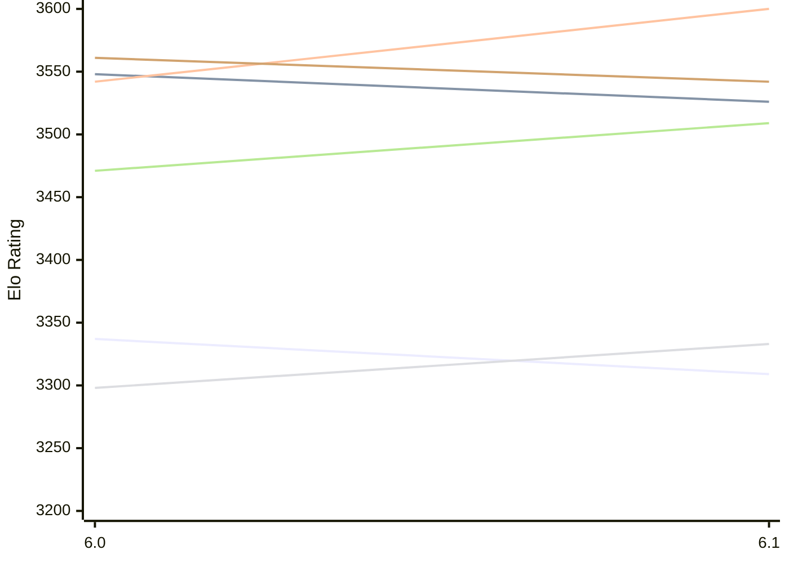
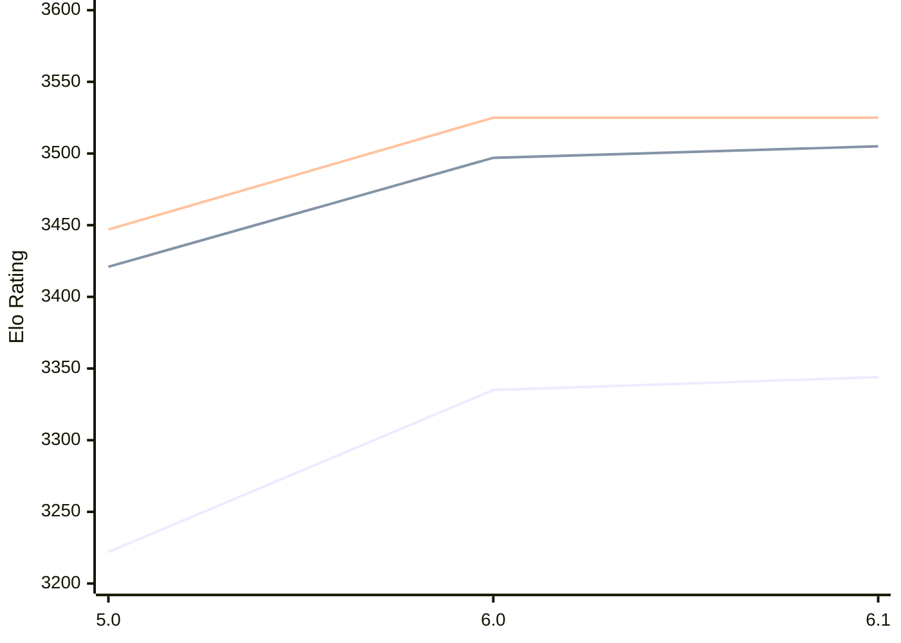

# Engine: Starzix

Author: zzzzz

Home: https://github.com/zzzzz151/Starzix

## Elo Ratings E1 (Ultra 7 265T (1.50 GHz) - E-Core)

| Version | Published | STC 8.0+0.08s  | LTC 60.0+0.60s | VLTC 2m24s+1.12s | Comment |
| --- | --- | --- | --- | --- | --- |
| 6.1 | 2025-04-06 | 3309(-28) | 3526(-22) | 3600(+58) |  |
| 6.0 | 2024-10-24 | 3337 | 3548 | 3542 |  |
 | | | cElo (∆ prev) | cElo (∆ prev) | cElo (∆ prev) | 

## Elo Ratings P1 (Ultra 7 265T (1.50 GHz) - P-Core)

| Version | Published | STC 8.0+0.08s  | LTC 60.0+0.60s | VLTC 2m24s+1.12s | Comment |
| --- | --- | --- | --- | --- | --- |
| 6.1 | 2025-04-06 | 3333(+35) | 3509(+38) | 3542(-19) |  |
| 6.0 | 2024-10-24 | 3298 | 3471 | 3561 |  |
 | | | cElo (∆ prev) | cElo (∆ prev) | cElo (∆ prev) | 

## Elo Ratings T1 (i5-7500T 2.70GHz)

| Version | Published | STC 8.0+0.08s  | LTC 60.0+0.60s | VLTC 2m24s+1.12s | Comment |
| --- | --- | --- | --- | --- | --- |
| 6.1 | 2025-04-06 | 3344(+9) | 3505(+8) | 3525(0) |  |
| 6.0 | 2024-10-24 | 3335(+113) | 3497(+76) | 3525(+78) |  |
| 5.0 | 2024-05-23 | 3222 | 3421 | 3447 |  |
 | | | cElo (∆ prev) | cElo (∆ prev) | cElo (∆ prev) | 

<a href="https://github.com/computer-chess-index/cci/issues/new?template=submit-version.yml&title=[VERSION]+Starzix+<version>&body=###%20Engine%20name%0AStarzix%0A%0A###%20Version%0A6.1" target="_blank">Submit new version</a>

 Test Conditions:

GUI/CLI: <a href=https://github.com/cutechess/cutechess target="_blank">Cute-Chess</a> 
Elo Calculation: <a href=https://www.remi-coulom.fr/Bayesian-Elo/ target="_blank">Bayesian-Elo</a> 
CPU for P1: Intel(R) Core(TM) Ultra 7 265T (1.50 GHz) - P-Core 
CPU for E1: Intel(R) Core(TM) Ultra 7 265T (1.50 GHz) - E-Core 
CPU for T1: Intel(R) Core(TM) i5-7500T 2.70GHz 
Opening book: 8_moves_v3 
\* STC: 8.0+0.08s, LTC: 60.0+0.60s, VLTC: 2m24s+1.12s

 Lists:
Ratings: <a href=https://github.com/computer-chess-index/cci/blob/main/lists/CCIRatings.csv target="_blank">Complete list</a>

Generated: 2026-11-27 05:43:42

## Ratings Verlauf E1 / P1

## Ratings Verlauf T1

## Detailed Evaluation Results

| Version | Time Control | Variant | Elo  | Range +/- | Matches | Score | Average Opponent Elo | Draws |
| --- | --- |--- | --- | --- | --- | --- | --- | --- |
| 6.1 | VLTC (2m24s+1.12s) | E1 | 3600 | 29 | 288 | 48% | 3614 | 79% |
|  |  | T1 | 3525 | 22 | 458 | 50% | 3525 | 87% |
|  |  | P1 | 3542 | 32 | 228 | 52% | 3533 | 84% |
|  | LTC (60.0+0.60s) | T1 | 3505 | 22 | 456 | 50% | 3505 | 86% |
|  |  | P1 | 3509 | 39 | 154 | 51% | 3501 | 81% |
|  |  | E1 | 3526 | 29 | 296 | 51% | 3519 | 78% |
|  | STC (8.0+0.08s) | T1 | 3344 | 20 | 620 | 50% | 3345 | 70% |
|  |  | P1 | 3333 | 28 | 344 | 51% | 3320 | 63% |
|  |  | E1 | 3309 | 24 | 480 | 48% | 3322 | 63% |
| --- | --- |--- | --- | --- | --- | --- | --- | --- |
| 6.0 | VLTC (2m24s+1.12s) | E1 | 3542 | 58 | 76 | 60% | 3448 | 72% |
|  |  | T1 | 3525 | 12 | 1620 | 50% | 3525 | 85% |
|  |  | P1 | 3561 | 131 | 20 | 78% | 3252 | 45% |
|  | LTC (60.0+0.60s) | T1 | 3497 | 12 | 1600 | 50% | 3495 | 82% |
|  |  | P1 | 3471 | 94 | 42 | 74% | 3186 | 43% |
|  |  | E1 | 3548 | 53 | 96 | 60% | 3436 | 66% |
|  | STC (8.0+0.08s) | T1 | 3335 | 13 | 1628 | 50% | 3337 | 68% |
|  |  | P1 | 3298 | 58 | 78 | 54% | 3259 | 64% |
|  |  | E1 | 3337 | 47 | 120 | 54% | 3294 | 63% |
| --- | --- |--- | --- | --- | --- | --- | --- | --- |
| 5.0 | VLTC (2m24s+1.12s) | T1 | 3447 | 32 | 236 | 51% | 3441 | 76% |
|  | LTC (60.0+0.60s) | T1 | 3421 | 32 | 240 | 48% | 3432 | 78% |
|  | STC (8.0+0.08s) | T1 | 3222 | 27 | 408 | 53% | 3136 | 56% |