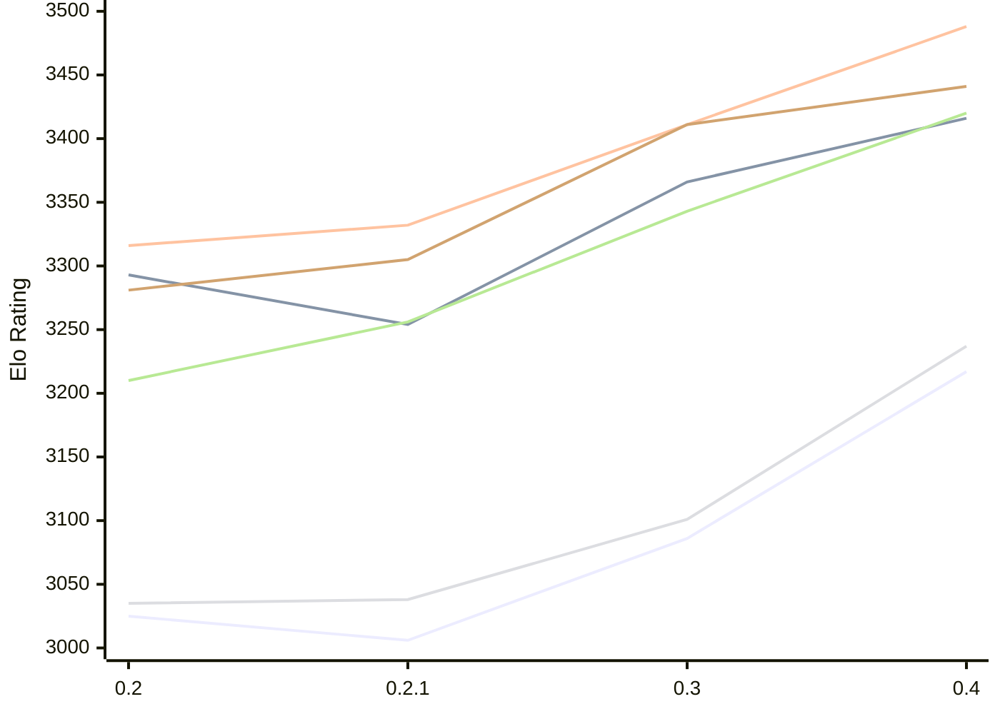

# Engine: StockDory

Author: Shaheryar Sohail

Home: https://github.com/TheBlackPlague/StockDory

## Elo Ratings E1 (Ultra 7 265T (1.50 GHz) - E-Core)

| Version | Published | STC 8.0+0.08s  | LTC 60.0+0.60s | VLTC 2m24s+1.12s | Comment |
| --- | --- | --- | --- | --- | --- |
| 0.4 | 2026-11-02 | 3217(+131) | 3416(+50) | 3488(+77) |  |
| 0.3 | 2026-10-06 | 3086(+80) | 3366(+112) | 3411(+79) |  |
| 0.2.1 | 2026-09-20 | 3006(-19) | 3254(-39) | 3332(+16) |  |
| 0.2 | 2026-09-15 | 3025 | 3293 | 3316 |  |
 | | | cElo (∆ prev) | cElo (∆ prev) | cElo (∆ prev) | 

## Elo Ratings P1 (Ultra 7 265T (1.50 GHz) - P-Core)

| Version | Published | STC 8.0+0.08s  | LTC 60.0+0.60s | VLTC 2m24s+1.12s | Comment |
| --- | --- | --- | --- | --- | --- |
| 0.4 | 2026-11-02 | 3237(+136) | 3420(+77) | 3441(+30) |  |
| 0.3 | 2026-10-06 | 3101(+63) | 3343(+87) | 3411(+106) |  |
| 0.2.1 | 2026-09-20 | 3038(+3) | 3256(+46) | 3305(+24) |  |
| 0.2 | 2026-09-15 | 3035 | 3210 | 3281 |  |
 | | | cElo (∆ prev) | cElo (∆ prev) | cElo (∆ prev) | 

## Elo Ratings T1 (i5-7500T 2.70GHz)

| Version | Published | STC 8.0+0.08s  | LTC 60.0+0.60s | VLTC 2m24s+1.12s | Comment |
| --- | --- | --- | --- | --- | --- |
| 0.2 | 2026-09-15 | 3035 | 3210 | 3281 |  |
 | | | cElo (∆ prev) | cElo (∆ prev) | cElo (∆ prev) | 

<a href="https://github.com/computer-chess-index/cci/issues/new?template=submit-version.yml&title=[VERSION]+StockDory+<version>&body=###%20Engine%20name%0AStockDory%0A%0A###%20Version%0A0.4" target="_blank">Submit new version</a>

 Test Conditions:

GUI/CLI: <a href=https://github.com/cutechess/cutechess target="_blank">Cute-Chess</a> 
Elo Calculation: <a href=https://www.remi-coulom.fr/Bayesian-Elo/ target="_blank">Bayesian-Elo</a> 
CPU for P1: Intel(R) Core(TM) Ultra 7 265T (1.50 GHz) - P-Core 
CPU for E1: Intel(R) Core(TM) Ultra 7 265T (1.50 GHz) - E-Core 
CPU for T1: Intel(R) Core(TM) i5-7500T 2.70GHz 
Opening book: 8_moves_v3 
\* STC: 8.0+0.08s, LTC: 60.0+0.60s, VLTC: 2m24s+1.12s

 Lists:
Ratings: <a href=https://github.com/computer-chess-index/cci/blob/main/lists/CCIRatings.csv target="_blank">Complete list</a>

Generated: 2026-11-28 05:43:30

## Ratings Verlauf E1 / P1

## Detailed Evaluation Results

| Version | Time Control | Variant | Elo  | Range +/- | Matches | Score | Average Opponent Elo | Draws |
| --- | --- |--- | --- | --- | --- | --- | --- | --- |
| 0.4 | VLTC (2m24s+1.12s) | P1 | 3441 | 37 | 182 | 49% | 3447 | 73% |
|  |  | E1 | 3488 | 31 | 248 | 51% | 3483 | 79% |
|  | LTC (60.0+0.60s) | P1 | 3420 | 40 | 148 | 51% | 3413 | 80% |
|  |  | E1 | 3416 | 28 | 312 | 52% | 3401 | 73% |
|  | STC (8.0+0.08s) | P1 | 3237 | 30 | 286 | 52% | 3227 | 66% |
|  |  | E1 | 3217 | 29 | 306 | 53% | 3191 | 65% |
| --- | --- |--- | --- | --- | --- | --- | --- | --- |
| 0.3 | VLTC (2m24s+1.12s) | P1 | 3411 | 35 | 216 | 53% | 3333 | 69% |
|  |  | E1 | 3411 | 27 | 359 | 56% | 3330 | 67% |
|  | LTC (60.0+0.60s) | E1 | 3366 | 28 | 348 | 55% | 3299 | 62% |
|  |  | P1 | 3343 | 32 | 264 | 54% | 3287 | 59% |
|  | STC (8.0+0.08s) | E1 | 3086 | 29 | 354 | 54% | 3032 | 52% |
|  |  | P1 | 3101 | 41 | 182 | 56% | 3000 | 50% |
| --- | --- |--- | --- | --- | --- | --- | --- | --- |
| 0.2.1 | VLTC (2m24s+1.12s) | P1 | 3305 | 39 | 168 | 54% | 3276 | 70% |
|  |  | E1 | 3332 | 34 | 224 | 46% | 3360 | 65% |
|  | LTC (60.0+0.60s) | P1 | 3256 | 43 | 136 | 47% | 3279 | 74% |
|  |  | E1 | 3254 | 31 | 264 | 47% | 3275 | 67% |
|  | STC (8.0+0.08s) | P1 | 3038 | 37 | 204 | 45% | 3074 | 52% |
|  |  | E1 | 3006 | 35 | 230 | 49% | 3013 | 52% |
| --- | --- |--- | --- | --- | --- | --- | --- | --- |
| 0.2 | VLTC (2m24s+1.12s) | P1 | 3281 | 69 | 56 | 43% | 3335 | 57% |
|  |  | E1 | 3316 | 40 | 158 | 53% | 3298 | 67% |
|  | LTC (60.0+0.60s) | P1 | 3210 | 60 | 72 | 42% | 3267 | 68% |
|  |  | E1 | 3293 | 44 | 134 | 43% | 3341 | 63% |
|  | STC (8.0+0.08s) | P1 | 3035 | 91 | 36 | 47% | 3062 | 39% |
|  |  | E1 | 3025 | 45 | 146 | 54% | 2988 | 46% |