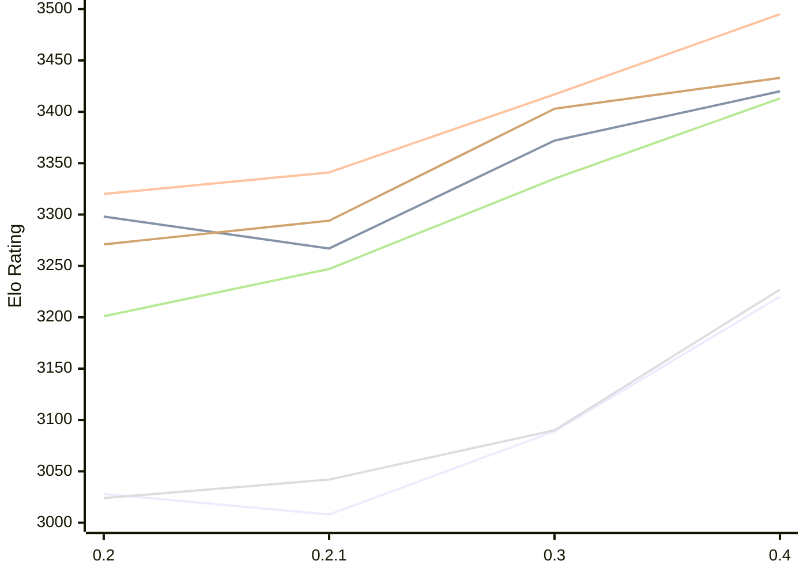

# Engine: StockDory

Author: Shaheryar Sohail

Home: https://github.com/TheBlackPlague/StockDory

## Elo Ratings E1 (Ultra 7 265T (1.50 GHz) - E-Core)

| Version | Published | STC 8.0+0.08s  | LTC 60.0+0.60s | VLTC 2m24s+1.12s | Comment |
| --- | --- | --- | --- | --- | --- |
| 0.4 | 2026-11-02 | 3220(+131) | 3420(+48) | 3495(+78) |  |
| 0.3 | 2026-10-06 | 3089(+81) | 3372(+105) | 3417(+76) |  |
| 0.2.1 | 2026-09-20 | 3008(-20) | 3267(-31) | 3341(+21) |  |
| 0.2 | 2026-09-15 | 3028 | 3298 | 3320 |  |
 | | | cElo (∆ prev) | cElo (∆ prev) | cElo (∆ prev) | 

## Elo Ratings P1 (Ultra 7 265T (1.50 GHz) - P-Core)

| Version | Published | STC 8.0+0.08s  | LTC 60.0+0.60s | VLTC 2m24s+1.12s | Comment |
| --- | --- | --- | --- | --- | --- |
| 0.4 | 2026-11-02 | 3227(+137) | 3413(+78) | 3433(+30) |  |
| 0.3 | 2026-10-06 | 3090(+48) | 3335(+88) | 3403(+109) |  |
| 0.2.1 | 2026-09-20 | 3042(+18) | 3247(+46) | 3294(+23) |  |
| 0.2 | 2026-09-15 | 3024 | 3201 | 3271 |  |
 | | | cElo (∆ prev) | cElo (∆ prev) | cElo (∆ prev) | 

## Elo Ratings T1 (i5-7500T 2.70GHz)

| Version | Published | STC 8.0+0.08s  | LTC 60.0+0.60s | VLTC 2m24s+1.12s | Comment |
| --- | --- | --- | --- | --- | --- |
| 0.2 | 2026-09-15 | 3024 | 3201 | 3271 |  |
 | | | cElo (∆ prev) | cElo (∆ prev) | cElo (∆ prev) | 

<a href="https://github.com/computer-chess-index/cci/issues/new?template=submit-version.yml&title=[VERSION]+StockDory+<version>&body=###%20Engine%20name%0AStockDory%0A%0A###%20Version%0A0.4" target="_blank">Submit new version</a>

 Test Conditions:

GUI/CLI: <a href=https://github.com/cutechess/cutechess target="_blank">Cute-Chess</a> 
Elo Calculation: <a href=https://www.remi-coulom.fr/Bayesian-Elo/ target="_blank">Bayesian-Elo</a> 
CPU for P1: Intel(R) Core(TM) Ultra 7 265T (1.50 GHz) - P-Core 
CPU for E1: Intel(R) Core(TM) Ultra 7 265T (1.50 GHz) - E-Core 
CPU for T1: Intel(R) Core(TM) i5-7500T 2.70GHz 
Opening book: 8_moves_v3 
\* STC: 8.0+0.08s, LTC: 60.0+0.60s, VLTC: 2m24s+1.12s

 Lists:
Ratings: <a href=https://github.com/computer-chess-index/cci/blob/main/lists/CCIRatings.csv target="_blank">Complete list</a>

Generated: 2026-11-24 05:43:28

## Ratings Verlauf E1 / P1

## Detailed Evaluation Results

| Version | Time Control | Variant | Elo  | Range +/- | Matches | Score | Average Opponent Elo | Draws |
| --- | --- |--- | --- | --- | --- | --- | --- | --- |
| 0.4 | VLTC (2m24s+1.12s) | P1 | 3433 | 37 | 182 | 49% | 3440 | 73% |
|  |  | E1 | 3495 | 31 | 248 | 51% | 3490 | 79% |
|  | LTC (60.0+0.60s) | P1 | 3413 | 41 | 144 | 51% | 3406 | 80% |
|  |  | E1 | 3420 | 29 | 296 | 52% | 3406 | 72% |
|  | STC (8.0+0.08s) | P1 | 3227 | 30 | 282 | 52% | 3217 | 67% |
|  |  | E1 | 3220 | 30 | 282 | 54% | 3193 | 66% |
| --- | --- |--- | --- | --- | --- | --- | --- | --- |
| 0.3 | VLTC (2m24s+1.12s) | E1 | 3417 | 27 | 359 | 56% | 3336 | 67% |
|  |  | P1 | 3403 | 35 | 216 | 53% | 3326 | 69% |
|  | LTC (60.0+0.60s) | E1 | 3372 | 28 | 348 | 55% | 3305 | 62% |
|  |  | P1 | 3335 | 32 | 264 | 54% | 3279 | 59% |
|  | STC (8.0+0.08s) | P1 | 3090 | 41 | 182 | 56% | 2990 | 50% |
|  |  | E1 | 3089 | 29 | 354 | 54% | 3033 | 52% |
| --- | --- |--- | --- | --- | --- | --- | --- | --- |
| 0.2.1 | VLTC (2m24s+1.12s) | P1 | 3294 | 42 | 144 | 55% | 3263 | 72% |
|  |  | E1 | 3341 | 35 | 216 | 47% | 3366 | 66% |
|  | LTC (60.0+0.60s) | P1 | 3247 | 49 | 104 | 46% | 3278 | 71% |
|  |  | E1 | 3267 | 39 | 172 | 47% | 3291 | 68% |
|  | STC (8.0+0.08s) | P1 | 3042 | 52 | 104 | 46% | 3074 | 53% |
|  |  | E1 | 3008 | 37 | 206 | 49% | 3015 | 53% |
| --- | --- |--- | --- | --- | --- | --- | --- | --- |
| 0.2 | VLTC (2m24s+1.12s) | P1 | 3271 | 69 | 56 | 43% | 3326 | 57% |
|  |  | E1 | 3320 | 40 | 158 | 53% | 3301 | 67% |
|  | LTC (60.0+0.60s) | E1 | 3298 | 44 | 134 | 43% | 3347 | 63% |
|  |  | P1 | 3201 | 60 | 72 | 42% | 3258 | 68% |
|  | STC (8.0+0.08s) | E1 | 3028 | 45 | 146 | 54% | 2990 | 46% |
|  |  | P1 | 3024 | 91 | 36 | 47% | 3051 | 39% |