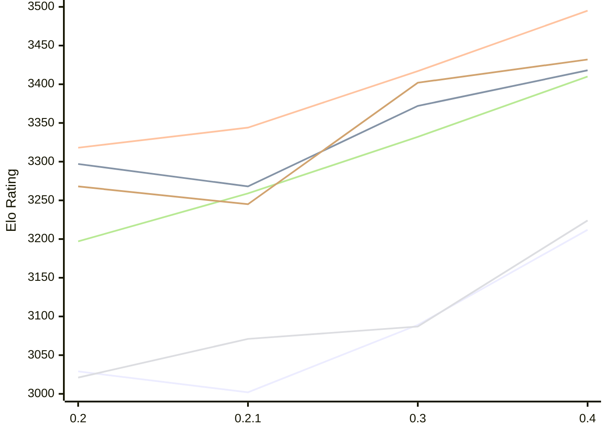

# Engine: StockDory

Author: Shaheryar Sohail

Home: https://github.com/TheBlackPlague/StockDory

## Elo Ratings E1 (Ultra 7 265T (1.50 GHz) - E-Core)

| Version | Published | STC 8.0+0.08s  | LTC 60.0+0.60s | VLTC 2m24s+1.12s | Comment |
| --- | --- | --- | --- | --- | --- |
| 0.4 | 2026-11-02 | 3212(+123) | 3418(+46) | 3495(+78) |  |
| 0.3 | 2026-10-06 | 3089(+87) | 3372(+104) | 3417(+73) |  |
| 0.2.1 | 2026-09-20 | 3002(-27) | 3268(-29) | 3344(+26) |  |
| 0.2 | 2026-09-15 | 3029 | 3297 | 3318 |  |
 | | | cElo (∆ prev) | cElo (∆ prev) | cElo (∆ prev) | 

## Elo Ratings P1 (Ultra 7 265T (1.50 GHz) - P-Core)

| Version | Published | STC 8.0+0.08s  | LTC 60.0+0.60s | VLTC 2m24s+1.12s | Comment |
| --- | --- | --- | --- | --- | --- |
| 0.4 | 2026-11-02 | 3224(+137) | 3410(+78) | 3432(+30) |  |
| 0.3 | 2026-10-06 | 3087(+16) | 3332(+73) | 3402(+157) |  |
| 0.2.1 | 2026-09-20 | 3071(+50) | 3259(+62) | 3245(-23) |  |
| 0.2 | 2026-09-15 | 3021 | 3197 | 3268 |  |
 | | | cElo (∆ prev) | cElo (∆ prev) | cElo (∆ prev) | 

## Elo Ratings T1 (i5-7500T 2.70GHz)

| Version | Published | STC 8.0+0.08s  | LTC 60.0+0.60s | VLTC 2m24s+1.12s | Comment |
| --- | --- | --- | --- | --- | --- |
| 0.2 | 2026-09-15 | 3021 | 3197 | 3268 |  |
 | | | cElo (∆ prev) | cElo (∆ prev) | cElo (∆ prev) | 

<a href="https://github.com/computer-chess-index/cci/issues/new?template=submit-version.yml&title=[VERSION]+StockDory+<version>&body=###%20Engine%20name%0AStockDory%0A%0A###%20Version%0A0.4" target="_blank">Submit new version</a>

 Test Conditions:

GUI/CLI: <a href=https://github.com/cutechess/cutechess target="_blank">Cute-Chess</a> 
Elo Calculation: <a href=https://www.remi-coulom.fr/Bayesian-Elo/ target="_blank">Bayesian-Elo</a> 
CPU for P1: Intel(R) Core(TM) Ultra 7 265T (1.50 GHz) - P-Core 
CPU for E1: Intel(R) Core(TM) Ultra 7 265T (1.50 GHz) - E-Core 
CPU for T1: Intel(R) Core(TM) i5-7500T 2.70GHz 
Opening book: 8_moves_v3 
\* STC: 8.0+0.08s, LTC: 60.0+0.60s, VLTC: 2m24s+1.12s

 Lists:
Ratings: <a href=https://github.com/computer-chess-index/cci/blob/main/lists/CCIRatings.csv target="_blank">Complete list</a>

Generated: 2026-11-23 05:43:20

## Ratings Verlauf E1 / P1

## Detailed Evaluation Results

| Version | Time Control | Variant | Elo  | Range +/- | Matches | Score | Average Opponent Elo | Draws |
| --- | --- |--- | --- | --- | --- | --- | --- | --- |
| 0.4 | VLTC (2m24s+1.12s) | P1 | 3432 | 37 | 182 | 49% | 3437 | 73% |
|  |  | E1 | 3495 | 31 | 248 | 51% | 3490 | 79% |
|  | LTC (60.0+0.60s) | P1 | 3410 | 41 | 144 | 51% | 3403 | 80% |
|  |  | E1 | 3418 | 29 | 296 | 52% | 3405 | 72% |
|  | STC (8.0+0.08s) | P1 | 3224 | 30 | 282 | 52% | 3213 | 67% |
|  |  | E1 | 3212 | 31 | 266 | 53% | 3191 | 67% |
| --- | --- |--- | --- | --- | --- | --- | --- | --- |
| 0.3 | VLTC (2m24s+1.12s) | P1 | 3402 | 35 | 216 | 53% | 3324 | 69% |
|  |  | E1 | 3417 | 27 | 359 | 56% | 3336 | 67% |
|  | LTC (60.0+0.60s) | P1 | 3332 | 32 | 264 | 54% | 3275 | 59% |
|  |  | E1 | 3372 | 28 | 348 | 55% | 3305 | 62% |
|  | STC (8.0+0.08s) | P1 | 3087 | 41 | 182 | 56% | 2988 | 50% |
|  |  | E1 | 3089 | 29 | 354 | 54% | 3035 | 52% |
| --- | --- |--- | --- | --- | --- | --- | --- | --- |
| 0.2.1 | VLTC (2m24s+1.12s) | P1 | 3245 | 62 | 62 | 50% | 3248 | 77% |
|  |  | E1 | 3344 | 36 | 204 | 47% | 3367 | 66% |
|  | LTC (60.0+0.60s) | P1 | 3259 | 92 | 32 | 38% | 3349 | 56% |
|  |  | E1 | 3268 | 39 | 168 | 47% | 3293 | 68% |
|  | STC (8.0+0.08s) | P1 | 3071 | 89 | 32 | 47% | 3094 | 63% |
|  |  | E1 | 3002 | 42 | 158 | 48% | 3017 | 52% |
| --- | --- |--- | --- | --- | --- | --- | --- | --- |
| 0.2 | VLTC (2m24s+1.12s) | P1 | 3268 | 69 | 56 | 43% | 3324 | 57% |
|  |  | E1 | 3318 | 40 | 158 | 53% | 3301 | 67% |
|  | LTC (60.0+0.60s) | P1 | 3197 | 60 | 72 | 42% | 3255 | 68% |
|  |  | E1 | 3297 | 44 | 134 | 43% | 3345 | 63% |
|  | STC (8.0+0.08s) | P1 | 3021 | 91 | 36 | 47% | 3048 | 39% |
|  |  | E1 | 3029 | 45 | 146 | 54% | 2990 | 46% |