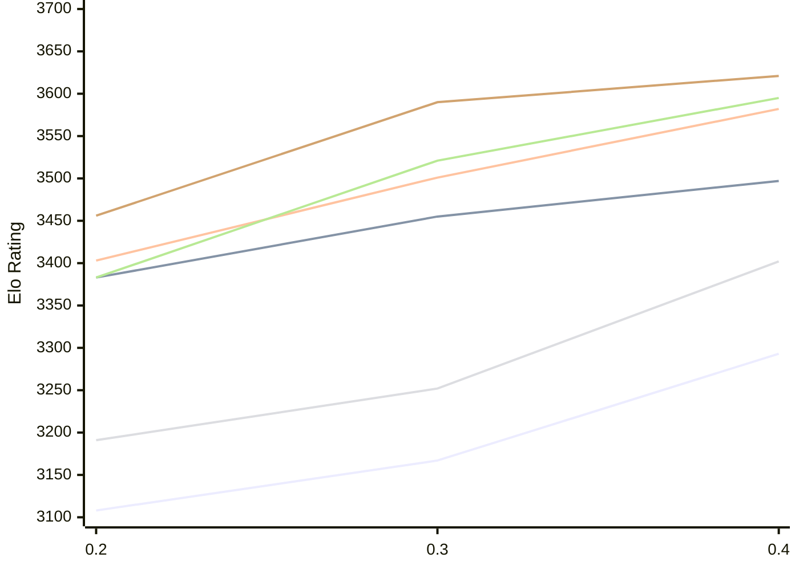

# Engine: StockDory

Author: Shaheryar Sohail

Home: https://github.com/TheBlackPlague/StockDory

## Elo Ratings E1 (Ultra 7 265T (1.50 GHz) - E-Core)

| Version | Published | STC 8.0+0.08s  | LTC 60.0+0.60s | VLTC 2m24s+1.12s | Comment |
| --- | --- | --- | --- | --- | --- |
| 0.4 | 2026-11-02 | 3293(+126) | 3497(+42) | 3582(+81) |  |
| 0.3 | 2026-10-06 | 3167(+59) | 3455(+72) | 3501(+98) |  |
| 0.2 | 2026-09-15 | 3108 | 3383 | 3403 |  |
 | | | cElo (∆ prev) | cElo (∆ prev) | cElo (∆ prev) | 

## Elo Ratings P1 (Ultra 7 265T (1.50 GHz) - P-Core)

| Version | Published | STC 8.0+0.08s  | LTC 60.0+0.60s | VLTC 2m24s+1.12s | Comment |
| --- | --- | --- | --- | --- | --- |
| 0.4 | 2026-11-02 | 3402(+150) | 3595(+74) | 3621(+31) |  |
| 0.3 | 2026-10-06 | 3252(+61) | 3521(+138) | 3590(+134) |  |
| 0.2 | 2026-09-15 | 3191 | 3383 | 3456 |  |
 | | | cElo (∆ prev) | cElo (∆ prev) | cElo (∆ prev) | 

## Elo Ratings T1 (i5-7500T 2.70GHz)

| Version | Published | STC 8.0+0.08s  | LTC 60.0+0.60s | VLTC 2m24s+1.12s | Comment |
| --- | --- | --- | --- | --- | --- |
| 0.2 | 2026-09-15 | 3191 | 3383 | 3456 |  |
 | | | cElo (∆ prev) | cElo (∆ prev) | cElo (∆ prev) | 

<a href="https://github.com/computer-chess-index/cci/issues/new?template=submit-version.yml&title=[VERSION]+StockDory+<version>&body=###%20Engine%20name%0AStockDory%0A%0A###%20Version%0A0.4" target="_blank">Submit new version</a>

 Test Conditions:

GUI/CLI: <a href=https://github.com/cutechess/cutechess target="_blank">Cute-Chess</a> 
Elo Calculation: <a href=https://www.remi-coulom.fr/Bayesian-Elo/ target="_blank">Bayesian-Elo</a> 
CPU for P1: Intel(R) Core(TM) Ultra 7 265T (1.50 GHz) - P-Core 
CPU for E1: Intel(R) Core(TM) Ultra 7 265T (1.50 GHz) - E-Core 
CPU for T1: Intel(R) Core(TM) i5-7500T 2.70GHz 
Opening book: 8_moves_v3 
\* STC: 8.0+0.08s, LTC: 60.0+0.60s, VLTC: 2m24s+1.12s

 Lists:
Ratings: <a href=https://github.com/computer-chess-index/cci/blob/main/lists/CCIRatings.csv target="_blank">Complete list</a>

Generated: 2026-11-11 05:42:58

## Ratings Verlauf E1 / P1

## Detailed Evaluation Results

| Version | Time Control | Variant | Elo  | Range +/- | Matches | Score | Average Opponent Elo | Draws |
| --- | --- |--- | --- | --- | --- | --- | --- | --- |
| 0.4 | VLTC (2m24s+1.12s) | P1 | 3621 | 37 | 178 | 49% | 3627 | 72% |
|  |  | E1 | 3582 | 32 | 228 | 51% | 3575 | 79% |
|  | LTC (60.0+0.60s) | P1 | 3595 | 44 | 124 | 51% | 3588 | 79% |
|  |  | E1 | 3497 | 31 | 260 | 51% | 3488 | 72% |
|  | STC (8.0+0.08s) | P1 | 3402 | 32 | 244 | 51% | 3394 | 68% |
|  |  | E1 | 3293 | 32 | 254 | 52% | 3274 | 68% |
| --- | --- |--- | --- | --- | --- | --- | --- | --- |
| 0.3 | VLTC (2m24s+1.12s) | P1 | 3590 | 35 | 216 | 53% | 3506 | 69% |
|  |  | E1 | 3501 | 29 | 327 | 57% | 3410 | 66% |
|  | LTC (60.0+0.60s) | P1 | 3521 | 32 | 264 | 54% | 3461 | 59% |
|  |  | E1 | 3455 | 29 | 328 | 56% | 3382 | 61% |
|  | STC (8.0+0.08s) | E1 | 3167 | 30 | 330 | 55% | 3106 | 52% |
|  |  | P1 | 3252 | 42 | 170 | 56% | 3141 | 48% |
| --- | --- |--- | --- | --- | --- | --- | --- | --- |
| 0.2 | VLTC (2m24s+1.12s) | E1 | 3403 | 40 | 158 | 53% | 3384 | 67% |
|  |  | P1 | 3456 | 69 | 56 | 43% | 3510 | 57% |
|  | LTC (60.0+0.60s) | E1 | 3383 | 44 | 134 | 43% | 3432 | 63% |
|  |  | P1 | 3383 | 60 | 72 | 42% | 3440 | 68% |
|  | STC (8.0+0.08s) | P1 | 3191 | 91 | 36 | 47% | 3220 | 39% |
|  |  | E1 | 3108 | 45 | 146 | 54% | 3070 | 46% |