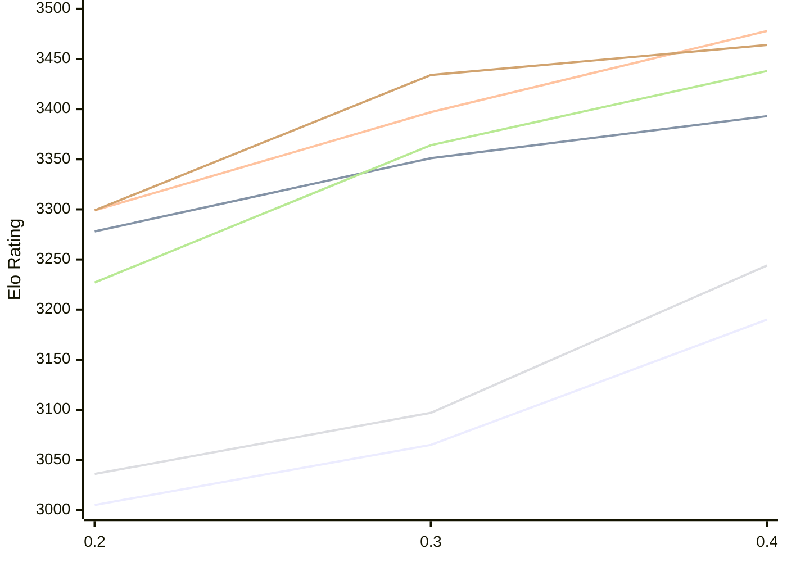

# Engine: StockDory

Author: Shaheryar Sohail

Home: https://github.com/TheBlackPlague/StockDory

## Elo Ratings E1 (Ultra 7 265T (1.50 GHz) - E-Core)

| Version | Published | STC 8.0+0.08s  | LTC 60.0+0.60s | VLTC 2m24s+1.12s | Comment |
| --- | --- | --- | --- | --- | --- |
| 0.4 | 2026-11-02 | 3190(+125) | 3393(+42) | 3478(+81) |  |
| 0.3 | 2026-10-06 | 3065(+60) | 3351(+73) | 3397(+98) |  |
| 0.2 | 2026-09-15 | 3005 | 3278 | 3299 |  |
 | | | cElo (∆ prev) | cElo (∆ prev) | cElo (∆ prev) | 

## Elo Ratings P1 (Ultra 7 265T (1.50 GHz) - P-Core)

| Version | Published | STC 8.0+0.08s  | LTC 60.0+0.60s | VLTC 2m24s+1.12s | Comment |
| --- | --- | --- | --- | --- | --- |
| 0.4 | 2026-11-02 | 3244(+147) | 3438(+74) | 3464(+30) |  |
| 0.3 | 2026-10-06 | 3097(+61) | 3364(+137) | 3434(+135) |  |
| 0.2 | 2026-09-15 | 3036 | 3227 | 3299 |  |
 | | | cElo (∆ prev) | cElo (∆ prev) | cElo (∆ prev) | 

## Elo Ratings T1 (i5-7500T 2.70GHz)

| Version | Published | STC 8.0+0.08s  | LTC 60.0+0.60s | VLTC 2m24s+1.12s | Comment |
| --- | --- | --- | --- | --- | --- |
| 0.2 | 2026-09-15 | 3036 | 3227 | 3299 |  |
 | | | cElo (∆ prev) | cElo (∆ prev) | cElo (∆ prev) | 

<a href="https://github.com/computer-chess-index/cci/issues/new?template=submit-version.yml&title=[VERSION]+StockDory+<version>&body=###%20Engine%20name%0AStockDory%0A%0A###%20Version%0A0.4" target="_blank">Submit new version</a>

 Test Conditions:

GUI/CLI: <a href=https://github.com/cutechess/cutechess target="_blank">Cute-Chess</a> 
Elo Calculation: <a href=https://www.remi-coulom.fr/Bayesian-Elo/ target="_blank">Bayesian-Elo</a> 
CPU for P1: Intel(R) Core(TM) Ultra 7 265T (1.50 GHz) - P-Core 
CPU for E1: Intel(R) Core(TM) Ultra 7 265T (1.50 GHz) - E-Core 
CPU for T1: Intel(R) Core(TM) i5-7500T 2.70GHz 
Opening book: 8_moves_v3 
\* STC: 8.0+0.08s, LTC: 60.0+0.60s, VLTC: 2m24s+1.12s

 Lists:
Ratings: <a href=https://github.com/computer-chess-index/cci/blob/main/lists/CCIRatings.csv target="_blank">Complete list</a>

Generated: 2026-11-13 05:43:18

## Ratings Verlauf E1 / P1

## Detailed Evaluation Results

| Version | Time Control | Variant | Elo  | Range +/- | Matches | Score | Average Opponent Elo | Draws |
| --- | --- |--- | --- | --- | --- | --- | --- | --- |
| 0.4 | VLTC (2m24s+1.12s) | P1 | 3464 | 37 | 182 | 49% | 3471 | 73% |
|  |  | E1 | 3478 | 32 | 230 | 51% | 3470 | 79% |
|  | LTC (60.0+0.60s) | P1 | 3438 | 44 | 124 | 51% | 3433 | 79% |
|  |  | E1 | 3393 | 31 | 260 | 51% | 3384 | 72% |
|  | STC (8.0+0.08s) | P1 | 3244 | 32 | 244 | 51% | 3237 | 68% |
|  |  | E1 | 3190 | 31 | 258 | 53% | 3170 | 68% |
| --- | --- |--- | --- | --- | --- | --- | --- | --- |
| 0.3 | VLTC (2m24s+1.12s) | E1 | 3397 | 28 | 331 | 57% | 3308 | 66% |
|  |  | P1 | 3434 | 35 | 216 | 53% | 3351 | 69% |
|  | LTC (60.0+0.60s) | E1 | 3351 | 29 | 332 | 55% | 3282 | 61% |
|  |  | P1 | 3364 | 32 | 264 | 54% | 3305 | 59% |
|  | STC (8.0+0.08s) | P1 | 3097 | 42 | 170 | 56% | 2990 | 48% |
|  |  | E1 | 3065 | 29 | 342 | 54% | 3013 | 52% |
| --- | --- |--- | --- | --- | --- | --- | --- | --- |
| 0.2 | VLTC (2m24s+1.12s) | P1 | 3299 | 69 | 56 | 43% | 3353 | 57% |
|  |  | E1 | 3299 | 40 | 158 | 53% | 3281 | 67% |
|  | LTC (60.0+0.60s) | P1 | 3227 | 60 | 72 | 42% | 3283 | 68% |
|  |  | E1 | 3278 | 44 | 134 | 43% | 3328 | 63% |
|  | STC (8.0+0.08s) | P1 | 3036 | 91 | 36 | 47% | 3065 | 39% |
|  |  | E1 | 3005 | 45 | 146 | 54% | 2967 | 46% |