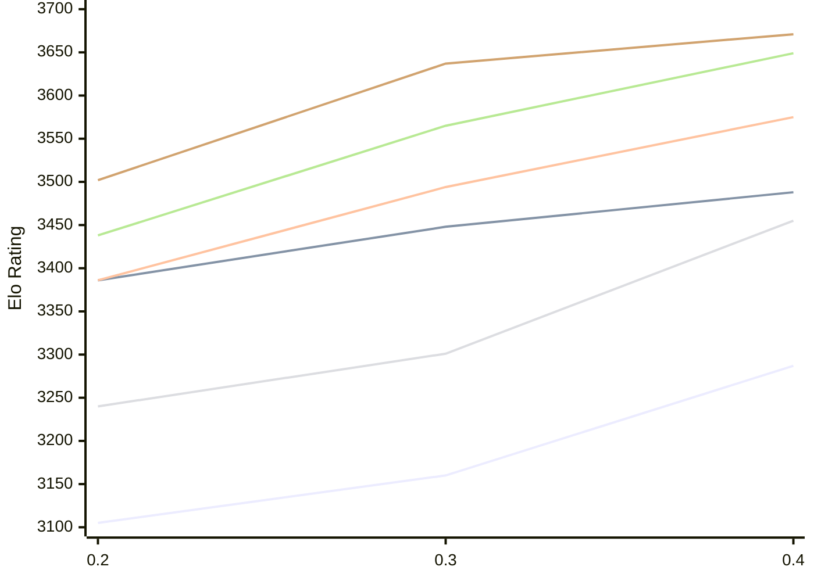

# Engine: StockDory

Author: Shaheryar Sohail

Home: https://github.com/TheBlackPlague/StockDory

## Elo Ratings E1 (Ultra 7 265T (1.50 GHz) - E-Core)

| Version | Published | STC 8.0+0.08s  | LTC 60.0+0.60s | VLTC 2m24s+1.12s | Comment |
| --- | --- | --- | --- | --- | --- |
| 0.4 | 2026-11-02 | 3287(+127) | 3488(+40) | 3575(+81) |  |
| 0.3 | 2026-10-06 | 3160(+55) | 3448(+62) | 3494(+108) |  |
| 0.2 | 2026-09-15 | 3105 | 3386 | 3386 |  |
 | | | cElo (∆ prev) | cElo (∆ prev) | cElo (∆ prev) | 

## Elo Ratings P1 (Ultra 7 265T (1.50 GHz) - P-Core)

| Version | Published | STC 8.0+0.08s  | LTC 60.0+0.60s | VLTC 2m24s+1.12s | Comment |
| --- | --- | --- | --- | --- | --- |
| 0.4 | 2026-11-02 | 3455(+154) | 3649(+84) | 3671(+34) |  |
| 0.3 | 2026-10-06 | 3301(+61) | 3565(+127) | 3637(+135) |  |
| 0.2 | 2026-09-15 | 3240 | 3438 | 3502 |  |
 | | | cElo (∆ prev) | cElo (∆ prev) | cElo (∆ prev) | 

## Elo Ratings T1 (i5-7500T 2.70GHz)

| Version | Published | STC 8.0+0.08s  | LTC 60.0+0.60s | VLTC 2m24s+1.12s | Comment |
| --- | --- | --- | --- | --- | --- |
| 0.2 | 2026-09-15 | 3240 | 3438 | 3502 |  |
 | | | cElo (∆ prev) | cElo (∆ prev) | cElo (∆ prev) | 

<a href="https://github.com/computer-chess-index/cci/issues/new?template=submit-version.yml&title=[VERSION]+StockDory+<version>&body=###%20Engine%20name%0AStockDory%0A%0A###%20Version%0A0.4" target="_blank">Submit new version</a>

 Test Conditions:

GUI/CLI: <a href=https://github.com/cutechess/cutechess target="_blank">Cute-Chess</a> 
Elo Calculation: <a href=https://www.remi-coulom.fr/Bayesian-Elo/ target="_blank">Bayesian-Elo</a> 
CPU for P1: Intel(R) Core(TM) Ultra 7 265T (1.50 GHz) - P-Core 
CPU for E1: Intel(R) Core(TM) Ultra 7 265T (1.50 GHz) - E-Core 
CPU for T1: Intel(R) Core(TM) i5-7500T 2.70GHz 
Opening book: 8_moves_v3 
\* STC: 8.0+0.08s, LTC: 60.0+0.60s, VLTC: 2m24s+1.12s

 Lists:
Ratings: <a href=https://github.com/computer-chess-index/cci/blob/main/lists/CCIRatings.csv target="_blank">Complete list</a>

Generated: 2026-11-06 05:42:50

## Ratings Verlauf E1 / P1

## Detailed Evaluation Results

| Version | Time Control | Variant | Elo  | Range +/- | Matches | Score | Average Opponent Elo | Draws |
| --- | --- |--- | --- | --- | --- | --- | --- | --- |
| 0.4 | VLTC (2m24s+1.12s) | E1 | 3575 | 34 | 204 | 52% | 3565 | 78% |
|  |  | P1 | 3671 | 42 | 140 | 49% | 3679 | 71% |
|  | LTC (60.0+0.60s) | P1 | 3649 | 47 | 104 | 52% | 3633 | 82% |
|  |  | E1 | 3488 | 33 | 232 | 51% | 3480 | 72% |
|  | STC (8.0+0.08s) | P1 | 3455 | 35 | 208 | 53% | 3438 | 64% |
|  |  | E1 | 3287 | 33 | 230 | 53% | 3264 | 68% |
| --- | --- |--- | --- | --- | --- | --- | --- | --- |
| 0.3 | VLTC (2m24s+1.12s) | P1 | 3637 | 35 | 216 | 53% | 3552 | 69% |
|  |  | E1 | 3494 | 29 | 327 | 57% | 3403 | 66% |
|  | LTC (60.0+0.60s) | P1 | 3565 | 32 | 264 | 54% | 3506 | 59% |
|  |  | E1 | 3448 | 29 | 328 | 56% | 3375 | 61% |
|  | STC (8.0+0.08s) | P1 | 3301 | 42 | 170 | 56% | 3190 | 48% |
|  |  | E1 | 3160 | 30 | 330 | 55% | 3100 | 52% |
| --- | --- |--- | --- | --- | --- | --- | --- | --- |
| 0.2 | VLTC (2m24s+1.12s) | P1 | 3502 | 69 | 56 | 43% | 3556 | 57% |
|  |  | E1 | 3386 | 43 | 136 | 52% | 3378 | 70% |
|  | LTC (60.0+0.60s) | P1 | 3438 | 64 | 62 | 43% | 3491 | 66% |
|  |  | E1 | 3386 | 49 | 110 | 44% | 3432 | 64% |
|  | STC (8.0+0.08s) | P1 | 3240 | 91 | 36 | 47% | 3267 | 39% |
|  |  | E1 | 3105 | 46 | 142 | 55% | 3060 | 46% |