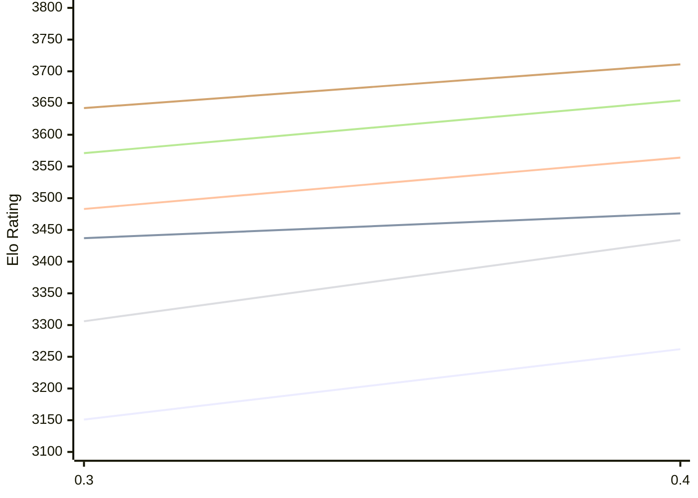

# Engine: StockDory

Author: Shaheryar Sohail

Home: https://github.com/TheBlackPlague/StockDory

## Elo Ratings E1 (Ultra 7 265T (1.50 GHz) - E-Core)

| Version | Published | STC 8.0+0.08s  | LTC 60.0+0.60s | VLTC 2m24s+1.12s | Comment |
| --- | --- | --- | --- | --- | --- |
| 0.4 | 2026-11-02 | 3262(+111) | 3476(+39) | 3564(+81) |  |
| 0.3 | 2026-10-06 | 3151 | 3437 | 3483 |  |
 | | | cElo (∆ prev) | cElo (∆ prev) | cElo (∆ prev) | 

## Elo Ratings P1 (Ultra 7 265T (1.50 GHz) - P-Core)

| Version | Published | STC 8.0+0.08s  | LTC 60.0+0.60s | VLTC 2m24s+1.12s | Comment |
| --- | --- | --- | --- | --- | --- |
| 0.4 | 2026-11-02 | 3434(+128) | 3654(+83) | 3711(+69) |  |
| 0.3 | 2026-10-06 | 3306 | 3571 | 3642 |  |
 | | | cElo (∆ prev) | cElo (∆ prev) | cElo (∆ prev) | 

## Elo Ratings T1 (i5-7500T 2.70GHz)

| Version | Published | STC 8.0+0.08s  | LTC 60.0+0.60s | VLTC 2m24s+1.12s | Comment |
| --- | --- | --- | --- | --- | --- |
| 0.3 | 2026-10-06 | 3306 | 3571 | 3642 |  |
 | | | cElo (∆ prev) | cElo (∆ prev) | cElo (∆ prev) | 

<a href="https://github.com/computer-chess-index/cci/issues/new?template=submit-version.yml&title=[VERSION]+StockDory+<version>&body=###%20Engine%20name%0AStockDory%0A%0A###%20Version%0A0.4" target="_blank">Submit new version</a>

 Test Conditions:

GUI/CLI: <a href=https://github.com/cutechess/cutechess target="_blank">Cute-Chess</a> 
Elo Calculation: <a href=https://www.remi-coulom.fr/Bayesian-Elo/ target="_blank">Bayesian-Elo</a> 
CPU for P1: Intel(R) Core(TM) Ultra 7 265T (1.50 GHz) - P-Core 
CPU for E1: Intel(R) Core(TM) Ultra 7 265T (1.50 GHz) - E-Core 
CPU for T1: Intel(R) Core(TM) i5-7500T 2.70GHz 
Opening book: 8_moves_v3 
\* STC: 8.0+0.08s, LTC: 60.0+0.60s, VLTC: 2m24s+1.12s

 Lists:
Ratings: <a href=https://github.com/computer-chess-index/cci/blob/main/lists/CCIRatings.csv target="_blank">Complete list</a>

Generated: 2026-11-05 05:42:53

## Ratings Verlauf E1 / P1

## Detailed Evaluation Results

| Version | Time Control | Variant | Elo  | Range +/- | Matches | Score | Average Opponent Elo | Draws |
| --- | --- |--- | --- | --- | --- | --- | --- | --- |
| 0.4 | VLTC (2m24s+1.12s) | P1 | 3711 | 89 | 32 | 55% | 3679 | 66% |
|  |  | E1 | 3564 | 46 | 116 | 53% | 3542 | 78% |
|  | LTC (60.0+0.60s) | P1 | 3654 | 64 | 56 | 54% | 3630 | 86% |
|  |  | E1 | 3476 | 49 | 100 | 51% | 3472 | 75% |
|  | STC (8.0+0.08s) | P1 | 3434 | 67 | 56 | 54% | 3402 | 70% |
|  |  | E1 | 3262 | 52 | 96 | 55% | 3221 | 65% |
| --- | --- |--- | --- | --- | --- | --- | --- | --- |
| 0.3 | VLTC (2m24s+1.12s) | P1 | 3642 | 35 | 216 | 53% | 3559 | 69% |
|  |  | E1 | 3483 | 29 | 327 | 57% | 3393 | 66% |
|  | LTC (60.0+0.60s) | P1 | 3571 | 32 | 264 | 54% | 3513 | 59% |
|  |  | E1 | 3437 | 29 | 328 | 56% | 3364 | 61% |
|  | STC (8.0+0.08s) | P1 | 3306 | 42 | 170 | 56% | 3195 | 48% |
|  |  | E1 | 3151 | 30 | 330 | 55% | 3089 | 52% |