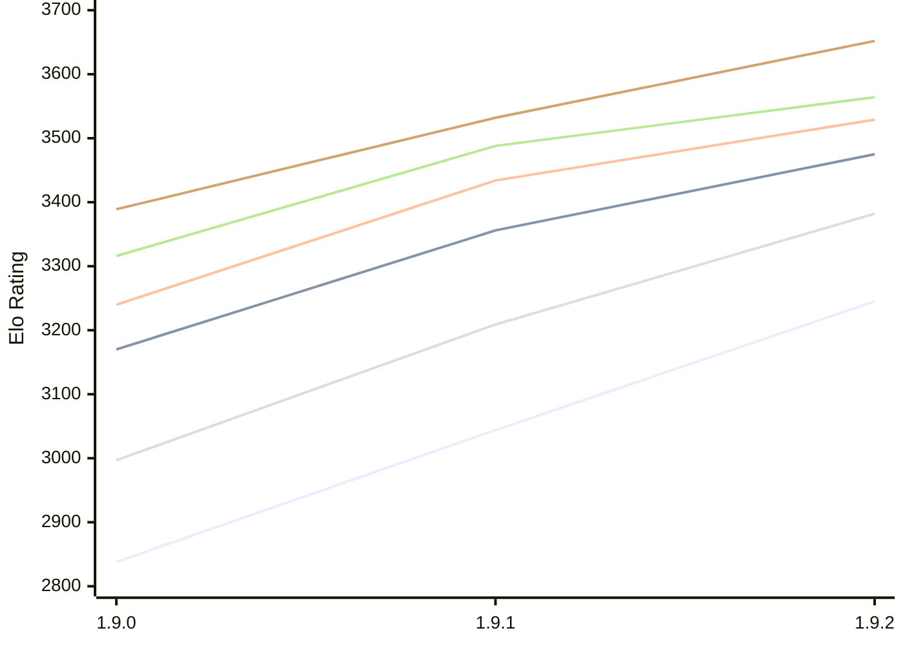

# Engine: Superpawn

Author: John Byrd

Home: https://github.com/johnwbyrd/superpawn

## Elo Ratings E1 (Ultra 7 265T (1.50 GHz) - E-Core)

| Version | Published | STC 8.0+0.08s  | LTC 60.0+0.60s | VLTC 2m24s+1.12s | Comment |
| --- | --- | --- | --- | --- | --- |
| 1.9.2 | 2026-11-08 | 3245(+201) | 3475(+119) | 3529(+95) |  |
| 1.9.1 | 2026-10-18 | 3044(+206) | 3356(+186) | 3434(+194) |  |
| 1.9.0 | 2026-10-16 | 2838 | 3170 | 3240 |  |
 | | | cElo (∆ prev) | cElo (∆ prev) | cElo (∆ prev) | 

## Elo Ratings P1 (Ultra 7 265T (1.50 GHz) - P-Core)

| Version | Published | STC 8.0+0.08s  | LTC 60.0+0.60s | VLTC 2m24s+1.12s | Comment |
| --- | --- | --- | --- | --- | --- |
| 1.9.2 | 2026-11-08 | 3382(+173) | 3564(+76) | 3652(+120) |  |
| 1.9.1 | 2026-10-18 | 3209(+212) | 3488(+172) | 3532(+143) |  |
| 1.9.0 | 2026-10-16 | 2997 | 3316 | 3389 |  |
 | | | cElo (∆ prev) | cElo (∆ prev) | cElo (∆ prev) | 

## Elo Ratings T1 (i5-7500T 2.70GHz)

| Version | Published | STC 8.0+0.08s  | LTC 60.0+0.60s | VLTC 2m24s+1.12s | Comment |
| --- | --- | --- | --- | --- | --- |
| 1.9.0 | 2026-10-16 | 2997 | 3316 | 3389 |  |
 | | | cElo (∆ prev) | cElo (∆ prev) | cElo (∆ prev) | 

<a href="https://github.com/computer-chess-index/cci/issues/new?template=submit-version.yml&title=[VERSION]+Superpawn+<version>&body=###%20Engine%20name%0ASuperpawn%0A%0A###%20Version%0A1.9.2" target="_blank">Submit new version</a>

 Test Conditions:

GUI/CLI: <a href=https://github.com/cutechess/cutechess target="_blank">Cute-Chess</a> 
Elo Calculation: <a href=https://www.remi-coulom.fr/Bayesian-Elo/ target="_blank">Bayesian-Elo</a> 
CPU for P1: Intel(R) Core(TM) Ultra 7 265T (1.50 GHz) - P-Core 
CPU for E1: Intel(R) Core(TM) Ultra 7 265T (1.50 GHz) - E-Core 
CPU for T1: Intel(R) Core(TM) i5-7500T 2.70GHz 
Opening book: 8_moves_v3 
\* STC: 8.0+0.08s, LTC: 60.0+0.60s, VLTC: 2m24s+1.12s

 Lists:
Ratings: <a href=https://github.com/computer-chess-index/cci/blob/main/lists/CCIRatings.csv target="_blank">Complete list</a>

Generated: 2026-11-12 05:43:07

## Ratings Verlauf E1 / P1

## Detailed Evaluation Results

| Version | Time Control | Variant | Elo  | Range +/- | Matches | Score | Average Opponent Elo | Draws |
| --- | --- |--- | --- | --- | --- | --- | --- | --- |
| 1.9.2 | VLTC (2m24s+1.12s) | P1 | 3652 | 31 | 258 | 55% | 3619 | 76% |
|  |  | E1 | 3529 | 34 | 218 | 52% | 3518 | 72% |
|  | LTC (60.0+0.60s) | P1 | 3564 | 42 | 136 | 51% | 3557 | 76% |
|  |  | E1 | 3475 | 28 | 330 | 53% | 3456 | 68% |
|  | STC (8.0+0.08s) | P1 | 3382 | 35 | 222 | 53% | 3357 | 60% |
|  |  | E1 | 3245 | 33 | 250 | 53% | 3222 | 58% |
| --- | --- |--- | --- | --- | --- | --- | --- | --- |
| 1.9.1 | VLTC (2m24s+1.12s) | P1 | 3532 | 35 | 210 | 52% | 3519 | 62% |
|  |  | E1 | 3434 | 29 | 314 | 52% | 3424 | 65% |
|  | LTC (60.0+0.60s) | P1 | 3488 | 35 | 216 | 50% | 3487 | 58% |
|  |  | E1 | 3356 | 32 | 264 | 52% | 3341 | 55% |
|  | STC (8.0+0.08s) | P1 | 3209 | 42 | 160 | 51% | 3201 | 48% |
|  |  | E1 | 3044 | 30 | 344 | 54% | 3011 | 38% |
| --- | --- |--- | --- | --- | --- | --- | --- | --- |
| 1.9.0 | VLTC (2m24s+1.12s) | P1 | 3389 | 43 | 194 | 60% | 3136 | 39% |
|  |  | E1 | 3240 | 34 | 292 | 55% | 3083 | 40% |
|  | LTC (60.0+0.60s) | P1 | 3316 | 50 | 150 | 62% | 2978 | 32% |
|  |  | E1 | 3170 | 42 | 214 | 62% | 2880 | 34% |
|  | STC (8.0+0.08s) | P1 | 2997 | 47 | 176 | 58% | 2765 | 26% |
|  |  | E1 | 2838 | 42 | 220 | 61% | 2585 | 26% |