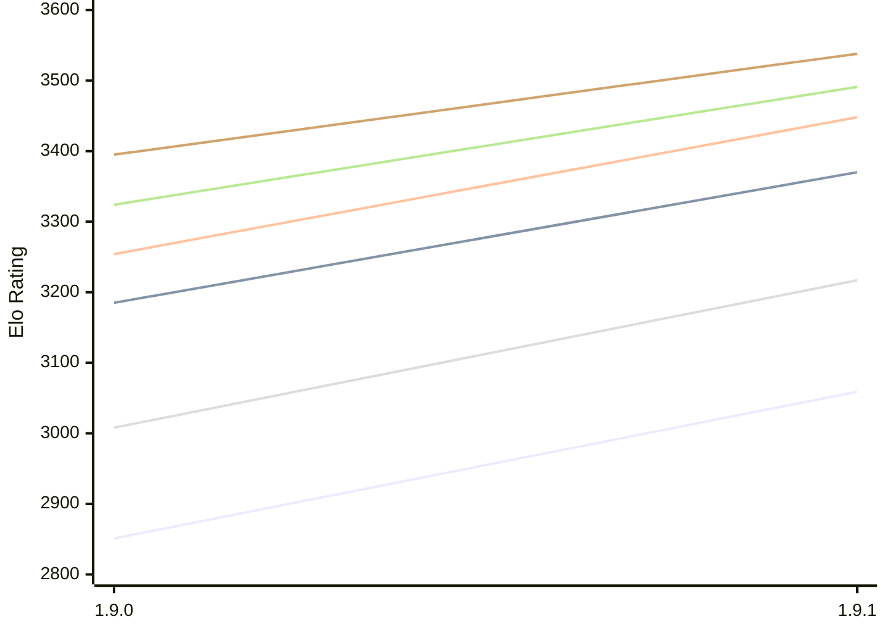

# Engine: Superpawn

Author: John Byrd

Home: https://github.com/johnwbyrd/superpawn

## Elo Ratings E1 (Ultra 7 265T (1.50 GHz) - E-Core)

| Version | Published | STC 8.0+0.08s  | LTC 60.0+0.60s | VLTC 2m24s+1.12s | Comment |
| --- | --- | --- | --- | --- | --- |
| 1.9.1 | 2026-10-18 | 3059(+208) | 3370(+185) | 3448(+194) |  |
| 1.9.0 | 2026-10-16 | 2851 | 3185 | 3254 |  |
 | | | cElo (∆ prev) | cElo (∆ prev) | cElo (∆ prev) | 

## Elo Ratings P1 (Ultra 7 265T (1.50 GHz) - P-Core)

| Version | Published | STC 8.0+0.08s  | LTC 60.0+0.60s | VLTC 2m24s+1.12s | Comment |
| --- | --- | --- | --- | --- | --- |
| 1.9.1 | 2026-10-18 | 3217(+209) | 3491(+167) | 3538(+143) |  |
| 1.9.0 | 2026-10-16 | 3008 | 3324 | 3395 |  |
 | | | cElo (∆ prev) | cElo (∆ prev) | cElo (∆ prev) | 

## Elo Ratings T1 (i5-7500T 2.70GHz)

| Version | Published | STC 8.0+0.08s  | LTC 60.0+0.60s | VLTC 2m24s+1.12s | Comment |
| --- | --- | --- | --- | --- | --- |
| 1.9.0 | 2026-10-16 | 3008 | 3324 | 3395 |  |
 | | | cElo (∆ prev) | cElo (∆ prev) | cElo (∆ prev) | 

<a href="https://github.com/computer-chess-index/cci/issues/new?template=submit-version.yml&title=[VERSION]+Superpawn+<version>&body=###%20Engine%20name%0ASuperpawn%0A%0A###%20Version%0A1.9.1" target="_blank">Submit new version</a>

 Test Conditions:

GUI/CLI: <a href=https://github.com/cutechess/cutechess target="_blank">Cute-Chess</a> 
Elo Calculation: <a href=https://www.remi-coulom.fr/Bayesian-Elo/ target="_blank">Bayesian-Elo</a> 
CPU for P1: Intel(R) Core(TM) Ultra 7 265T (1.50 GHz) - P-Core 
CPU for E1: Intel(R) Core(TM) Ultra 7 265T (1.50 GHz) - E-Core 
CPU for T1: Intel(R) Core(TM) i5-7500T 2.70GHz 
Opening book: 8_moves_v3 
\* STC: 8.0+0.08s, LTC: 60.0+0.60s, VLTC: 2m24s+1.12s

 Lists:
Ratings: <a href=https://github.com/computer-chess-index/cci/blob/main/lists/CCIRatings.csv target="_blank">Complete list</a>

Generated: 2026-11-04 05:43:29

## Ratings Verlauf E1 / P1

## Detailed Evaluation Results

| Version | Time Control | Variant | Elo  | Range +/- | Matches | Score | Average Opponent Elo | Draws |
| --- | --- |--- | --- | --- | --- | --- | --- | --- |
| 1.9.1 | VLTC (2m24s+1.12s) | P1 | 3538 | 36 | 202 | 52% | 3525 | 62% |
|  |  | E1 | 3448 | 31 | 274 | 52% | 3433 | 65% |
|  | LTC (60.0+0.60s) | P1 | 3491 | 36 | 208 | 50% | 3491 | 57% |
|  |  | E1 | 3370 | 34 | 236 | 52% | 3356 | 55% |
|  | STC (8.0+0.08s) | P1 | 3217 | 43 | 156 | 50% | 3212 | 47% |
|  |  | E1 | 3059 | 33 | 300 | 55% | 3016 | 36% |
| --- | --- |--- | --- | --- | --- | --- | --- | --- |
| 1.9.0 | VLTC (2m24s+1.12s) | P1 | 3395 | 43 | 194 | 60% | 3144 | 39% |
|  |  | E1 | 3254 | 34 | 292 | 55% | 3096 | 40% |
|  | LTC (60.0+0.60s) | P1 | 3324 | 50 | 150 | 62% | 2988 | 32% |
|  |  | E1 | 3185 | 42 | 214 | 62% | 2893 | 34% |
|  | STC (8.0+0.08s) | E1 | 2851 | 42 | 224 | 61% | 2599 | 26% |
|  |  | P1 | 3008 | 47 | 176 | 58% | 2777 | 26% |