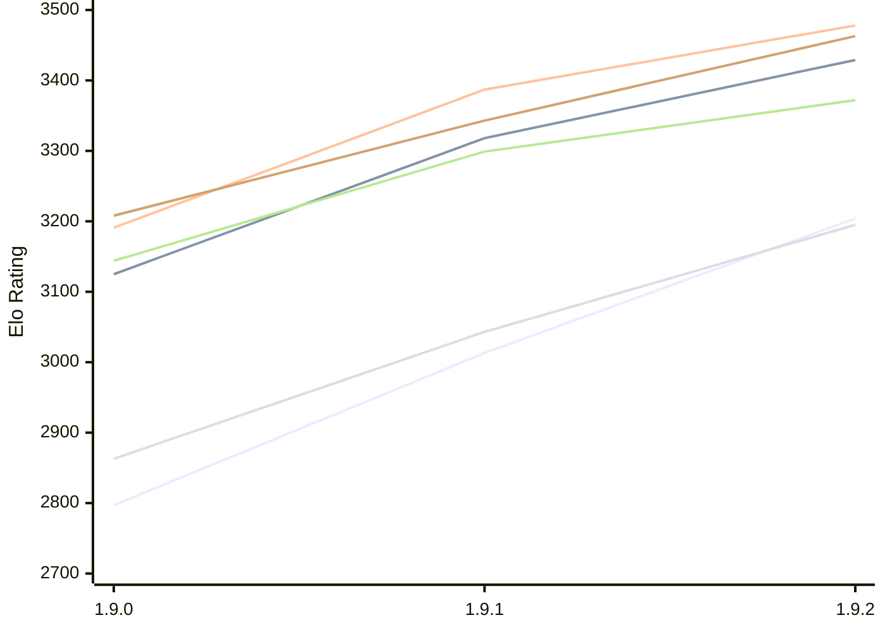

# Engine: Superpawn

Author: John Byrd

Home: https://github.com/johnwbyrd/superpawn

## Elo Ratings E1 (Ultra 7 265T (1.50 GHz) - E-Core)

| Version | Published | STC 8.0+0.08s  | LTC 60.0+0.60s | VLTC 2m24s+1.12s | Comment |
| --- | --- | --- | --- | --- | --- |
| 1.9.2 | 2026-11-08 | 3204(+191) | 3429(+111) | 3478(+91) |  |
| 1.9.1 | 2026-10-18 | 3013(+216) | 3318(+193) | 3387(+196) |  |
| 1.9.0 | 2026-10-16 | 2797 | 3125 | 3191 |  |
 | | | cElo (∆ prev) | cElo (∆ prev) | cElo (∆ prev) | 

## Elo Ratings P1 (Ultra 7 265T (1.50 GHz) - P-Core)

| Version | Published | STC 8.0+0.08s  | LTC 60.0+0.60s | VLTC 2m24s+1.12s | Comment |
| --- | --- | --- | --- | --- | --- |
| 1.9.2 | 2026-11-08 | 3195(+152) | 3372(+73) | 3463(+120) |  |
| 1.9.1 | 2026-10-18 | 3043(+180) | 3299(+155) | 3343(+135) |  |
| 1.9.0 | 2026-10-16 | 2863 | 3144 | 3208 |  |
 | | | cElo (∆ prev) | cElo (∆ prev) | cElo (∆ prev) | 

## Elo Ratings T1 (i5-7500T 2.70GHz)

| Version | Published | STC 8.0+0.08s  | LTC 60.0+0.60s | VLTC 2m24s+1.12s | Comment |
| --- | --- | --- | --- | --- | --- |
| 1.9.0 | 2026-10-16 | 2863 | 3144 | 3208 |  |
 | | | cElo (∆ prev) | cElo (∆ prev) | cElo (∆ prev) | 

<a href="https://github.com/computer-chess-index/cci/issues/new?template=submit-version.yml&title=[VERSION]+Superpawn+<version>&body=###%20Engine%20name%0ASuperpawn%0A%0A###%20Version%0A1.9.2" target="_blank">Submit new version</a>

 Test Conditions:

GUI/CLI: <a href=https://github.com/cutechess/cutechess target="_blank">Cute-Chess</a> 
Elo Calculation: <a href=https://www.remi-coulom.fr/Bayesian-Elo/ target="_blank">Bayesian-Elo</a> 
CPU for P1: Intel(R) Core(TM) Ultra 7 265T (1.50 GHz) - P-Core 
CPU for E1: Intel(R) Core(TM) Ultra 7 265T (1.50 GHz) - E-Core 
CPU for T1: Intel(R) Core(TM) i5-7500T 2.70GHz 
Opening book: 8_moves_v3 
\* STC: 8.0+0.08s, LTC: 60.0+0.60s, VLTC: 2m24s+1.12s

 Lists:
Ratings: <a href=https://github.com/computer-chess-index/cci/blob/main/lists/CCIRatings.csv target="_blank">Complete list</a>

Generated: 2026-11-25 05:43:46

## Ratings Verlauf E1 / P1

## Detailed Evaluation Results

| Version | Time Control | Variant | Elo  | Range +/- | Matches | Score | Average Opponent Elo | Draws |
| --- | --- |--- | --- | --- | --- | --- | --- | --- |
| 1.9.2 | VLTC (2m24s+1.12s) | P1 | 3463 | 30 | 266 | 54% | 3433 | 76% |
|  |  | E1 | 3478 | 32 | 246 | 51% | 3471 | 73% |
|  | LTC (60.0+0.60s) | P1 | 3372 | 41 | 144 | 51% | 3370 | 76% |
|  |  | E1 | 3429 | 27 | 358 | 53% | 3407 | 69% |
|  | STC (8.0+0.08s) | P1 | 3195 | 32 | 258 | 52% | 3182 | 60% |
|  |  | E1 | 3204 | 30 | 306 | 53% | 3183 | 57% |
| --- | --- |--- | --- | --- | --- | --- | --- | --- |
| 1.9.1 | VLTC (2m24s+1.12s) | P1 | 3343 | 35 | 210 | 52% | 3330 | 62% |
|  |  | E1 | 3387 | 28 | 346 | 51% | 3376 | 64% |
|  | LTC (60.0+0.60s) | P1 | 3299 | 33 | 248 | 49% | 3306 | 59% |
|  |  | E1 | 3318 | 30 | 302 | 53% | 3295 | 56% |
|  | STC (8.0+0.08s) | P1 | 3043 | 40 | 180 | 50% | 3044 | 45% |
|  |  | E1 | 3013 | 28 | 400 | 53% | 2985 | 39% |
| --- | --- |--- | --- | --- | --- | --- | --- | --- |
| 1.9.0 | VLTC (2m24s+1.12s) | P1 | 3208 | 43 | 194 | 60% | 2975 | 39% |
|  |  | E1 | 3191 | 34 | 292 | 55% | 3036 | 40% |
|  | LTC (60.0+0.60s) | P1 | 3144 | 50 | 150 | 62% | 2830 | 32% |
|  |  | E1 | 3125 | 42 | 214 | 62% | 2835 | 34% |
|  | STC (8.0+0.08s) | E1 | 2797 | 42 | 220 | 61% | 2546 | 26% |
|  |  | P1 | 2863 | 47 | 176 | 58% | 2643 | 26% |