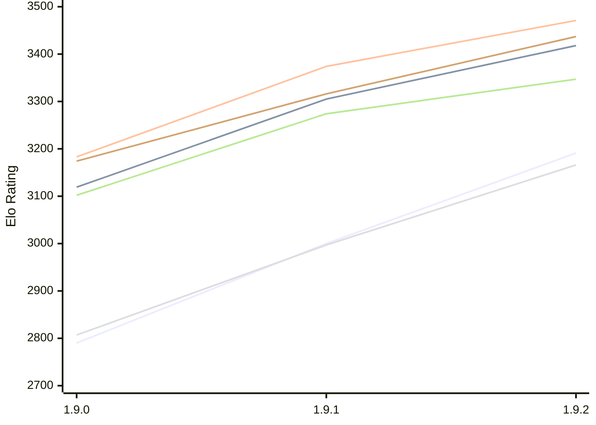

# Engine: Superpawn

Author: John Byrd

Home: https://github.com/johnwbyrd/superpawn

## Elo Ratings E1 (Ultra 7 265T (1.50 GHz) - E-Core)

| Version | Published | STC 8.0+0.08s  | LTC 60.0+0.60s | VLTC 2m24s+1.12s | Comment |
| --- | --- | --- | --- | --- | --- |
| 1.9.2 | 2026-11-08 | 3191(+191) | 3418(+113) | 3471(+97) |  |
| 1.9.1 | 2026-10-18 | 3000(+210) | 3305(+186) | 3374(+191) |  |
| 1.9.0 | 2026-10-16 | 2790 | 3119 | 3183 |  |
 | | | cElo (∆ prev) | cElo (∆ prev) | cElo (∆ prev) | 

## Elo Ratings P1 (Ultra 7 265T (1.50 GHz) - P-Core)

| Version | Published | STC 8.0+0.08s  | LTC 60.0+0.60s | VLTC 2m24s+1.12s | Comment |
| --- | --- | --- | --- | --- | --- |
| 1.9.2 | 2026-11-08 | 3166(+169) | 3347(+73) | 3437(+121) |  |
| 1.9.1 | 2026-10-18 | 2997(+190) | 3274(+172) | 3316(+142) |  |
| 1.9.0 | 2026-10-16 | 2807 | 3102 | 3174 |  |
 | | | cElo (∆ prev) | cElo (∆ prev) | cElo (∆ prev) | 

## Elo Ratings T1 (i5-7500T 2.70GHz)

| Version | Published | STC 8.0+0.08s  | LTC 60.0+0.60s | VLTC 2m24s+1.12s | Comment |
| --- | --- | --- | --- | --- | --- |
| 1.9.0 | 2026-10-16 | 2807 | 3102 | 3174 |  |
 | | | cElo (∆ prev) | cElo (∆ prev) | cElo (∆ prev) | 

<a href="https://github.com/computer-chess-index/cci/issues/new?template=submit-version.yml&title=[VERSION]+Superpawn+<version>&body=###%20Engine%20name%0ASuperpawn%0A%0A###%20Version%0A1.9.2" target="_blank">Submit new version</a>

 Test Conditions:

GUI/CLI: <a href=https://github.com/cutechess/cutechess target="_blank">Cute-Chess</a> 
Elo Calculation: <a href=https://www.remi-coulom.fr/Bayesian-Elo/ target="_blank">Bayesian-Elo</a> 
CPU for P1: Intel(R) Core(TM) Ultra 7 265T (1.50 GHz) - P-Core 
CPU for E1: Intel(R) Core(TM) Ultra 7 265T (1.50 GHz) - E-Core 
CPU for T1: Intel(R) Core(TM) i5-7500T 2.70GHz 
Opening book: 8_moves_v3 
\* STC: 8.0+0.08s, LTC: 60.0+0.60s, VLTC: 2m24s+1.12s

 Lists:
Ratings: <a href=https://github.com/computer-chess-index/cci/blob/main/lists/CCIRatings.csv target="_blank">Complete list</a>

Generated: 2026-11-15 05:43:24

## Ratings Verlauf E1 / P1

## Detailed Evaluation Results

| Version | Time Control | Variant | Elo  | Range +/- | Matches | Score | Average Opponent Elo | Draws |
| --- | --- |--- | --- | --- | --- | --- | --- | --- |
| 1.9.2 | VLTC (2m24s+1.12s) | P1 | 3437 | 31 | 258 | 55% | 3406 | 76% |
|  |  | E1 | 3471 | 33 | 230 | 51% | 3464 | 73% |
|  | LTC (60.0+0.60s) | P1 | 3347 | 42 | 140 | 51% | 3343 | 76% |
|  |  | E1 | 3418 | 27 | 338 | 53% | 3399 | 68% |
|  | STC (8.0+0.08s) | E1 | 3191 | 32 | 266 | 52% | 3174 | 58% |
|  |  | P1 | 3166 | 35 | 222 | 53% | 3141 | 60% |
| --- | --- |--- | --- | --- | --- | --- | --- | --- |
| 1.9.1 | VLTC (2m24s+1.12s) | P1 | 3316 | 35 | 210 | 52% | 3305 | 62% |
|  |  | E1 | 3374 | 29 | 322 | 51% | 3367 | 65% |
|  | LTC (60.0+0.60s) | P1 | 3274 | 35 | 220 | 50% | 3272 | 59% |
|  |  | E1 | 3305 | 31 | 288 | 53% | 3285 | 56% |
|  | STC (8.0+0.08s) | P1 | 2997 | 42 | 164 | 50% | 2998 | 47% |
|  |  | E1 | 3000 | 29 | 380 | 53% | 2975 | 38% |
| --- | --- |--- | --- | --- | --- | --- | --- | --- |
| 1.9.0 | VLTC (2m24s+1.12s) | E1 | 3183 | 34 | 292 | 55% | 3031 | 40% |
|  |  | P1 | 3174 | 43 | 194 | 60% | 2942 | 39% |
|  | LTC (60.0+0.60s) | E1 | 3119 | 42 | 214 | 62% | 2832 | 34% |
|  |  | P1 | 3102 | 50 | 150 | 62% | 2793 | 32% |
|  | STC (8.0+0.08s) | E1 | 2790 | 42 | 220 | 61% | 2542 | 26% |
|  |  | P1 | 2807 | 47 | 176 | 58% | 2596 | 26% |