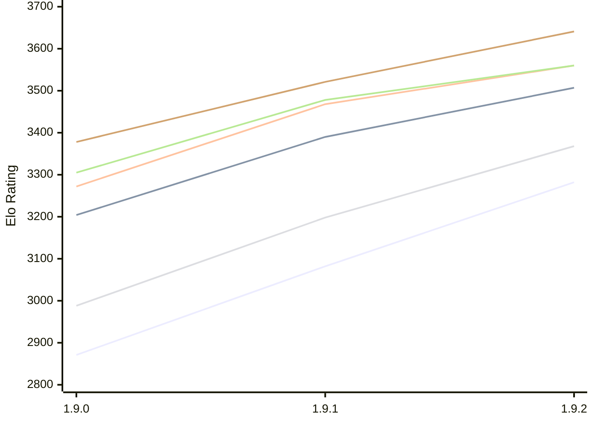

# Engine: Superpawn

Author: John Byrd

Home: https://github.com/johnwbyrd/superpawn

## Elo Ratings E1 (Ultra 7 265T (1.50 GHz) - E-Core)

| Version | Published | STC 8.0+0.08s  | LTC 60.0+0.60s | VLTC 2m24s+1.12s | Comment |
| --- | --- | --- | --- | --- | --- |
| 1.9.2 | 2026-11-08 | 3282(+200) | 3507(+117) | 3560(+92) |  |
| 1.9.1 | 2026-10-18 | 3082(+211) | 3390(+186) | 3468(+196) |  |
| 1.9.0 | 2026-10-16 | 2871 | 3204 | 3272 |  |
 | | | cElo (∆ prev) | cElo (∆ prev) | cElo (∆ prev) | 

## Elo Ratings P1 (Ultra 7 265T (1.50 GHz) - P-Core)

| Version | Published | STC 8.0+0.08s  | LTC 60.0+0.60s | VLTC 2m24s+1.12s | Comment |
| --- | --- | --- | --- | --- | --- |
| 1.9.2 | 2026-11-08 | 3368(+170) | 3560(+82) | 3641(+120) |  |
| 1.9.1 | 2026-10-18 | 3198(+210) | 3478(+173) | 3521(+143) |  |
| 1.9.0 | 2026-10-16 | 2988 | 3305 | 3378 |  |
 | | | cElo (∆ prev) | cElo (∆ prev) | cElo (∆ prev) | 

## Elo Ratings T1 (i5-7500T 2.70GHz)

| Version | Published | STC 8.0+0.08s  | LTC 60.0+0.60s | VLTC 2m24s+1.12s | Comment |
| --- | --- | --- | --- | --- | --- |
| 1.9.0 | 2026-10-16 | 2988 | 3305 | 3378 |  |
 | | | cElo (∆ prev) | cElo (∆ prev) | cElo (∆ prev) | 

<a href="https://github.com/computer-chess-index/cci/issues/new?template=submit-version.yml&title=[VERSION]+Superpawn+<version>&body=###%20Engine%20name%0ASuperpawn%0A%0A###%20Version%0A1.9.2" target="_blank">Submit new version</a>

 Test Conditions:

GUI/CLI: <a href=https://github.com/cutechess/cutechess target="_blank">Cute-Chess</a> 
Elo Calculation: <a href=https://www.remi-coulom.fr/Bayesian-Elo/ target="_blank">Bayesian-Elo</a> 
CPU for P1: Intel(R) Core(TM) Ultra 7 265T (1.50 GHz) - P-Core 
CPU for E1: Intel(R) Core(TM) Ultra 7 265T (1.50 GHz) - E-Core 
CPU for T1: Intel(R) Core(TM) i5-7500T 2.70GHz 
Opening book: 8_moves_v3 
\* STC: 8.0+0.08s, LTC: 60.0+0.60s, VLTC: 2m24s+1.12s

 Lists:
Ratings: <a href=https://github.com/computer-chess-index/cci/blob/main/lists/CCIRatings.csv target="_blank">Complete list</a>

Generated: 2026-11-11 05:43:13

## Ratings Verlauf E1 / P1

## Detailed Evaluation Results

| Version | Time Control | Variant | Elo  | Range +/- | Matches | Score | Average Opponent Elo | Draws |
| --- | --- |--- | --- | --- | --- | --- | --- | --- |
| 1.9.2 | VLTC (2m24s+1.12s) | P1 | 3641 | 31 | 258 | 55% | 3609 | 76% |
|  |  | E1 | 3560 | 35 | 208 | 52% | 3549 | 71% |
|  | LTC (60.0+0.60s) | P1 | 3560 | 45 | 116 | 52% | 3546 | 78% |
|  |  | E1 | 3507 | 28 | 330 | 53% | 3490 | 68% |
|  | STC (8.0+0.08s) | P1 | 3368 | 37 | 198 | 53% | 3343 | 59% |
|  |  | E1 | 3282 | 34 | 234 | 54% | 3254 | 57% |
| --- | --- |--- | --- | --- | --- | --- | --- | --- |
| 1.9.1 | VLTC (2m24s+1.12s) | P1 | 3521 | 35 | 210 | 52% | 3509 | 62% |
|  |  | E1 | 3468 | 29 | 314 | 52% | 3456 | 65% |
|  | LTC (60.0+0.60s) | P1 | 3478 | 35 | 216 | 50% | 3476 | 58% |
|  |  | E1 | 3390 | 32 | 264 | 52% | 3374 | 55% |
|  | STC (8.0+0.08s) | P1 | 3198 | 42 | 160 | 51% | 3190 | 48% |
|  |  | E1 | 3082 | 31 | 336 | 54% | 3043 | 37% |
| --- | --- |--- | --- | --- | --- | --- | --- | --- |
| 1.9.0 | VLTC (2m24s+1.12s) | P1 | 3378 | 43 | 194 | 60% | 3125 | 39% |
|  |  | E1 | 3272 | 34 | 292 | 55% | 3114 | 40% |
|  | LTC (60.0+0.60s) | P1 | 3305 | 50 | 150 | 62% | 2969 | 32% |
|  |  | E1 | 3204 | 42 | 214 | 62% | 2911 | 34% |
|  | STC (8.0+0.08s) | P1 | 2988 | 47 | 176 | 58% | 2755 | 26% |
|  |  | E1 | 2871 | 42 | 220 | 61% | 2615 | 26% |