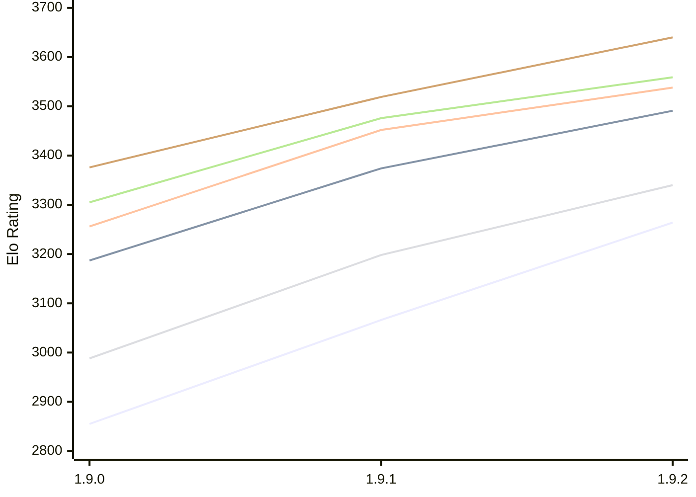

# Engine: Superpawn

Author: John Byrd

Home: https://github.com/johnwbyrd/superpawn

## Elo Ratings E1 (Ultra 7 265T (1.50 GHz) - E-Core)

| Version | Published | STC 8.0+0.08s  | LTC 60.0+0.60s | VLTC 2m24s+1.12s | Comment |
| --- | --- | --- | --- | --- | --- |
| 1.9.2 | 2026-11-08 | 3264(+198) | 3491(+117) | 3538(+86) |  |
| 1.9.1 | 2026-10-18 | 3066(+211) | 3374(+187) | 3452(+196) |  |
| 1.9.0 | 2026-10-16 | 2855 | 3187 | 3256 |  |
 | | | cElo (∆ prev) | cElo (∆ prev) | cElo (∆ prev) | 

## Elo Ratings P1 (Ultra 7 265T (1.50 GHz) - P-Core)

| Version | Published | STC 8.0+0.08s  | LTC 60.0+0.60s | VLTC 2m24s+1.12s | Comment |
| --- | --- | --- | --- | --- | --- |
| 1.9.2 | 2026-11-08 | 3340(+142) | 3559(+83) | 3640(+121) |  |
| 1.9.1 | 2026-10-18 | 3198(+210) | 3476(+171) | 3519(+143) |  |
| 1.9.0 | 2026-10-16 | 2988 | 3305 | 3376 |  |
 | | | cElo (∆ prev) | cElo (∆ prev) | cElo (∆ prev) | 

## Elo Ratings T1 (i5-7500T 2.70GHz)

| Version | Published | STC 8.0+0.08s  | LTC 60.0+0.60s | VLTC 2m24s+1.12s | Comment |
| --- | --- | --- | --- | --- | --- |
| 1.9.0 | 2026-10-16 | 2988 | 3305 | 3376 |  |
 | | | cElo (∆ prev) | cElo (∆ prev) | cElo (∆ prev) | 

<a href="https://github.com/computer-chess-index/cci/issues/new?template=submit-version.yml&title=[VERSION]+Superpawn+<version>&body=###%20Engine%20name%0ASuperpawn%0A%0A###%20Version%0A1.9.2" target="_blank">Submit new version</a>

 Test Conditions:

GUI/CLI: <a href=https://github.com/cutechess/cutechess target="_blank">Cute-Chess</a> 
Elo Calculation: <a href=https://www.remi-coulom.fr/Bayesian-Elo/ target="_blank">Bayesian-Elo</a> 
CPU for P1: Intel(R) Core(TM) Ultra 7 265T (1.50 GHz) - P-Core 
CPU for E1: Intel(R) Core(TM) Ultra 7 265T (1.50 GHz) - E-Core 
CPU for T1: Intel(R) Core(TM) i5-7500T 2.70GHz 
Opening book: 8_moves_v3 
\* STC: 8.0+0.08s, LTC: 60.0+0.60s, VLTC: 2m24s+1.12s

 Lists:
Ratings: <a href=https://github.com/computer-chess-index/cci/blob/main/lists/CCIRatings.csv target="_blank">Complete list</a>

Generated: 2026-11-10 05:43:12

## Ratings Verlauf E1 / P1

## Detailed Evaluation Results

| Version | Time Control | Variant | Elo  | Range +/- | Matches | Score | Average Opponent Elo | Draws |
| --- | --- |--- | --- | --- | --- | --- | --- | --- |
| 1.9.2 | VLTC (2m24s+1.12s) | P1 | 3640 | 31 | 254 | 55% | 3607 | 76% |
|  |  | E1 | 3538 | 37 | 184 | 51% | 3530 | 73% |
|  | LTC (60.0+0.60s) | P1 | 3559 | 45 | 116 | 52% | 3545 | 78% |
|  |  | E1 | 3491 | 28 | 318 | 53% | 3475 | 68% |
|  | STC (8.0+0.08s) | P1 | 3340 | 47 | 124 | 50% | 3333 | 56% |
|  |  | E1 | 3264 | 34 | 230 | 53% | 3236 | 57% |
| --- | --- |--- | --- | --- | --- | --- | --- | --- |
| 1.9.1 | VLTC (2m24s+1.12s) | E1 | 3452 | 29 | 314 | 52% | 3441 | 65% |
|  |  | P1 | 3519 | 35 | 210 | 52% | 3507 | 62% |
|  | LTC (60.0+0.60s) | P1 | 3476 | 35 | 216 | 50% | 3475 | 58% |
|  |  | E1 | 3374 | 32 | 264 | 52% | 3359 | 55% |
|  | STC (8.0+0.08s) | P1 | 3198 | 42 | 160 | 51% | 3190 | 48% |
|  |  | E1 | 3066 | 31 | 336 | 54% | 3027 | 37% |
| --- | --- |--- | --- | --- | --- | --- | --- | --- |
| 1.9.0 | VLTC (2m24s+1.12s) | P1 | 3376 | 43 | 194 | 60% | 3124 | 39% |
|  |  | E1 | 3256 | 34 | 292 | 55% | 3100 | 40% |
|  | LTC (60.0+0.60s) | P1 | 3305 | 50 | 150 | 62% | 2967 | 32% |
|  |  | E1 | 3187 | 42 | 214 | 62% | 2894 | 34% |
|  | STC (8.0+0.08s) | P1 | 2988 | 47 | 176 | 58% | 2755 | 26% |
|  |  | E1 | 2855 | 42 | 220 | 61% | 2600 | 26% |