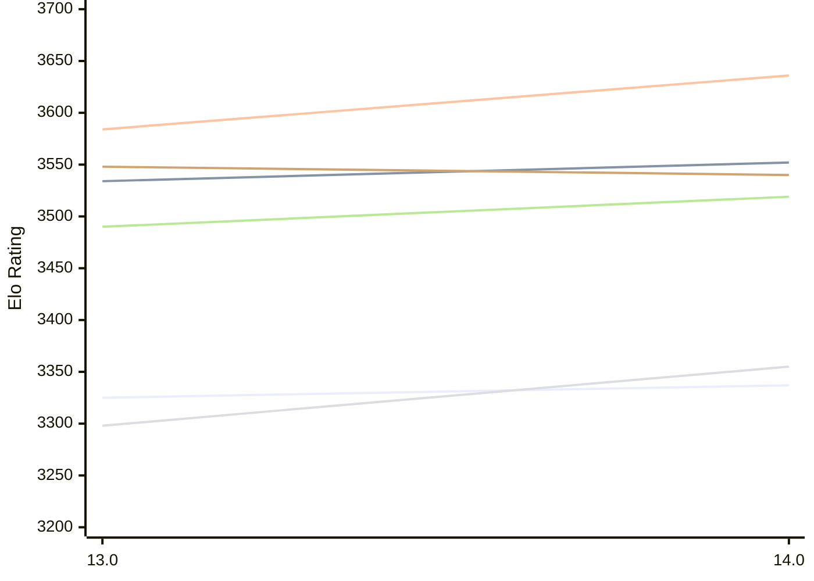
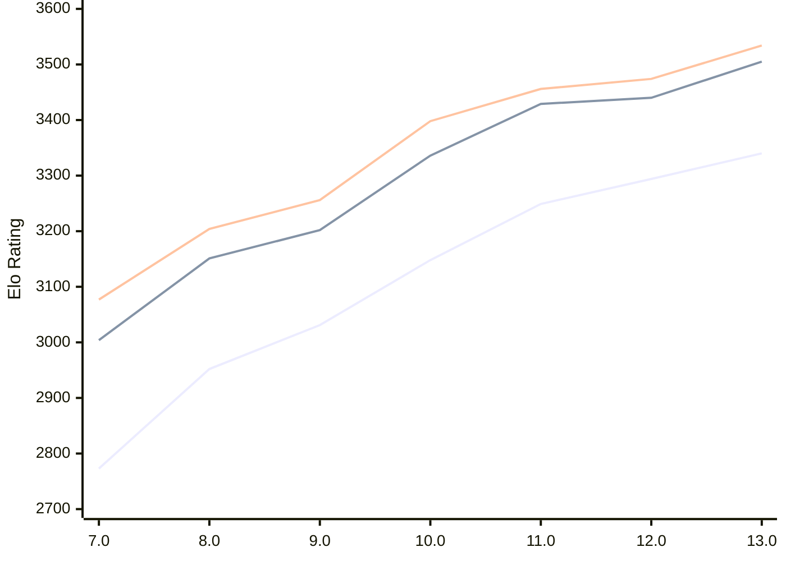

# Engine: Tcheran

Author: Jonathan Gilchrist

Home: https://github.com/tcheran-chess/tcheran

## Elo Ratings E1 (Ultra 7 265T (1.50 GHz) - E-Core)

| Version | Published | STC 8.0+0.08s  | LTC 60.0+0.60s | VLTC 2m24s+1.12s | Comment |
| --- | --- | --- | --- | --- | --- |
| 14.0 | 2026-10-14 | 3337(+12) | 3552(+18) | 3636(+52) |  |
| 13.0 | 2026-07-17 | 3325 | 3534 | 3584 |  |
 | | | cElo (∆ prev) | cElo (∆ prev) | cElo (∆ prev) | 

## Elo Ratings P1 (Ultra 7 265T (1.50 GHz) - P-Core)

| Version | Published | STC 8.0+0.08s  | LTC 60.0+0.60s | VLTC 2m24s+1.12s | Comment |
| --- | --- | --- | --- | --- | --- |
| 14.0 | 2026-10-14 | 3355(+57) | 3519(+29) | 3540(-8) |  |
| 13.0 | 2026-07-17 | 3298 | 3490 | 3548 |  |
 | | | cElo (∆ prev) | cElo (∆ prev) | cElo (∆ prev) | 

## Elo Ratings T1 (i5-7500T 2.70GHz)

| Version | Published | STC 8.0+0.08s  | LTC 60.0+0.60s | VLTC 2m24s+1.12s | Comment |
| --- | --- | --- | --- | --- | --- |
| 13.0 | 2026-07-17 | 3340(+46) | 3505(+65) | 3534(+60) |  |
| 12.0 | 2026-05-08 | 3294(+45) | 3440(+11) | 3474(+18) |  |
| 11.0 | 2026-02-13 | 3249(+101) | 3429(+93) | 3456(+58) |  |
| 10.0 | 2025-12-28 | 3148(+117) | 3336(+134) | 3398(+142) |  |
| 9.0 | 2025-12-08 | 3031(+79) | 3202(+51) | 3256(+52) |  |
| 8.0 | 2025-11-27 | 2952(+179) | 3151(+147) | 3204(+127) |  |
| 7.0 | 2025-11-07 | 2773 | 3004 | 3077 |  |
 | | | cElo (∆ prev) | cElo (∆ prev) | cElo (∆ prev) | 

<a href="https://github.com/computer-chess-index/cci/issues/new?template=submit-version.yml&title=[VERSION]+Tcheran+<version>&body=###%20Engine%20name%0ATcheran%0A%0A###%20Version%0A13.0" target="_blank">Submit new version</a>

 Test Conditions:

GUI/CLI: <a href=https://github.com/cutechess/cutechess target="_blank">Cute-Chess</a> 
Elo Calculation: <a href=https://www.remi-coulom.fr/Bayesian-Elo/ target="_blank">Bayesian-Elo</a> 
CPU for P1: Intel(R) Core(TM) Ultra 7 265T (1.50 GHz) - P-Core 
CPU for E1: Intel(R) Core(TM) Ultra 7 265T (1.50 GHz) - E-Core 
CPU for T1: Intel(R) Core(TM) i5-7500T 2.70GHz 
Opening book: 8_moves_v3 
\* STC: 8.0+0.08s, LTC: 60.0+0.60s, VLTC: 2m24s+1.12s

 Lists:
Ratings: <a href=https://github.com/computer-chess-index/cci/blob/main/lists/CCIRatings.csv target="_blank">Complete list</a>

Generated: 2026-11-18 05:44:09

## Ratings Verlauf E1 / P1

## Ratings Verlauf T1

## Detailed Evaluation Results

| Version | Time Control | Variant | Elo  | Range +/- | Matches | Score | Average Opponent Elo | Draws |
| --- | --- |--- | --- | --- | --- | --- | --- | --- |
| 14.0 | VLTC (2m24s+1.12s) | P1 | 3540 | 40 | 148 | 49% | 3542 | 84% |
|  |  | E1 | 3636 | 34 | 198 | 52% | 3625 | 83% |
|  | LTC (60.0+0.60s) | P1 | 3519 | 41 | 132 | 50% | 3519 | 89% |
|  |  | E1 | 3552 | 32 | 228 | 50% | 3552 | 82% |
|  | STC (8.0+0.08s) | P1 | 3355 | 38 | 172 | 50% | 3359 | 73% |
|  |  | E1 | 3337 | 29 | 312 | 48% | 3349 | 69% |
| --- | --- |--- | --- | --- | --- | --- | --- | --- |
| 13.0 | VLTC (2m24s+1.12s) | T1 | 3534 | 23 | 418 | 49% | 3538 | 86% |
|  |  | P1 | 3548 | 41 | 136 | 51% | 3544 | 84% |
|  |  | E1 | 3584 | 30 | 258 | 47% | 3602 | 85% |
|  | LTC (60.0+0.60s) | T1 | 3505 | 24 | 402 | 52% | 3492 | 83% |
|  |  | P1 | 3490 | 35 | 188 | 49% | 3495 | 81% |
|  |  | E1 | 3534 | 32 | 232 | 47% | 3552 | 78% |
|  | STC (8.0+0.08s) | T1 | 3340 | 28 | 320 | 51% | 3332 | 70% |
|  |  | P1 | 3298 | 33 | 236 | 49% | 3309 | 69% |
|  |  | E1 | 3325 | 29 | 308 | 47% | 3348 | 65% |
| --- | --- |--- | --- | --- | --- | --- | --- | --- |
| 12.0 | VLTC (2m24s+1.12s) | T1 | 3474 | 24 | 404 | 50% | 3478 | 84% |
|  | LTC (60.0+0.60s) | T1 | 3440 | 25 | 380 | 51% | 3436 | 81% |
|  | STC (8.0+0.08s) | T1 | 3294 | 25 | 418 | 52% | 3278 | 68% |
| --- | --- |--- | --- | --- | --- | --- | --- | --- |
| 11.0 | VLTC (2m24s+1.12s) | T1 | 3456 | 23 | 434 | 51% | 3452 | 80% |
|  | LTC (60.0+0.60s) | T1 | 3429 | 24 | 424 | 51% | 3420 | 79% |
|  | STC (8.0+0.08s) | T1 | 3249 | 25 | 448 | 51% | 3247 | 56% |
| --- | --- |--- | --- | --- | --- | --- | --- | --- |
| 10.0 | VLTC (2m24s+1.12s) | T1 | 3398 | 27 | 336 | 49% | 3406 | 75% |
|  | LTC (60.0+0.60s) | T1 | 3336 | 30 | 268 | 49% | 3345 | 75% |
|  | STC (8.0+0.08s) | T1 | 3148 | 31 | 286 | 52% | 3136 | 58% |
| --- | --- |--- | --- | --- | --- | --- | --- | --- |
| 9.0 | VLTC (2m24s+1.12s) | T1 | 3256 | 38 | 180 | 50% | 3255 | 66% |
|  | LTC (60.0+0.60s) | T1 | 3202 | 39 | 168 | 52% | 3189 | 65% |
|  | STC (8.0+0.08s) | T1 | 3031 | 37 | 212 | 47% | 3060 | 53% |
| --- | --- |--- | --- | --- | --- | --- | --- | --- |
| 8.0 | VLTC (2m24s+1.12s) | T1 | 3204 | 44 | 132 | 50% | 3201 | 64% |
|  | LTC (60.0+0.60s) | T1 | 3151 | 37 | 204 | 57% | 3096 | 58% |
|  | STC (8.0+0.08s) | T1 | 2952 | 42 | 164 | 47% | 2974 | 49% |
| --- | --- |--- | --- | --- | --- | --- | --- | --- |
| 7.0 | VLTC (2m24s+1.12s) | T1 | 3077 | 51 | 116 | 47% | 3101 | 44% |
|  | LTC (60.0+0.60s) | T1 | 3004 | 49 | 130 | 50% | 2984 | 42% |
|  | STC (8.0+0.08s) | T1 | 2773 | 54 | 116 | 56% | 2696 | 36% |